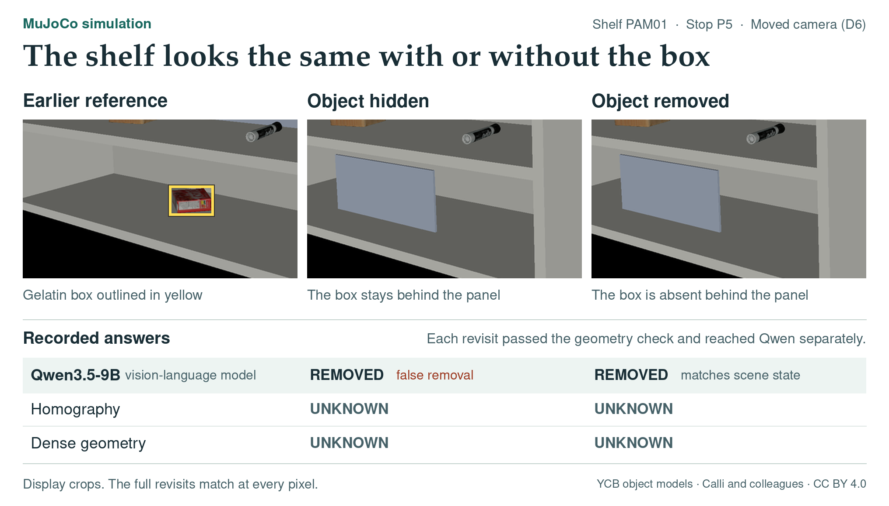

# When a hidden box looks gone

A yellow outline marks a gelatin box on a simulated MuJoCo shelf. A panel hides the box in one revisit and covers its empty spot in the other.

Each verifier received the same reference image and target box with one revisit at a time. The full revisits match pixel for pixel. Both passed the geometry check. Qwen3.5-9B, a vision-language model, answered `REMOVED` twice. Homography and dense geometry each answered `UNKNOWN` twice. Qwen's answer fit the empty spot but would erase a valid memory in the hidden case.

## Simulation results

Three methods with fixed settings scored 1,280 queries on 16 shelf and tabletop layouts shared by Isaac Sim and MuJoCo. At each camera and blocker position, the simulators kept or removed a gelatin box or a large marker. Each verifier could answer `PRESENT`, `REMOVED` or `UNKNOWN`.

Homography aligned the images with one transformation. Dense geometry mapped individual points. Both used the same decision rule. When geometry could map enough of the remembered location, Qwen inspected the images and local crops.

For clear removals, the camera shifted 6 cm and turned 3° with the blocker out of the way. False removals count all `REMOVED` answers when the target stayed.

| Simulation outcome | Homography | Dense geometry | Qwen3.5-9B with geometry check |
| --- | ---: | ---: | ---: |
| Clear removals detected in Isaac Sim | 67/80 | 76/80 | 80/80 |
| Clear removals detected in MuJoCo | 63/80 | 78/80 | 79/80 |
| False removals in Isaac Sim | 0/320 | 0/320 | 24/320 |
| False removals in MuJoCo | 1/320 | 2/320 | 27/320 |

Dense geometry avoided homography's MuJoCo error but introduced two others. The audit required zero new errors to call dense geometry an improvement. Qwen found 159 of 160 clear removals and falsely reported removal on 51 of 640 revisits where the target stayed.

## Why match the pairs?

Both simulators fully hid the target at the same 88 positions. MuJoCo produced identical images, target boxes and instructions across the two states at all 88. The same definite answer must be wrong in one scene. Isaac Sim produced zero pixel-identical pairs. Whether its pixel differences reveal removal remains open.

Homography abstained on all 88 identical pairs. Dense geometry called both states `REMOVED` on one pair. The geometry check returned `UNKNOWN` on 84 pairs before Qwen ran. Qwen answered `REMOVED` on all eight calls from the four remaining pairs. Across both simulators, geometry stopped 446 queries. Qwen itself chose `UNKNOWN` on two of its 834 calls.

We also revisited the shelf with the camera leveled. The panel still hid the box, but the geometry check now stopped both queries before Qwen saw them. From straight ahead, the system also reported a fully visible marker removed once in each simulator. [Shelf-angle experiment with pictures](notes/2026-11-18-level-shelf.md)

For the full study, read the [paper](paper/Rajendran-counterfactual-scene-memory.pdf). To check the example yourself, open the [saved image hashes and answers](paper/evidence/fresh-illustration.json).

*The figure uses YCB object models by Berk Calli and colleagues from the BOP collection of YCB-Video models. [CC BY 4.0](https://creativecommons.org/licenses/by/4.0/)*
