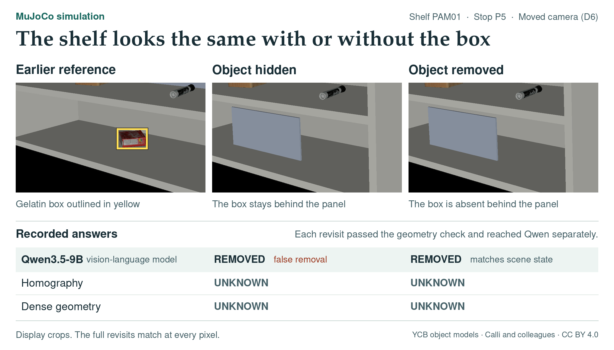

# Occlusion-aware active verification for robot scene memory

Adithya Rajendran · CMPE 249, San José State University · Fall 2026

**Concluded November 2026.** A robot remembers a box on a shelf. On its next visit, a panel covers the spot. Should it erase the box from memory? This simulation study tested that decision on shelves and tabletops. Zero-shot Qwen3.5-9B served only as a visual verifier at camera poses set by a script.

The researcher generated 16 layouts with two seeded arrangements for each combination of surface, target and blocker. Each shelf or tabletop held a gelatin box or a large marker. Either a wide panel or a white box served as the blocker. Isaac Sim and MuJoCo rendered the same layouts with each target retained and removed. [Layout records](paper/evidence/arrangements.csv) · [Study design](development/paper_audit/PROTOCOL.md)

Dense geometry detected more clear removals after camera motion in both simulators. It also introduced two false deletions on MuJoCo shelves and failed the study’s improvement rule. The study ended before collecting real-camera evaluation data or running the proposed one-extra-view experiment. [Primary results](paper/evidence/summary.json)

[Read the paper (PDF)](paper/Rajendran-counterfactual-scene-memory.pdf) · [Edit the CoRL LaTeX source (ZIP)](paper/Rajendran-counterfactual-scene-memory-latex.zip) · [Download the exact images and results](https://github.com/Adithya-Rajendran/cmpe249-active-verification/releases/tag/scene-memory-audit-v1) · [Reproduce the comparison](paper/README.md#reproduce-the-main-comparison)

## When a hidden box looks gone

A yellow outline marks a gelatin box on a simulated MuJoCo shelf. A panel hides the box in one revisit and covers its empty spot in the other.

Each verifier received the earlier image, the target box and one revisit. The two revisits match pixel for pixel. Both passed Qwen’s alignment check. Qwen answered `REMOVED` twice. Homography and dense geometry each answered `UNKNOWN` twice. Acting on Qwen’s answer would erase a valid memory in the scene where the box stayed.

### Simulation results

The three original verifiers could answer `PRESENT`, `REMOVED` or `UNKNOWN`. Homography aligned the images with one transformation. Dense geometry mapped individual points. Both used the same decision rule after alignment. When dense geometry could align enough of the remembered location, Qwen inspected the images and local crops.

The table covers all 1,280 queries across both simulators. Removal recall counts detected removals among all 640 removed targets, including cases where the verifier abstained. A false deletion erases one of the 640 targets that stayed.

| Verifier | Removal recall | False deletions |
| --- | ---: | ---: |
| Homography | 378/640 (59.1%) | 1/640 (0.16%) |
| Dense geometry | 399/640 (62.3%) | 2/640 (0.31%) |
| Zero-shot Qwen3.5-9B | 419/640 (65.5%) | 51/640 (7.97%) |
| Trained STILL, registered crop (later comparison) | 462/640 (72.2%) | 36/640 (5.63%) |

Qwen detected 20 more removals than dense geometry and falsely deleted 49 more retained objects. On 47 of Qwen’s 51 false deletions, the entire target remained visible. The other four targets were fully hidden. Seven false deletions came from unchanged MuJoCo images. Both geometric methods correctly kept the object on all 80 unchanged controls. [Full counts by simulator](paper/evidence/still-comparison-counts.csv) · [Per-query decisions](paper/evidence/queries.csv)

After inspecting the original results, the researcher calibrated the authors’ trained STILL verifier on ten separate layouts and scored the archived images. Its 36 false deletions involved 28 fully hidden targets and eight partly visible targets. [Comparison and example crops](notes/2026-11-20-trained-still.md) · [Reproduce the STILL comparison](paper/README.md#reproduce-the-trained-still-comparison)

The primary test compared the two geometric methods on clear removals after a 6 cm camera shift and a 3° turn. Dense geometry raised detections from 67/80 to 76/80 in Isaac Sim and from 63/80 to 78/80 in MuJoCo. It avoided homography’s one false deletion but introduced two others. Qwen detected 80/80 clear removals in Isaac Sim and 79/80 in MuJoCo. Its initial capability check used only clear views. [Geometric results](paper/evidence/summary.json) · [Qwen comparison](paper/evidence/reader-comparison.json)

At 50% to below 90% exposure, homography answered 31 of 56 queries correctly. Dense geometry answered four correctly and abstained on the other 52.
Both states use the target exposure in the paired retained view. Five layouts supplied these positions. [Answers by visibility](paper/evidence/answers-by-visibility.csv)

### Why match the pairs?

Both simulators fully hid the target at the same 88 positions. MuJoCo produced identical images, target boxes and instructions across the two states at all 88. A definite answer must be wrong in one scene.

In Isaac Sim, all 88 hidden pairs differed. On a 0–255 scale, the median whole-image mean absolute RGB difference was 0.293. On 80 unchanged views with the blocker parked, the median was 0.309.

In four of five separate calibration views, a patch outside the target and blocker brightened after removal on both repeats. This is consistent with indirect lighting. The fixed capture order prevents identifying the cause for individual pairs. [Pixel measurements](paper/evidence/hidden-pair-pixels.txt) · [Tabletop example](paper/figures/isaac-hidden-patch.png)

Homography abstained on all 88 identical pairs. Dense geometry called both states `REMOVED` on one pair. The geometry check returned `UNKNOWN` on 84 pairs before Qwen ran. Qwen answered `REMOVED` on all eight calls from the four remaining pairs. Across both simulators, geometry stopped 446 queries. Qwen itself chose `UNKNOWN` on two of its 834 calls.

We also revisited the shelf with the camera leveled. The panel still hid the box, but the geometry check now stopped both queries before Qwen saw them. From straight ahead, the system also reported a fully visible marker removed once in each simulator. [Shelf-angle experiment with pictures](notes/2026-11-18-level-shelf.md)

For the full study, read the [paper](paper/Rajendran-counterfactual-scene-memory.pdf). To check the example yourself, open the [saved image hashes and answers](paper/evidence/fresh-illustration.json).

*The figure uses YCB object models by Berk Calli and colleagues from the BOP collection of YCB-Video models. [CC BY 4.0](https://creativecommons.org/licenses/by/4.0/)*

The [evidence guide](paper/README.md) explains how to reproduce the results. The [study protocol](development/paper_audit/PROTOCOL.md) records the comparison rules. Protocol and results first appeared in Git together.

## Does this happen beyond the shelf?

We tested a sliding door, a power drill and a bleach bottle in eight new corridor layouts.
In MuJoCo, the geometry check stopped all eight oblique closed-door pairs before Qwen ran.
From straight ahead, Qwen called the object removed in both identical images on seven of eight layouts.
Isaac Sim also hid the object, but its images differed across the two states.
Qwen correctly detected all 24 clear removals in Isaac and 20 of 24 in MuJoCo. [Corridor results and pictures](notes/2026-11-18-corridor-transfer.md)

We repeated all eight layouts in a furnished workshop with a working sliding door.
The same frontal MuJoCo test gave zero false deletions in eight identical pairs. The geometry check stopped every call before Qwen ran.
On two robot camera mounts, Qwen called a fully visible drill removed four times in Isaac and twice in MuJoCo.
The homography baseline answered every open-door case correctly and waited on every closed-door case. [Workshop results and images](notes/2026-11-18-workshop-clearance.md)

A separate [mobile robot demonstration](development/workshop_realism/ROBOTICS.md) uses the workshop.

## Completed simulation audit

A missing detection does not establish removal. The target can remain behind an occluder.
The verifier returns PRESENT, REMOVED or UNKNOWN from a reference image and one revisit image.
REMOVED means absent from the remembered region under the stated task assumptions. It does not mean absent from the whole scene.

The image verifier checks separate evidence for presence and removal.
An agreement veto can reject its errors. A conditional cascade can add answers where it abstains.
The evaluation measures unsupported answers and useful correct answers together.

The earlier veto and cascade proposals stopped because the project could not validate broader visual support labels.

The same researcher designed the layouts, chose the evaluation rules and scored the verifiers. The measured error rates describe these scenes. A future study could change only the memory verifier on an independently designed RoboDojo grasp task in Isaac Sim. A vision-language model could call a grasp routine, with cuRobo planning the motion. Task success would show whether erasing a valid memory costs the robot a grasp. [RoboDojo](https://arxiv.org/abs/2607.04434) · [Code as Policies](https://arxiv.org/abs/2209.07753) · [cuRobo](https://arxiv.org/abs/2310.17274)

| Read | Purpose |
| --- | --- |
| [Standalone introduction](CASE_STUDY.md) | Illustrated case study for a first reading |
| [Paper](paper/Rajendran-counterfactual-scene-memory.pdf) | Paired simulation audit, zero-shot Qwen results and the trained STILL follow-up |
| [Document guide](docs/README.md) | Current research documents and historical records |
| [Proposal](docs/PROPOSAL.md) | Research question, contribution and closest work |
| [Method](docs/METHOD.md) | Inputs, labels, decision rule and controls |
| [Evaluation plan](docs/EVALUATION_PLAN.md) | Data, comparisons, metrics and readiness checks |
| [Stress experiment](development/stress/PROTOCOL.md) | Declared camera levels, labels, controls and execution checks |
| [Research update](notes/2026-11-17-research-and-stress-plan.md) | Closest work and corrections to the earlier interpretations |
| [Stress execution](notes/2026-11-17-stress-execution.md) | Completed smoke, AI label audit and full rendering status |
| [Scoring and label review](notes/2026-11-17-scoring-and-label-review.md) | Completed controls, independent recount and label qualification |
| [Paired simulator results](notes/2026-11-17-cross-sim-pilot.md) | Fixed controls, one certified ambiguous error, and the recurring tabletop failure |
| [RGB geometry results](notes/2026-11-18-rgb-geometry-comparison.md) | Tabletop gains, two shelf errors and the decision to stop this version |
| [Visual support qualification](notes/2026-11-18-support-label-qualification.md) | Blinded Terra judgments, independent evidence review and all 32 image examples |
| [Locating the object first](notes/2026-11-18-label-localization.md) | Matched instructions, both simulator outcomes and the visual evidence for all 30 cases |
| [Simulator evaluation plan](development/cross_sim/PLAN.md) | Adapter qualification and decision rules for the paired simulator studies |
| [VA-TAMP review](notes/2026-11-17-va-tamp-and-simulation-scope.md) | Prior-work overlap, candidate contribution and simulation scope |
| [Freeze policy](docs/FREEZE_POLICY.md) | Development, release conditions and historical records |
| [Label audit](notes/2026-11-16-development-support-audit.md) | Support labels, ambiguous fragments and review limits |
| [Development pilot](notes/2026-11-16-development-pilot.md) | Completed runs, failed baseline qualification and next decisions |

## Earlier development

Early physical-camera photos checked the capture setup. The final evaluation used simulation images throughout.

The first study tested camera view selection. That study is complete, with important limits in its design.
The final study tested whether the images support a decision about a remembered object.
The first development pilot is complete. Its model verifier failed an obvious retained-target control.

The camera-displacement run is complete. Guard controls recover many abstentions without added physical errors.
AI support judgments remain provisional after qualification and a repeated audit.

The paired pilot tested 1,200 queries in Isaac Sim and MuJoCo. The wider alignment guard gave 803 correct answers and one false removal.
RGB geometry resolved all 25 clear tabletop removals at the largest displacement in each simulator.
It made two new false removals in one shelf setup. The declared rule ends this version.

In a separate label pilot, Terra identified all four partly visible retained objects per simulator.
It abstained on all four partly occluded removals in each simulator and failed qualification.

On four fresh layouts, asking Terra to locate the object first recovered two partial removals in MuJoCo and zero in Isaac.
Only MuJoCo passed qualification.
The fixed-camera calibration detected every parked-blocker change and missed its required partial yield in both engines.

The final study measured simulator outcomes. Physical-camera transfer and general visual support on unequal images remain unmeasured.

## Earlier view-selection study

The [completed study](https://github.com/Adithya-Rajendran/cmpe249-active-verification/tree/b81ded23d6710bf792e96ac53b5104fce6b177a1) ended at `b81ded2`.
The historical tag `simulation-freeze-1` identifies the [original freeze commit](https://github.com/Adithya-Rajendran/cmpe249-active-verification/tree/6d0ed94a73a20ff41549a2383b07f0358bf69ad9).
The later audit does not replace its results.

| Record | Purpose |
| --- | --- |
| [Frozen results](notes/2026-11-06-test-results.md) | Original declared comparisons |
| [Post-hoc review](notes/2026-11-12-posthoc-review.md) | Later analyses and interpretation limits |
| [Historical freeze](docs/FREEZE.md) | Original manifest and runbook |
| [Freeze addenda](docs/FREEZE_ADDENDA.md) | Exceptions, later analyses and closure |
| [Historical experiment plan](docs/EXPERIMENT_PLAN.md) | Original study only |
| [Historical reproduction guide](docs/REPRODUCE.md) | Original software and data pipeline |
| [Document snapshots](docs/archive/2026-11-16-reset/ARCHIVE.md) | Previous README and proposal |

The later project treated the earlier test data as development evidence.

## Existing software

| Folder | Existing function |
| --- | --- |
| [capture](capture/README.md) | Camera capture and acquisition checks |
| [perception](perception/README.md) | Image evidence and reference matching |
| [verify](verify/README.md) | Replay, old selectors and the shared stopping rule |
| [sim](sim/README.md) | Scene generation, rendering and geometric labels |
| [development](development/README.md) | Completed studies and development tools |
| [public_data](public_data/README.md) | Development data adapters |

The historical code implements the completed study. Its pinned files and results remain unchanged.
The [development runner](development/pilot/README.md) implements controls and arrangement-level analysis.
The pilot uses existing simulator images. It does not establish an implemented robot-memory system or a method advantage.

## Project lessons

The retrospective explains how baseline checks, access to external data and advance decision rules shaped this project. [Read the lessons](notes/2026-11-19-lessons.md) · [Printable page](notes/2026-11-19-lessons.pdf)

## AI assistance

AI tools assisted with literature review, software, analysis and document preparation.
The researcher must verify the sources, experimental records and final claims.
The existing submission files remain historical records of the original proposal.
