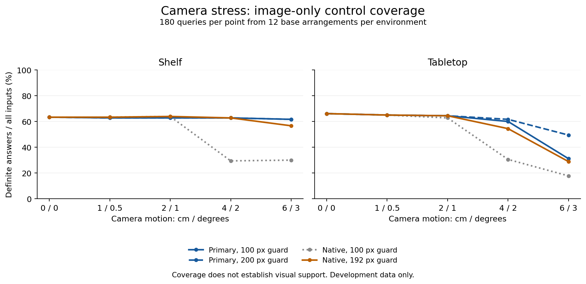

# Project Progress Feedback

Evidence-Aware Verification for Robot Scene Memory

Adithya Rajendran | CMPE 249, Fall 2026 | Professor Kaikai Liu | 17 November 2026

[GitHub · Adithya-Rajendran/cmpe249-active-verification · revision 8ec82b3](https://github.com/Adithya-Rajendran/cmpe249-active-verification/tree/8ec82b34e68d25b759d1cde3fbcc3f81189eb9d6)

## Research question and scope

When a remembered object is no longer visible, does the supplied image justify PRESENT, REMOVED, or UNKNOWN? The input is a reference image, its target box, and one revisit image. REMOVED means absent from the remembered region. The planned study uses Isaac Sim and MuJoCo only.

## Completed work

The earlier view-selection study is complete. Its design left little room for a better selector. I revised the question toward evidence for memory updates. An initial language-model pilot failed clear retention controls, so I have not claimed a model advantage.

The new Isaac Sim development study contains 24 arrangements across shelf and tabletop scenes, five camera stops, and five displacement levels. Four image-only configurations each processed the same 1,800 queries. The 7,200 scoring records passed an independent code-based audit. The sampling unit is the arrangement.

| Image-only configuration | Definite answers / 1,800 | Physical errors |
| --- | ---: | ---: |
| Primary resolution, 100 px guard | 1,080 | 1 |
| Primary resolution, 200 px guard | 1,116 | 1 |
| Native resolution, 100 px guard | 886 | 0 |
| Native resolution, 192 px guard | 1,060 | 0 |

The guard limits accepted image-registration displacement. Both primary configurations share the same false-removal case. Zero observed errors do not establish zero risk.

At 6 cm and 3 degrees on tabletop scenes, the wider primary guard increased correct definite answers from 56/180 to 89/180, without added physical errors. Coverage counts UNKNOWN against the method. These counts do not measure whether an answer was visually justified.

<!-- pagebreak -->

# Direction and questions for feedback

## Interpretation and current blockers

The stronger image-only controls recover many refusals. A language model must demonstrate value beyond those controls before it becomes a contribution claim.

Answer-support labels remain a blocker. Two AI labeling instructions each matched 47/48 judgments from an AI reference, but a fresh review changed 17/180 audit labels. This does not validate a 1% unsupported-error claim. Simulator state supplies physical truth. Masks supply geometric diagnostics. Neither automatically establishes visual answerability.

MuJoCo currently supports the older shelf rig. It still needs an adapter and qualification for the textured arrangement specification used by Isaac Sim.

## Research positioning

VA-TAMP and Evidence-Gated TAMP already establish substantial overlap in evidence checking and information gathering. My candidate contribution is a controlled evaluation of supported memory decisions under occlusion, viewpoint change, and simulator transfer. I am not claiming a new gating principle. SceneDiff and GeoSCD are candidates for a stronger change-detection comparison.

## Next development steps

- Qualify the MuJoCo adapter against the shared scene and camera definitions.
- Run fixed image-only settings on ten fresh paired arrangements in both simulators. The pilot plans 600 queries per engine, with all variants grouped by arrangement.
- Validate the support endpoint separately. Keep AI judgments and simulator diagnostics distinct.
- Continue an added-method claim only if a repeatable opportunity survives strong controls. Reserve fresh arrangements and assets for a later evaluation.

The pilot will stop the added veto/cascade claim on this axis if one fixed control resolves at least 90% of each clear class in every engine, environment and level, with no observed physical error. This is a development decision rule, not a safety guarantee. Physical-camera transfer remains future work.

## Feedback requested

1. Is this narrowly defined verification task a worthwhile simulation-only research contribution, especially as an evaluation study?
2. Which comparison should I prioritize: a modern geometric change detector, or a qualified vision-language verifier with calibrated rejection?
3. What validation would make programmatic support labels credible, particularly for occluded-present versus removed pairs?
4. What additional held-out variation would make an Isaac Sim / MuJoCo transfer result convincing?

## References and project files

[VA-TAMP (2026)](https://arxiv.org/abs/2611.16213) | [Evidence-Gated TAMP (2026)](https://arxiv.org/abs/2608.20084)

[SceneDiff](https://arxiv.org/abs/2512.16908) | [GeoSCD](https://arxiv.org/abs/2509.11292)

The links below open the code and research notes at the revision used for this report.

[Verification method](https://github.com/Adithya-Rajendran/cmpe249-active-verification/blob/8ec82b34e68d25b759d1cde3fbcc3f81189eb9d6/docs/METHOD.md) | [Isaac Sim results and label audit](https://github.com/Adithya-Rajendran/cmpe249-active-verification/blob/8ec82b34e68d25b759d1cde3fbcc3f81189eb9d6/notes/2026-11-17-scoring-and-label-review.md) | [Paired simulator pilot plan](https://github.com/Adithya-Rajendran/cmpe249-active-verification/blob/8ec82b34e68d25b759d1cde3fbcc3f81189eb9d6/development/cross_sim/PLAN.md)

AI tools assisted software, analysis and literature review. All reported results are development findings.
