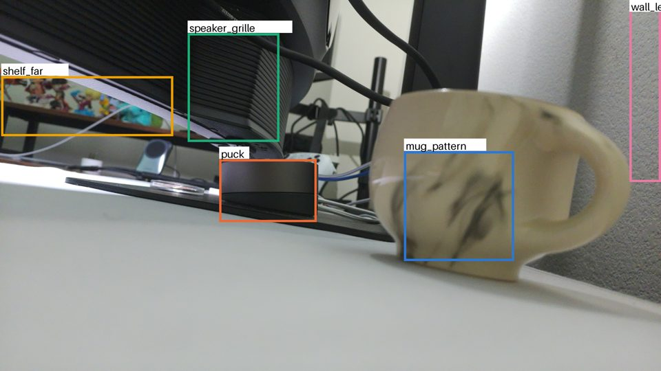
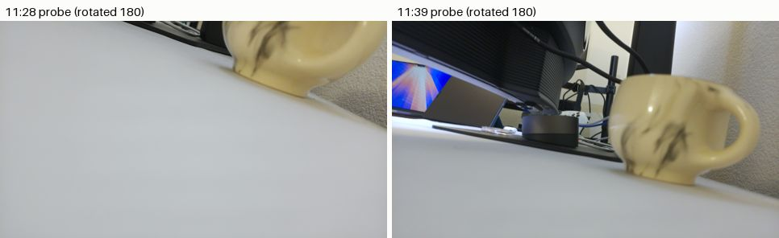
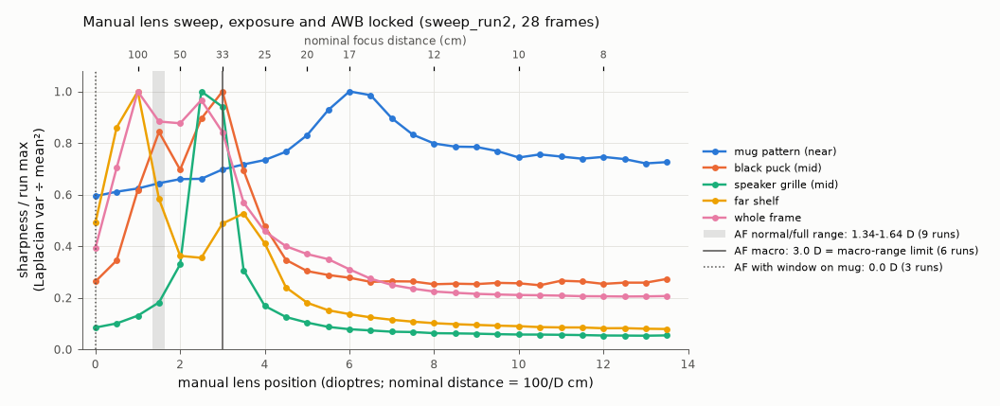
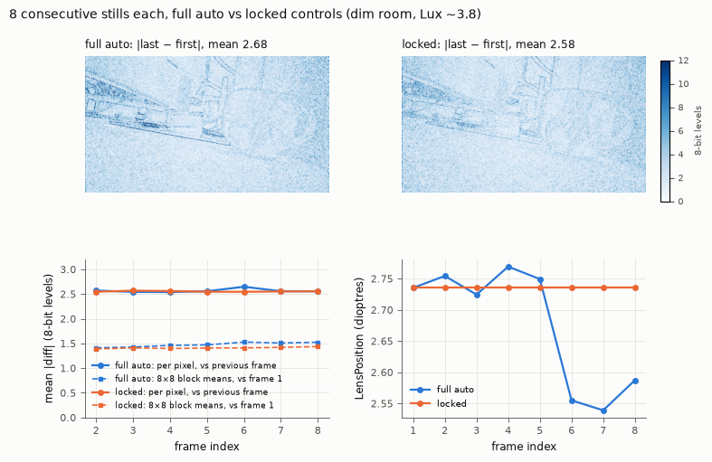
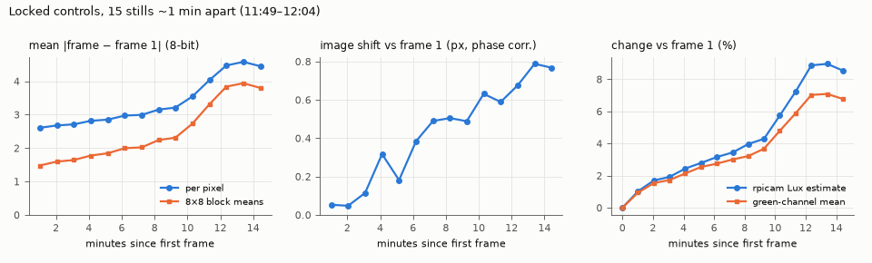
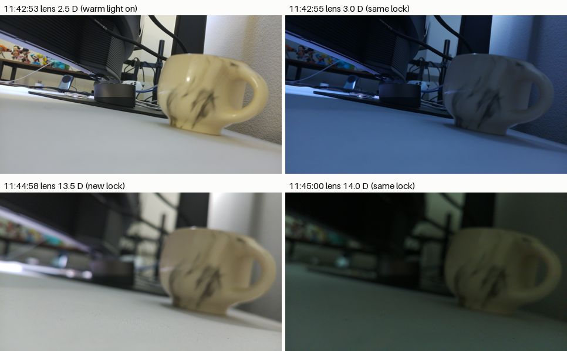
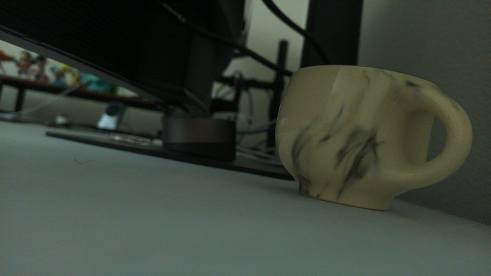
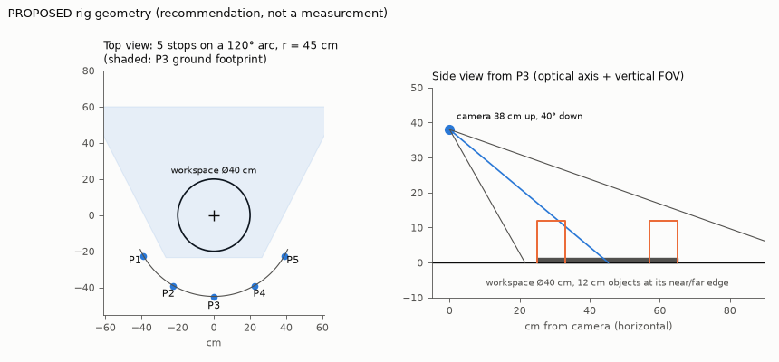

# 2026-09-26 — Pi camera check and a locked-settings capture tool

Week 3, Saturday, 11:39–12:06 PDT. The Pi camera was still pointed at a cup on the desk; nothing was moved
for this check. The scene is not a study workspace, so every number here describes the **camera and the
room**, not the experiment.

**Summary**

- The camera is the **standard (not wide) imx708** Camera Module 3: 66° × 41° field of view per the datasheet.
- **Autofocus never focused on the cup.** In 31 autofocus stills it never went above 3.0 dioptres
  (33 cm). The manual sweep puts the cup's sharpness peak at 5.8–6.2 D, which is nominally 16–17 cm away.
- The **room lighting changed three times in 25 minutes** without anyone asking. A warm source switched
  off, then a bright source near the monitor went dark, then daylight crept up about 7 % over 15 minutes.
  Each of these changes was larger than any difference caused by the camera's own settings.
- With every control locked, back-to-back frames differ by a mean of 2.5 of 255 levels. That is capture
  noise from the sensor, ISP and JPEG. In this dim scene, full-auto frames differ by nearly the same
  amount. What locking did remove was lens wander (0.23 D range) and white-balance drift.
- `capture/pi_capture.py` is deployed on the Pi at `~/cmpe249/capture/` and was tested for real: a
  calibration, five labelled pilot shots, one refused overwrite and eight rejected commands (four bad
  labels, four protocol violations). A later code review fixed robustness and guard bugs (v0.2.0) and
  re-tested it on the camera; see §3.1.

---

## 1. What was run

Everything ran on the Pi with `rpicam-still` (rpicam-apps 1.13.0, libcamera 0.7.2, Python 3.13.5
stdlib) and was analysed on the GB10 in a throwaway uv environment. In total: 133 camera-check stills
(1 probe plus 132 logged in `commands.log`), 6 capture-tool stills (1 calibration + 5 shots) and 0
installed packages.

```bash
# on the Pi (script: capture/camera_check/camcheck.sh; every call is logged verbatim with its wall time
# in data/raw/2026-09-26_camera-check/commands.log)
rpicam-hello --list-cameras
bash camcheck.sh af                        # 15 AF stills: continuous/auto x normal/macro/full, 3 each
bash camcheck.sh afwin 0.10,0.30,0.30,0.40 # 3 AF stills with the AF window on the cup
bash camcheck.sh sweep                     # run 1: auto calib, then lens 0..15 D in 0.5 D steps (AE/AWB locked)
bash camcheck.sh sweep sweep_run2          # run 2 (run 1 was hit by a lighting change)
bash camcheck.sh fine fine_mug 4.0 8.0 0.25   # descending 0.25 D sweep around the cup
bash camcheck.sh rep 8                     # 8 full-auto stills, 1 calibration still, 8 fully locked stills
bash camcheck.sh drift 15 60               # 15 locked stills, one per minute

# on the GB10
U="uv run --no-project --with numpy --with pillow --with matplotlib python capture/camera_check/analyze_camcheck.py"
D=data/raw/2026-09-26_camera-check
$U focus --data $D --runs sweep_run2 fine_mug sweep_run1_lightchange --out $D/analysis \
   --fig notes/figures/2026-09-26/focus_sweep.png --af-json $D/analysis/af_marks.json
$U repeat --data $D --out $D/analysis --name repeat_dim --fig notes/figures/2026-09-26/repeatability.png
$U repeat --data $D --dir af --tags cont_normal auto_normal auto_full --labels a b c --out $D/analysis --name repeat_bright_af
$U drift --data $D --out $D/analysis --fig notes/figures/2026-09-26/drift.png
$U fov --out $D/analysis --fig notes/figures/2026-09-26/rig_geometry_proposal.png --radius 45 --height 38 --tilt 40 --arc 120 --ws-d 40
```

Sharpness is the variance of a 3×3 Laplacian of luma. It is computed inside hand-picked regions, and
also divided by the squared region mean so that small brightness changes cancel. The peak is found with
a parabola through log-sharpness at the best step and its two neighbours. Frames whose whole-frame mean
brightness is more than 5 % off the run median are excluded. Full-resolution frames, per-frame CSVs and
JSON summaries are in `data/raw/2026-09-26_camera-check/` (gitignored).

## 2. Measured

### 2.1 The scene as found



*Frame `sweep_run2/lp_03.0.jpg`, rotated 180° for display. All analysis uses native sensor orientation.*

- The camera lies on the desk **upside down**: rotated 180°, the image is upright. The optical axis is
  nearly horizontal, at desk-surface height. The cup is the nearest object, and behind it are a black
  puck, a monitor base with a striped grille, and a shelf about 1 m back.
- After the 180° flip there is still a **roll of about 8°**. That figure comes from a line fitted to a
  monitor-arm pole, assuming the pole is vertical: −8.6° from vertical, with 10 px residual scatter
  because cables cross the pole. It is an estimate, not a calibration. *(Evidence check, same day:
  the line fit was run inline and not saved. An independent Hough-line fit on `sweep_run2/lp_03.0.jpg`
  gave 7.0–7.8° on pole segments and 5.6–8.2° across three near-vertical edges, so read this as
  "roughly 6–9°".)*
- **The camera pose changed between the 11:28 probe and 11:39**, so someone or something moved it.
  **A laptop in the background disappeared between 11:39:19 and 11:41:03.** The desk is shared and not
  under our control.



### 2.2 Camera identity and field of view

| Evidence | Value |
| --- | --- |
| `rpicam-hello --list-cameras` | `imx708 [4608x2592 10-bit RGGB]`. Modes: 1536×864 (120 fps, **3072×1728 centre crop**), 2304×1296 (56 fps, full sensor, 2×2 binned), 4608×2592 (14 fps) |
| Tuning file loaded (`auto_probe.log`) | `/usr/share/libcamera/ipa/rpi/pisp/imx708.json`. The wide module would load `imx708_wide.json` and the NoIR module `imx708_noir.json` |
| AF lens range in that tuning file | normal 0–12 D, macro 3–15 D, VCM map 0–15 D (the wide file has macro 4–32 D) |
| Datasheet (raspberrypi.com camera documentation, standard lens) | 66° H × 41° V, f = 4.74 mm, F1.8, focus approx. 10 cm to infinity |

Footprint on a plane facing the camera (datasheet FOV; a pinhole model with f = 4.74 mm and the
6.45 × 3.63 mm sensor gives 68.5° × 41.9°, slightly wider):

| Distance | 2304×1296 or 4608×2592 (66° × 41°) | 1536×864 crop mode (46.8° × 28.0°) |
| --- | --- | --- |
| 30 cm | 39.0 × 22.4 cm | 26.0 × 15.0 cm |
| 45 cm | 58.4 × 33.6 cm | 39.0 × 22.4 cm |
| 60 cm | 77.9 × 44.9 cm | 51.9 × 29.9 cm |

The 1536×864 mode silently narrows the view, so the capture tool only offers 2304×1296 and 4608×2592.
*(Evidence check: the `--list-cameras` output with the crop rectangle was not saved in the repo and was
not re-run, because the camera was not to be used. The tuning-file AF ranges above were re-read from
`/usr/share/libcamera/ipa/rpi/pisp/imx708*.json` on the Pi and match. The datasheet row matches the
Raspberry Pi camera documentation.)*

### 2.3 Focus

Autofocus runs (default windows unless stated). The first 15 were at about 52 lux, before the lighting
changed.

| AF setting | n | LensPosition (D) | Nominal distance |
| --- | --- | --- | --- |
| continuous, normal range | 3 | 1.37, 1.58, 1.46 | 63–73 cm |
| auto (triggered on capture), normal | 3 | 1.39, 1.47, 1.42 | 68–72 cm |
| auto, full range | 3 | 1.34, 1.36, 1.64 | 61–75 cm |
| continuous, macro range | 3 | 3.00, 3.00, 3.00 | = macro-range minimum (33 cm) |
| auto, macro range | 3 | 3.00, 3.00, 3.00 | = macro-range minimum |
| auto, full range, AF window on the cup | 3 | 0.00, 0.00, 0.00 | infinity (AF clearly failed) |
| default AF, probe + run-1 calibration still (about 52 lux) | 2 | 1.61, 1.66 | 60–62 cm |
| default AF in the later calibration stills (17, 3.7, 3.9 lux) | 3 | 2.07, 2.82, 2.74 | 35–48 cm |
| default AF, the 8 `rep/auto` stills (3.8 lux) | 8 | 2.54–2.77 | 36–39 cm |

In the manual sweep, exposure and white balance were locked from an auto still and the lens was set by
`--lens-position`. The reported LensPosition always equalled the request.



| Region | Peak (D), run 2 | Band ≥ 80 % of peak (D) | Nominal distance | Other runs |
| --- | --- | --- | --- | --- |
| cup pattern (near) | **6.17** | 4.76–7.97 | **16.2 cm** (12.5–21.0) | run 1: 6.15; fine sweep (0.25 D steps, 3.7 lux): 5.85 |
| black puck | 2.87 | 2.26–3.33 | 35 cm (30–44) | — |
| speaker grille | 2.72 | 2.35–3.11 | 37 cm (32–43) | — |
| textured wall | 2.72 | 2.18–3.26 | 37 cm (31–46) | — |
| far shelf | 0.86 | 0.42–1.24 | 116 cm (81–239) | — |
| whole frame | 1.12 | 0.66–3.08 | 89 cm (33–151) | — |

Run 2 used 28 of 31 frames; the steps 14.0–15.0 D fell after a lighting drop and were excluded. Only the
cup region is usable from run 1, where 6 bright frames were excluded, and from the fine sweep, which was
dark and noisy with a raised sharpness floor.

**Cup distance.** Three independent sweeps put the cup-pattern peak at 5.85–6.17 D, **nominally 16–17 cm**.
The in-focus band (≥ 80 % of peak) spans about 12.5–21 cm. Treat 13–21 cm as the honest range. Two
caveats apply. First, the dioptre scale is the tuning file's generic linear VCM map, not a per-unit
calibration. Second, the pattern lies on a curved surface a few cm deep. A tape measure would settle it;
none was used today.

**Autofocus verdict.** AF never chose the cup. In good light it settled at 1.3–1.6 D, between the
mid-ground (2.7–2.9 D) and the far shelf (0.9 D); this sits near the whole-frame sharpness peak
(1.1 D). The camera's own contrast figure (FocusFoM) was 368 at 1.5 D but only 119 at 6.0 D, where the
cup is sharp. The macro range stopped at its 3.0 D limit, and a window over the cup made AF fail to
infinity. **Conclusion: AF picks the background here, so focus has to be set manually and locked.**

In this scene, sharpness stayed within 80 % of peak for roughly ±0.4–0.6 D around the mid-ground peaks.
That is a usable rule of thumb for how much depth one locked lens position covers.

### 2.4 Repeatability: full auto vs locked

Each still is a separate `rpicam-still` process, as the capture tool will run them. **Locked** means
`--shutter --gain --awbgains --lens-position` taken from a calibration still just before. The 8+8 set
was taken at 3.8 lux (dim room, after the lights went off).

| 8 consecutive stills | Full auto | Locked |
| --- | --- | --- |
| mean abs diff vs previous frame (8-bit, per pixel) | 2.57 (max 2.65) | 2.55 (max 2.57) |
| mean abs diff of 8×8 block means vs frame 1 | 1.41 → 1.53, rising | 1.39–1.44, flat |
| max share of pixels > 10 levels from frame 1 | 2.93 % | 2.13 % |
| channel-mean range R, G, B (levels) | 0.56, 0.54, 0.55 | 0.60, 0.11, 0.42 |
| ExposureTime (µs) | 66 642, all 8 (AE at its limit) | 66 616, all 8 |
| AnalogueGain | 7.817, all 8 (AE at its limit) | 7.817, all 8 |
| ColourGains range (red, blue) | 0.0065, 0.0138 | 0, 0 |
| ColourTemperature (K) | 3497–3509 | 3498 |
| LensPosition (D) | **2.54–2.77** (range 0.23) | 2.736, all 8 |
| image shift, last vs first (phase correlation) | 0.40 px | 0.13 px |

*Evidence check on the shift row: the sub-pixel shift depends on the estimator. For the same frame
pairs, three other phase-correlation implementations gave 0.13–0.57 px (auto) and 0.10–0.25 px
(locked): OpenCV `phaseCorrelate`, and scikit-image `phase_cross_correlation` with and without a Hann
window. One of them (scikit-image, no window) showed no auto-vs-locked difference (0.13 vs 0.12 px).
Treat both columns as roughly 0.1–0.6 px. They are not a measured auto-vs-locked difference.*

In good light (about 52 lux), the 18 auto AF-stage stills (window runs included) had AnalogueGain from
2.681 to 2.775, a 3.5 % spread with exposure fixed at 49 995 µs. Within each normal- or full-range auto
triple, LensPosition varied by 0.08–0.30 D. *(Evidence check: the macro and AF-window triples did not
vary; they stayed at 3.0 and 0.0 D.)*
Mean abs diff between consecutive frames was 2.0–2.3. **No locked set was taken in good light**, because
the lights went off before that step. This is a gap.



### 2.5 Drift under locked controls

Fifteen locked stills were taken one minute apart (11:49–12:04), with the camera and scene untouched.



- Scene brightness rose steadily. The Lux estimate went from 3.86 to 4.21 (+9 %) and the green-channel
  mean from 63.9 to 68.4 (+7 %). rpicam's Lux estimate tracks real brightness even with the exposure
  locked, which is why the capture tool uses it as a lighting guard.
- The image slowly shifted from 0.05 px to 0.76 px (max 0.79 px) against frame 1 (phase correlation).
  For back-to-back locked frames the shift was 0.13 px. *(Evidence check: the size of the shift depends
  on the estimator. Three other phase-correlation implementations gave 0.30–0.72 px for last vs first
  and 0.37–0.84 px at most. All of them put the drift above the back-to-back locked shift of 0.10–0.25 px.)*
- As a result, the frame-vs-frame-1 difference grew from 2.6 to 4.6 levels per pixel (block means: 1.5
  to 3.9), and the share of pixels more than 10 levels off grew from 2.1 % to at most 10.9 %. After scaling out
  the global brightness change with the per-channel mean ratio, the difference to frame 1 fell from 4.58 to
  2.69 (frame 14) and from 4.45 to 2.69 (frame 15, the last). That is close to the 2.6-level back-to-back
  floor. *(Corrected in the evidence check. This line first said "last-vs-first 4.58 → 2.88", but 4.58 is
  frame 14, and 2.88 could not be reproduced; scaling by the global mean instead gives 2.70–2.71.)*

### 2.6 Lighting events (not caused by the capture tool)



| Time | What changed | Measured under locked controls |
| --- | --- | --- |
| between 11:39:19 and 11:41:03 | laptop screen in the background removed | — |
| 11:42:53 → 11:42:55 | warm light source off; scene turns blue-grey | mean R/G/B 132/131/125 → 44/64/92 |
| 11:44:58 → 11:45:00 | bright source at the monitor's lower edge goes dark | Lux 15.6 → 3.1 |
| 11:49 → 12:04 | slow brightening (probably daylight) | +7 % green mean, +9 % Lux |

The calibration still's auto AE went from 50 ms / gain 2.67 (51 lux) to 66.6 ms / gain 7.82 (3.7 lux).
In the dim room, AE sat at its limits.

### 2.7 Capture timing

| Invocation | n | Median wall time |
| --- | --- | --- |
| full auto, `-t 3000` | 18 | 3.25 s |
| AF triggered on capture, `-t 2000` | 12 | 2.95 s |
| locked, `-t 1200` | 79 | 1.44 s |
| locked, `-t 1500` (helper script) | 23 | 1.84 s |
| `pi_capture.py shoot` (locked, `-t 1500`) | 5 | 1.74–1.76 s |

JPEG size at 2304×1296: 361–478 KB at q93 (median 446 KB over the 132 logged stills) and 564–565 KB at
q95 (the 6 pilot stills, dim scene). *(Corrected in the evidence check; this line first said "about
400 KB at q93".)* The planned roughly 1 200 images (900 queries plus references) come to under 1 GB.

## 3. Capture tool pilot

`capture/pi_capture.py` v0.1.0 is Python 3.13 stdlib only. It has 15 unit tests using a fake
`rpicam-still`, and they pass on the GB10 (3.12) and on the Pi (3.13.5). Usage, layout and rules are in
[`capture/README.md`](../capture/README.md). The run script and full transcript are in
`data/raw/pilot/pilot_2026-09-26.sh` and `pilot_2026-09-26_transcript.txt`. The session data was pulled
with `rsync -a ai-pi:cmpe249/data/2026-09-26-pilot data/raw/pilot/`.

```text
$ pi_capture.py calibrate --session 2026-09-26-pilot --lighting ambient --lens-position 6.0 --rotation 180 --note "..."
locked ambient-v1: shutter 66642 us, gain 7.8445, AWB [1.611, 2.4317], lens 6.0 D (manual (--lens-position)); lux 4.112085
$ pi_capture.py shoot ... --arrangement PILOT00 --position P1 --role reference --condition pilot --lighting ambient --take 1   # and --take 2
$ pi_capture.py shoot ... --role query --condition pilot --take 1   # and 2, 3 -> saved, with the warning
WARNING: arrangement PILOT00 has no reference at ['P2', 'P3', 'P4', 'P5'] (allowed for condition=pilot only)
```

| Check | Result |
| --- | --- |
| 5 shots (2 references, 3 queries at P1) | all saved. sha256 in each sidecar matches the file; `lock_check.ok` true for all (reported 66 616 µs vs 66 642 requested, gain 7.846, AWB exact, lens 6.0); Lux ratio vs calibration 1.002–1.005 |
| Reference t01 vs the other 4 shots | per-pixel mean abs diff 2.51–2.52; 8×8 block means 1.40–1.42; pixels > 10 levels 1.55–1.67 %; shift ≤ 0.1 px |
| Same labels shot again | **refused**, exit 3: "refusing to overwrite … use --take 2" |
| `--position P6`, `--condition hidden` | rejected by argparse, exit 2 |
| `--arrangement pilot00` | rejected, exit 2 (must match `^[A-Z][A-Z0-9]{1,15}$`) |
| `--lighting lamp` (not calibrated) | rejected, exit 6 |
| reference with `--condition occluded` | rejected, exit 4 |
| reference after queries exist | rejected, exit 4 (late reference) |
| query at P2 with no P2 reference | rejected, exit 4 |
| second `calibrate` without `--recalibrate --reason` | rejected, exit 4 |

The pilot reference is upright because of `--rotation 180` and sharp on the cup because of the manual
lens lock. The roll is still visible:



### 3.1 Update after code review (12:40–12:51): tool v0.2.0

The pilot above was shot with v0.1.0, and its data and numbers are unchanged. A code review then
found and fixed these problems in `pi_capture.py`. Each one has a new unit test that fails against
v0.1.0 (11 of the 26 tests).

- **rpicam exits 0 but its output is broken.** Missing or non-JSON metadata used to crash with a
  Python traceback (exit 1). A missing image did the same. A truncated JPEG was accepted as-is. Now
  the JPEG is checked for its start and end markers and its frame header, and the metadata must be
  JSON. On failure nothing is saved and the exit code is 5.
- **Stale temporary files.** A leftover `.partial.jpg` from an interrupted run could be hard-linked
  into place as the new capture if rpicam wrote no image. Temporaries are now deleted before each
  capture.
- **`--copy-from` gave the new lighting the wrong Lux reference.** A copied lock reused the source
  lock's Lux, so the guard compared L2 shots with L1's light. It now takes one still with the copied
  controls under the new lighting and uses that still's Lux. `--copy-from` also refuses options it
  would silently ignore, such as `--lens-position`.
- **`--dry-run` still wrote files.** `calibrate --copy-from --dry-run` wrote the lock anyway. It no
  longer does.
- **The Lux guard could switch itself off silently.** When a shot or the calibration had no Lux, or
  Lux was 0, the guard was skipped without a warning. Both cases are now flagged.
- **Actual values are recorded, not assumed ones.** The sidecar's pixel size now comes from the JPEG
  header, not the lock. `lock_check` also compares the reported `ScalerCrop` (the field of view) with
  the calibration still's, and the pixel size with the lock's. `manifest.jsonl` gains `lock_ok` and
  `light_ok`.
- **Log handling.** A failed shot's error message named a `.partial.log` file that had already been
  renamed. Failed-log names now include microseconds, so two fast failures cannot overwrite each other.

Tests: 26/26 pass on the GB10 (Python 3.12.3) and on the Pi (3.13.5). Deployed sha256
`19568328c508…` matches the repo. *(Update, 16:55: the GB10 project environment moved to CPython 3.13.5 to
match the Pi, and the same 26 tests pass there too. The log is in
`runs/2026-09-26-py313-migration/logs/capture_unittest_py3135.txt`; see perception-smoke §9.)*

**Real-camera re-test.** The script and transcripts are in `data/raw/2026-09-26_code-review/`
(`pilot99_retest*.sh`, `*_transcript.txt`). It used a throwaway session `PILOT99-review` with
arrangement PILOT99, in the same pose and the same dim room light. The steps:

1. **L1 calibration.** Lens 6.0 D, `--rotation 180`. The lock came out at 66 642 µs, gain 7.8445,
   AWB 1.7009/2.2591, with Lux 3.19.
2. **L2 via `--copy-from L1`.** The dry run wrote nothing, and adding `--lens-position` was refused
   with exit 2. The real run took its own still (Lux 3.20; `lock_check` ok).
3. **Seven shots.** Five references and two episode queries, one of them cross-lighting (warned).
4. **One more query at P4** in a second pass, after the message fix.

All 8 shots passed `lock_check`: shutter 66 616 µs reported, gain 7.846, ScalerCrop
`(0, 0)/4608x2592`, 2304×1296 read from the JPEG header. Lux ratios were 1.002–1.022 and wall times
1.74–1.77 s.

Failure paths:

- With `rpicam-hello` holding the camera, `shoot` exited 5, saved nothing and kept
  `<stem>.failed-<time>.log`. A retry after release succeeded.
- A repeated shot was refused with exit 3.
- A second calibration without `--recalibrate` was refused with exit 4.
- A late reference was refused with exit 4.

The session's JSON and logs were copied to `data/raw/2026-09-26_code-review/PILOT99-review_json/`.
Then the session directory (36 files) and the two scripts were deleted from the Pi. No other Pi file
was touched.

## 4. What this means for the capture protocol (interpretation)

1. **Focus must be manual and locked.** AF chose the background in every configuration tried. It also
   varied by up to 0.3 D between runs, and it cannot know which object is the target. Set
   `--lens-position` to the measured slant distance to the workspace centre, then confirm with a
   sweep on the real rig.
2. **Lock exposure and white balance too, but locking is not the main defence.** In this scene, capture
   noise was about 2.5 levels either way. The large differences came from the room: two abrupt light
   changes and a +7 % daylight drift in 25 minutes. With locked exposure, a lighting change shows up in
   full, which makes it detectable (the Lux guard) but also means it has to be prevented physically.
3. **Keep references and queries close in time.** Even untouched, the reference-vs-query difference
   nearly doubled over 15 minutes. Most of that growth was a global brightness change: after scaling
   it out, the difference was back near the noise floor (§2.5). Shoot each arrangement's references and queries in one sitting,
   under the same lamps, and do not reuse references across sittings.
4. **Raw pixel differencing is not a usable change signal**, which the proposal already assumed. The
   noise floor (1.5–2 % of pixels more than 10 levels off even back to back) and the sub-pixel drift
   would both register as change. The detector plus reference-crop matching front end is the right
   design. Any occlusion cue built on image differences would need alignment and brightness
   normalisation.
5. **The session/lighting lock design holds up.** One lock per lighting label covers the two lighting
   conditions without any silent re-calibration, and the Lux ratio flags lighting changes above ×1.25.
   Measured noise in the Lux estimate is < 1 % for back-to-back locked frames, so a tighter threshold
   of about ×1.10 could be justified once the lighting is controlled.

## 5. Recommended physical set-up (recommendation, not measured)



The geometry below comes from the datasheet FOV (`analyze_camcheck.py fov`). Treat it as a starting
point to check with one pilot arrangement.

- **Workspace.** A circle about 40 cm across, which fits 6–10 household objects plus occluders on a
  matte, mid-grey or wood surface (not the white desk). Mark the centre with a cross. Keep
  position/registration marks outside the workspace so they never reveal whether the target is present.
- **Camera stops.** Five stops on a 120° arc (−60°, −30°, 0°, +30°, +60°), radius **45 cm** from the
  workspace centre, each aimed at the centre.
- **Height and tilt.** Lens **38 cm** above the table, pitched **40° down**, which gives a slant
  distance of 59 cm. The optical axis then meets the table 45 cm out. Visible ground runs from 21.5 cm
  to 107 cm from the camera foot, and the view is 77 cm wide at the centre and 53 cm at the near edge.
  The whole 40 cm circle, including 12 cm tall objects at its far edge, stays in frame from every stop,
  with about 3.5 cm to spare at the near side. At 59 cm an 8 cm cup is about 240 px wide at 2304 px
  (pinhole model, f = 1774 px).
  A higher camera or steeper tilt shows less background but needs taller occluders, since at 40° down
  on the optical axis, an occluder hides a target only if it is taller than the target plus 0.84 × their spacing.
- **Focus.** Lock at about 1.75 D, set with `calibrate --lens-position 1.75`. The workspace floor
  spans 45–75 cm of slant distance (2.2–1.33 D), which is inside the measured ±0.4–0.6 D in-focus rule
  of thumb. Check this with `camcheck.sh sweep` once the rig exists.
- **Orientation and roll.** Mount the camera the right way up, or keep `--rotation 180`, which is
  lossless and recorded in the lock. The residual roll (about 8° now, and it looked larger at 11:28)
  must be fixed **physically**. rpicam only supports 0/180, and rotating in software resamples the
  image and crops the corners. Put a small bubble level on the camera plate and check that a taped
  straight line across the backdrop looks level in a preview.
- **Jig or template.** Use a rigid stand with fixed height and tilt: a locked ball-head, or a
  wood/3D-printed bracket, with the Pi on the same stand unless the ribbon cable is long enough.
  Build a floor template (MDF, foam board or taped paper) showing the workspace circle, the centre
  cross, the 45 cm arc and five notches or L-shaped stops so the stand base sits at the same place and
  yaw every time. A string or laser line from the centre helps aim. The alternative is a lazy-Susan
  turntable with five detents under a fixed camera. It is far easier to repeat, but the lighting then
  rotates with the objects, which is not what a moving robot sees. If chosen, say so in the report.
- **Travel cost.** Record the rig in a `positions.json`: radius, height, tilt, the azimuth of each stop
  measured with a protractor, and the tape-measured arc length between stops. On a 45 cm radius, one
  30° step is 23.6 cm of arc (23.3 cm chord), and P1→P5 is 94.2 cm. Arc length along the template is
  the path cost the replay interface should use. Optionally also time five hand moves per adjacent pair,
  including re-seating, as a practical cost.
- **Repositioning test** (before the dev set). Shoot P3, go to P1 and back, and repeat ten times.
  Measure the P3-to-P3 image shift with the phase correlation in `analyze_camcheck.py`, and aim for a few
  pixels (1 px ≈ 0.03°). Today's floor for an untouched camera was about 0.1–0.25 px back to back and
  0.3–0.8 px over 15 minutes, depending on the shift estimator (§2.5).
- **Lighting control.** Close the blinds, or schedule sessions for when daylight is steady. Turn off
  screens and lamps in or near the view. Use two fixed LED lamps (no dimmer, no smart schedule) with
  tape marks on the table. Define **L1** as both lamps on, diffuse, and **L2** as one lamp off or moved
  to the side, and write both down. Warm the lamps up for about 5 min, then run `calibrate` per lighting
  label. Put a matte backdrop board behind and beside the workspace so people, screens and shelves drop
  out of the background; today a laptop disappeared from the background mid-check.
- **Rig acceptance.** Before any dev arrangement, run three checks on the finished rig: a lens sweep,
  8 locked stills in good light (the missing measurement from today), and a 10-minute locked drift
  series under the chosen lamps. Aim for a Lux ratio within about ±5 %.

## 6. Open items

- Tape-measure the cup, or a target at 20/30/50/100 cm, to check the nominal dioptre scale.
- No locked-vs-auto comparison yet in good light (see §2.4).
- Camera ribbon length and mounting hardware are unknown; they decide whether the Pi moves with the camera.
- The Lux guard threshold (×1.25) is a first guess. Tighten it once lighting is controlled.
- The pilot set shows one position under one uncontrolled lighting condition. It tests the tool, not
  perception or view selection.

## 7. Evidence check (13:00–13:20, GB10 only; the camera was not used)

Every number above was traced to a file or recomputed. Corrections are marked inline in §2.1, §2.2,
§2.4, §2.5 and §2.7. Scripts, outputs and commands are in `data/raw/2026-09-26_evidence-check/`
(gitignored; see its `README.txt`). What was re-run:

- **Analysis re-run.** `analyze_camcheck.py focus|repeat|drift|fov` was re-run with the §1 arguments
  into a scratch directory. All five summary JSONs matched the saved ones to 1e-6.
- **Metadata tables.** The AF table, FocusFoM (368 at 1.5 D and 119 at 6.0 D, both from sweep run 2),
  the Lux steps (52.1 → 17.0 and 15.56 → 3.07), the timing table (from `commands.log`) and the pilot
  sidecars were re-read by a separate script. All match, apart from the items corrected inline.
- **Image statistics recomputed independently** (numpy/PIL, scikit-image, OpenCV via
  `uv run --no-project --with ...`):
  - The mean R/G/B across the 11:42:54 light change was 131.7/131.3/124.3 → 44.5/63.9/92.2, which
    matches.
  - The pilot reference t01 vs the other 4 shots gave per-pixel 2.51–2.52, block means 1.40–1.42,
    1.55–1.67 % of pixels > 10 levels, and a shift ≤ 0.03 px, which matches.
  - The phase-correlation shifts and the brightness-scaled drift difference did not reproduce
    exactly; see the inline notes. A fourth shift estimator, plain cross-correlation, failed on the
    drift pair (220 px) and was discarded.
- **Not re-checked:** the roll line fit and the `--list-cameras` output, which were not saved; the
  deletion of the PILOT99 files on the Pi.

## Files

- Tool: `capture/pi_capture.py`, `capture/README.md`, `capture/tests/`. On the Pi: `~/cmpe249/capture/`.
- Measurement helpers: `capture/camera_check/camcheck.sh` (Pi) and `capture/camera_check/analyze_camcheck.py` (GB10).
- Raw data (gitignored): `data/raw/2026-09-26_camera-check/` (frames, metadata, logs, `commands.log`,
  `analysis/*.json|csv`) and `data/raw/pilot/2026-09-26-pilot/` (pilot session, transcript).
- Figures: `notes/figures/2026-09-26/{current_view_rois,pose_change,focus_sweep,repeatability,drift,lighting_changes,rig_geometry_proposal,pilot_reference_P1}.*`
