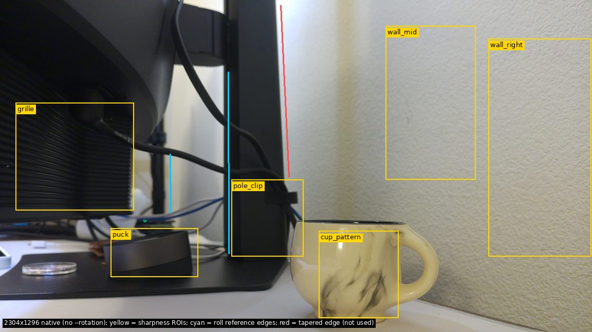
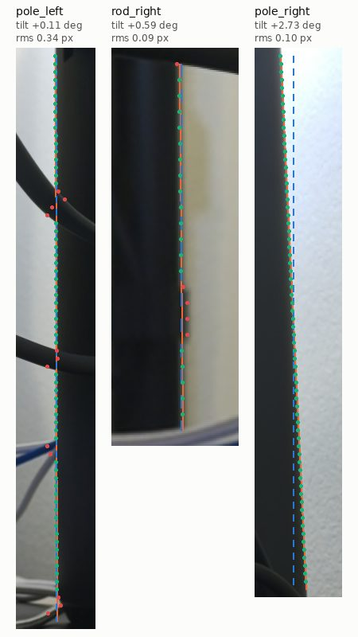
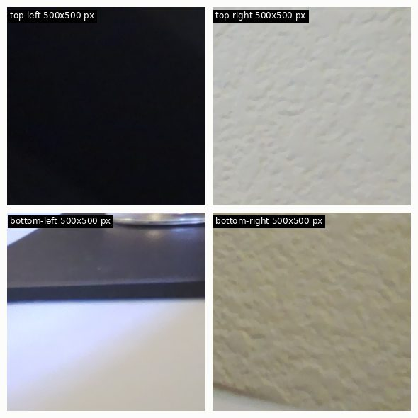
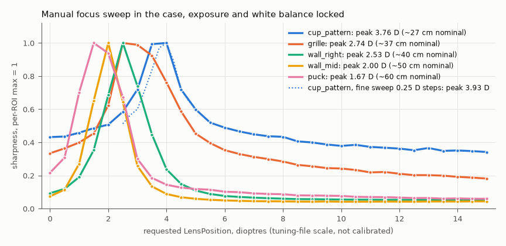
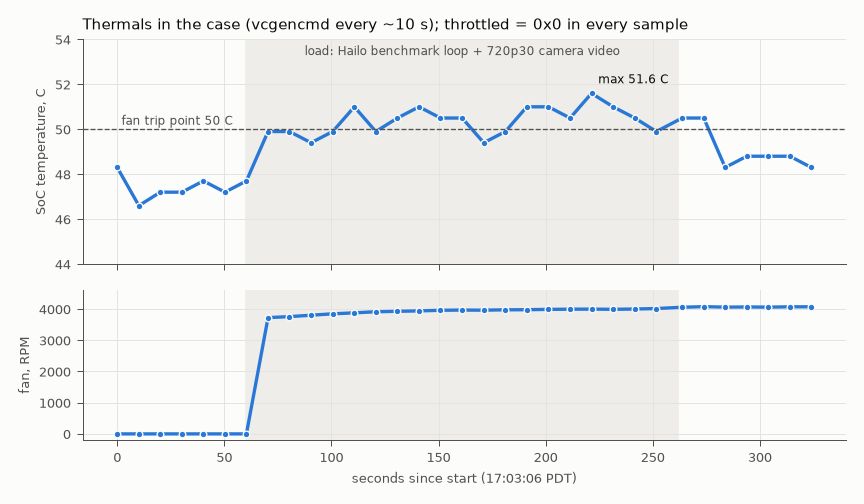
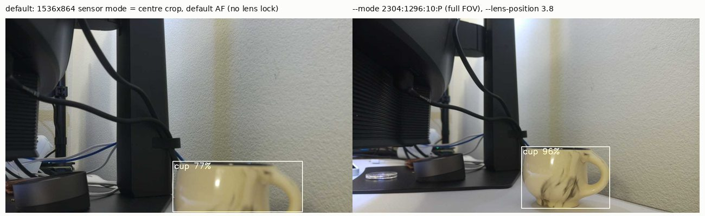
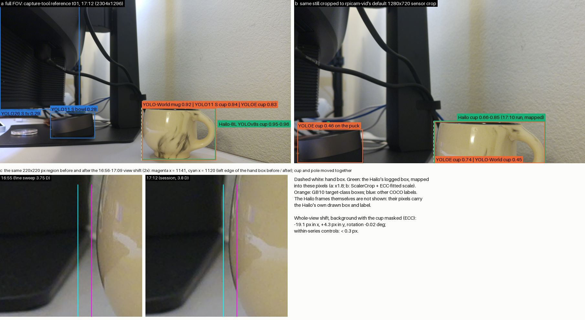
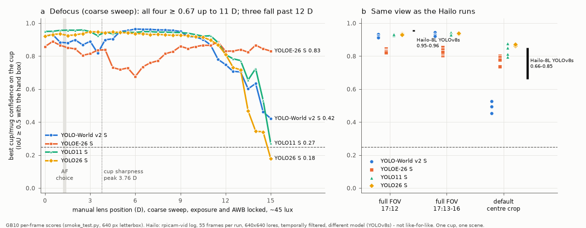

# 2026-09-26: Pi and camera in the 3D-printed case

Week 3, Saturday, 16:48–17:20 PDT. The student printed a case for the Pi with a camera holder and
power-cycled the Pi into it (the kernel booted at 16:41:20). This check covers the boot, the network,
the camera in its holder, thermals, the capture tool and the Hailo pipeline. The camera looks at the
same desk corner as this morning (cup, monitor stand, wall). **It is not a study workspace**, so the
numbers describe the case and the camera, not the experiment. Nobody is known to have touched the case
during the check *[evidence check: was "Nobody touched the case during the check, as far as the data
shows"; §2.7 now shows transient whole-image sub-pixel shifts of unknown cause]*. A hand-like object
entered one frame; see §2.7.

**Summary (measured)**

- **The Hailo driver comes up at boot without help.** `hailo_pci` 4.23.0 loaded 3.66 s after kernel
  start and the firmware loaded in 170 ms. `/dev/hailo0` appeared at 3.87 s, and `fw-control identify`
  reports HAILO8L with firmware 4.23.0. The benchmark gives **58.71 FPS and 13.01 ms**, the same as
  the pre-case run earlier today (58.71 FPS, 13.0 ms) *[evidence check: was "yesterday"; that run was
  on 2026-09-26 at 12:32–12:47 per the Pi's `~/hailort.log` timestamps, `evidence_check/e08`]*.
- **Wi-Fi now works.** `wlan0` is connected to the home Wi-Fi network (DHCP address on the home LAN, 5 GHz channel 112, signal
  63/100). `eth0` has no carrier. The `ai-pi` alias resolves through `ai-pi.local`, so the new IP
  doesn't matter.
- **The camera is the standard imx708** (tuning file `imx708.json`) and was detected at boot
  *[evidence check: removed "after the ribbon was re-seated"; no saved output or brief records a
  re-seat]*.
- **In the holder the image is upright without `--rotation 180`, and nearly level.** The morning's
  roughly 6–9° roll is gone. Two presumed-vertical scene edges tilt +0.10° to +0.62°. A joint
  roll/pitch solve gives a roll of −0.15° to −0.51° and a pitch of 2–4° down. The honest reading is
  "|roll| ≲ 0.6°", because nobody has checked that the reference edges are plumb.
- **No sign of the holder in the field of view** on the three edges and corners that can be checked. The
  top-left corner shows a black monitor back and **can't be checked in this scene**. Forcing the Pi's
  green and red LEDs on did not change the image beyond noise, and there is no visible flare.
- **Focus:** the cup's sharpness peaks at 3.76 D (coarse sweep) and 3.93 D (fine sweep), nominally
  25–27 cm away. The dioptre scale is uncalibrated. Autofocus again chose the background: 1.18–1.41 D
  in 5 auto stills.
- **Stable over 18 s; a transient ~1 px shift over 3 minutes.** Across 11 back-to-back locked stills,
  no frame shifted more than 0.20 px (OpenCV) or 0.11 px (scikit-image) from the first (ECC: 0.23 px),
  and brightness varied by 0.31 %. A 3-minute locked series shifted by at most 0.87 px (OpenCV),
  0.36 px (scikit-image) or 0.94 px (ECC). That shift was transient. *[Evidence check: corrected. The
  note said it was "not rigid: it was concentrated in the bottom-right quadrant, where the nearest
  objects are". That holds for scikit-image only. ECC translation, the only estimator that recovered
  non-circular synthetic shifts exactly, gives a smooth, near-rigid downward shift of +0.54 to
  +1.04 px in all 24 tiles of the frame: a whole-image (camera-side) movement of unknown cause
  (§2.7).]*
- **Thermals: SoC max 51.6 °C, never throttled.** A fan with a tachometer is connected and spins at
  3.7–4.1 k RPM once the SoC reaches 50 °C (and kept spinning down to 48.3 °C in the cool-down
  *[evidence check: added]*). `get_throttled` read `0x0` in all 33 samples and EXT5V
  stayed between 4.84 and 4.98 V. **The load was weaker than planned:** only one process can use the
  Hailo, so the camera's Hailo post-process could not run next to the benchmark (§2.8).
- **Capture tool:** 26/26 unit tests pass on the Pi. A real session (CASE00, P1, 2 references and 2
  queries) saved 4 shots, all with `lock_ok` and `light_ok`. Lux ratios were 1.0005–1.0025.
- **Camera → Hailo:** the cup was detected in every frame. By default `rpicam-vid` at 1280×720
  **uses the centre-crop sensor mode**, and there confidence was 0.66–0.85. With
  `--mode 2304:1296:10:P` (full field of view) and `--lens-position 3.8` it was 0.95–0.96.
- **Side finding:** `cv2.phaseCorrelate` (opencv-python-headless 5.0.0) **writes the Hann window
  into its input arrays** when a window is passed. The evidence check's `shift3.py` reused those
  arrays. Once the arrays are copied, the estimators still disagree (0.30–0.84 px on the morning drift
  pair), so the caveat "sub-pixel shift depends on the estimator" still holds (§2.11). *[Evidence
  check: the in-place windowing did cause the evidence check's 220 px failure. With copied inputs it
  reads 0.531 px (`evidence_check/e12`).]*

---

## 1. What was run

Everything on the Pi ran as user `raspberry` over `ssh -o BatchMode=yes ai-pi`. Stills were taken
with rpicam-apps 1.13.0 and libcamera 0.7.2+rpt20260817, and the Python on the Pi was 3.13.5 stdlib.
Analysis ran on the GB10 in throwaway uv environments
(`uv run --no-project --with numpy --with pillow --with opencv-python-headless --with scikit-image
--with matplotlib`, which resolved Python 3.13.5, numpy 2.5.3, opencv 5.0.0 and scikit-image 0.26.0).
The project `.venv` was not used.

```bash
# Pi (raw outputs in ~/cmpe249/case-check/, mirrored to data/raw/2026-09-26_case-check/pi/)
uptime -s; systemd-analyze; sudo dmesg | grep -i hailo; ls -l /dev/hailo0; hailortcli fw-control identify
hailortcli benchmark /usr/share/hailo-models/yolov8s_h8l.hef --time-to-run 10
ip -br addr; nmcli ...; nmcli dev wifi list --rescan no              # read-only, no config change
rpicam-hello --list-cameras
rpicam-still -v 2 -t 3000 ... (2 full-auto probes: 2304x1296 and 4608x2592)
bash casecheck.sh led          # LED leak test: locked stills, ACT+PWR LEDs forced off/on
bash casecheck.sh sweep sweep  # auto calibration still, then lens 0..15 D in 0.5 D steps, AE/AWB locked
CALIB=sweep/calib.json bash casecheck.sh fine fine_cup 2.5 5.0 0.25
bash casecheck.sh burst burst 12 2.5                                  # 12 locked stills back to back
bash casecheck.sh drift drift 13 14 49995 2.8904 1.2489,3.404 3.8     # 13 locked stills, 3 min 11 s
bash thermal.sh                # 60 s idle, 200 s load, 60 s cool-down; samples every ~10 s
python3 -m unittest discover -s capture/tests -v; bash case_session.sh   # capture tool
rpicam-vid -n -t 12000 --width 1280 --height 720 --framerate 5 --codec mjpeg --segment 1 -o f%04d.jpg \
  --post-process-file /usr/share/rpi-camera-assets/hailo_yolov8_inference.json -v 2   # + a --mode 2304:1296:10:P --lens-position 3.8 run

# GB10 (scripts in data/raw/2026-09-26_case-check/scripts/)
analyze_case.py focus|led|burst; roll_fit.py; roll_pitch_solve.py; edges_check.py; quadrant_shift.py;
session_stats.py; shift_selftest.py; tally_hailo.py; shift_recheck_camcheck.py; make_figures.py
```

In total that was 80 helper stills (all with exit code 0, logged verbatim in `pi/commands.log`; median
wall time 1.45 s), 5 capture-tool stills and four video runs.

## 2. Measured

### 2.1 Boot and Hailo

| Item | Value |
| --- | --- |
| Kernel boot (from `uptime -s`) | 16:41:20 PDT. Startup 1.60 s kernel + 12.90 s userspace; `multi-user.target` at 6.89 s |
| Clock | The RTC set the clock to 1970-01-01 at boot. systemd then advanced it to the saved `timesync/clock` time (15:47), and NTP corrected it later. **Journal and `who -b` timestamps from before the sync read about 15:47; they are not the boot time.** |
| PCIe | `0001:01:00.0 [1e60:2864]`, link up **8.0 GT/s x1** (`config.txt` has no `pciex1_gen` line) |
| Driver | `hailo_pci` loaded at 3.664 s, "Init module. driver version 4.23.0" |
| Firmware | `hailo8_fw.bin` written, "NNC Firmware loaded successfully", "FW loaded, took 170 ms" at 3.860 s |
| Device node | "Added board 1e60-2864, /dev/hailo0" at 3.872 s; `crw-rw-rw-` |
| `fw-control identify` | Firmware 4.23.0 (release, app, extended context switch buffer), Board Name Hailo-8, **Device Architecture HAILO8L** |
| `hailort.service` | active *[evidence check: the lane's saved outputs only show `enabled`; `systemctl is-active` at 17:27 gave `active` (running since boot), `evidence_check/e01`]* |
| Benchmark, `yolov8s_h8l.hef --time-to-run 10` | **58.7107 FPS** hw_only, 58.7079 FPS streaming, **13.0139 ms** hardware latency (earlier today, 12:32–12:47, before the case: 58.71 FPS, 13.0 ms *[evidence check: was "yesterday"]*). SoC 40.6 → 41.1 °C |

There was one harmless udev warning: `51-hailo-udev.rules is marked executable`.

### 2.2 Network (read-only; no configuration was changed)

| Interface | State |
| --- | --- |
| `wlan0` | UP, **a DHCP address on the home LAN**, default route via the home router. NetworkManager profile for the home Wi-Fi auto-activated at boot ("secrets exist", associated in 0.3 s, DHCP lease). Channel 112, 270 Mbit/s, signal 63/100 (level −57 dBm), WPA2/WPA3 |
| `eth0` | NO-CARRIER (carrier 0). The profile `netplan-eth0` exists but is not active |
| GB10 → Pi | `ai-pi` = `ai-pi.local` (mDNS). Ping: 10/10, round trip 6.4 / 10.5 / 24.6 ms (min/avg/max) |

**The Wi-Fi profile now connects.** This morning it failed. *[Evidence check: "so the password was
evidently fixed" softened. How it was fixed isn't visible from the Pi. The cloud-init seed files on
`/boot/firmware` are unchanged since 2026-07-08, and both netplan profile files were rewritten during
this boot (mtime 15:47:05 on the pre-NTP clock; `evidence_check/e21`, stat only).]*

### 2.3 Camera detection

```text
$ rpicam-hello --list-cameras        (16:50:18)
0 : imx708 [4608x2592 10-bit RGGB] (/base/axi/pcie@1000120000/rp1/i2c@88000/imx708@1a)
    Modes: 'SRGGB10_CSI2P' : 1536x864 [120.13 fps - (768, 432)/3072x1728 crop]
                             2304x1296 [56.03 fps - (0, 0)/4608x2592 crop]
                             4608x2592 [14.35 fps - (0, 0)/4608x2592 crop]
```

The kernel reports "imx708 10-001a: camera module ID 0x0301". The probe log shows
`Using tuning file /usr/share/libcamera/ipa/rpi/pisp/imx708.json`, which means the standard module
(the wide and NoIR modules load `imx708_wide.json` and `imx708_noir.json`). The sensor format is
`SBGGR10`, as in all 266 sensor-format lines of this morning's 133 logs *[evidence check: was "all
266 of this morning's logs"]*. This listing is saved as
`03_list_cameras.txt`; this morning's listing was not.

### 2.4 What the camera sees; orientation and roll



*Capture-tool reference `CASE00_P1_reference_pilot_L1_t01.jpg` (17:12), native orientation, no
rotation. Yellow boxes are the sharpness regions. Cyan lines are the two edges used for roll, and the
red line is the tapered pole edge that was not used.*

**The scene.** The camera sits at about desk level and looks along the desk into a wall corner:

- **Left:** the back of a monitor, with a striped grille and a cable plugged in.
- **Centre-left:** a black monitor-stand pole with a cable clip. A thin black rod stands further back.
- **On the monitor's base plate:** a black puck-shaped device and a clear disc.
- **Centre-right:** the cream cup with dark marbling, on the white desk.
- **Right half:** the textured wall.
- A green LED on a device behind the monitor is part of the scene, not the Pi.

The cup rim shows as a thin ellipse, so the lens sits a little above rim height. rpicam's Lux estimate
was 44.7–45.6 on the 33 stills outside the focus sweeps (the other 4, the 200 ms / gain-8 LED stills,
read 19.9 *[evidence check: added]*); the morning ranged from 3.0 to 53 lux *[evidence check: was "about 3.1 to 52"; the 133
morning JSONs give 3.04–53.16, `evidence_check/e19`]*.
During the coarse sweep, Lux fell steadily from 46.0 at 0 D to 39.4 at 15 D, while the whole-frame
mean stayed within 112.9–119.4. ~~The data can't tell whether the lens position, the sensor warming or
the light caused this.~~ *[Evidence check: corrected. The fine sweep separates the causes. It ran with
the lens descending (5.0 → 2.5 D) while the sensor warmed from 32 to 39 °C, and Lux rose from 43.6 to
45.0. At the six lens positions both sweeps share, their Lux values agree within 0.26 despite up to
7 °C difference. Across both sweeps, Lux ≈ 45.9 − 0.44 × lens position in D (residual RMS 0.09);
temperature alone fits poorly (RMS 0.93). The Lux estimate tracks the lens position, not the sensor
temperature. The mechanism was not investigated (`evidence_check/e04`, `e14`, `e23`).]*

**Orientation.** Native frames are upright. **`--rotation 180` is no longer needed.** The capture-tool
session below used rotation 0.

**Roll: method.** The fit ran on the mean of burst frames 2–12 (2304×1296) and on the 4608×2592
probe. For each row, the edge was located to sub-pixel precision at the maximum of the horizontal
luma gradient (after Gaussian smoothing, with a parabolic peak). A robust least-squares line
x = a·y + b was fitted with iterative 3×MAD clipping, which drops rows where cables cross the edge.
Tilt = atan(a); positive means the bottom of the edge is further right than the top. As a
cross-check, Canny edge pixels within ±3 px of the fitted line were refitted with `cv2.fitLine`
(Huber). Hough segments are also saved, but they only resolve whole pixel runs and return 0.00° on
the pole. Per-row inputs and outputs are in `analysis/roll_rows_*.csv`, `roll_fit.json` and
`roll_pitch_solve.json`.



*Green dots: rows used (every 10th shown). Red: rows rejected, mostly where cables cross. Orange: the
fitted line. Blue dashed: image vertical through the fitted line's midpoint.*

| Edge (x ≈ px of 2304) | Tilt, burst mean (fitLine) | Tilt, 4608 probe (fitLine) | Residual RMS | Rows used |
| --- | --- | --- | --- | --- |
| pole, left edge (890) | +0.109° (+0.095°) | +0.180° (+0.179°) | 0.34 px (0.64 px at 4608) | 580/710, 1157/1420 |
| far rod, right edge (664) | +0.588° (+0.617°) | +0.469° (+0.468°) | 0.09 px (0.11 px) | 183/230, 373/460 |
| pole, right edge (1109): **not used** | +2.733° (+2.731°) | +2.740° (+2.742°) | 0.10 px (0.16 px) | 670/670, 1340/1340 |

- **The pole's right edge was excluded.** It runs 2.6° off the same pole's left edge, so at least
  one of the two is not plumb. The pole looks tapered by eye. The left edge agrees with an
  independent object (the far rod) to within 0.29–0.52°.
- **If both reference edges are plumb**, their tilt difference comes from camera pitch, because
  vertical lines converge toward a vanishing point. A two-unknown solve (pinhole camera, principal
  point at the image centre, f = 1693 or 1774 px) gives **roll −0.15° to −0.51° and pitch 2.2–4.1°
  down**.
- **Uncertainty.** The fit standard errors (≤ 0.006° *[evidence check: was "≤ 0.11°";
  `roll_fit.json` gives 0.001–0.006°]*) are much smaller than the systematic terms:
  whether the stand and rod are plumb, whether the desk is level, the principal point, and lens
  distortion. **Conclusion: |roll| ≲ 0.6°, sign not resolved.** This morning's 8.6° line fit and
  6–9° Hough range came from a pole fit, with the camera lying upside down on the desk.

### 2.5 Field-of-view edges, holder intrusion, stray light and LEDs



- **Border bands.** This was measured on the mean of burst frames 2–12. For 8 segments along each of
  the 4 image edges, the mean luma of the outermost band (pixels 1–8) was divided by the band at 8–24
  px. All 32 ratios fall between 0.98 and 1.10. The texture (std of the Laplacian) in the outer band
  stays within ×0.70–1.39 of the inner band everywhere *[evidence check: was "matches the inner band
  everywhere"]*. A printed lip in the view would show as a dark, textureless
  outer band, and none does. Source: `analysis/edges_check.json`.
- **Corners** (full-resolution crops above). The top-right, bottom-left and bottom-right corners show
  scene texture right to the edge. **The top-left corner is filled by the black monitor back, so an
  intrusion there could not be told apart from the scene.** The same goes for the first segment of
  the top and left edges.
- **Stray light.** A gamma-0.35 stretch of the shadows (`analysis/burst_mean_gamma035_small.jpg`)
  shows no veiling glare, ghost or coloured glow.
- **LED leak test.** The Pi's ACT (green) and PWR (red) LEDs were forced off and on through sysfs
  (with sudo; see §5), with 2 locked stills per state. The test ran at the calibrated exposure and at
  200 ms / gain 8. The triggers were then restored to ACT=`mmc0` and PWR=`none`/0 *[evidence check:
  the pre-test LED state was not saved, so "restored" assumes these were the original values]*. Differences are
  maxima over 32×32-pixel block means, in 8-bit levels (R/G/B):

| Exposure | on − off | off − off (noise) | on − on (noise) |
| --- | --- | --- | --- |
| 50 ms, gain 2.88 | 1.40 / 1.49 / 3.03 | 2.78 / 3.09 / 3.67 | 2.10 / 1.57 / 3.85 |
| 200 ms, gain 8 (72 % of blocks saturated and excluded) | 2.69 / 1.15 / 4.33 | 3.97 / 1.84 / 6.65 | 3.71 / 1.55 / 5.73 |

  The on/off difference stays inside the noise floor at both exposures, so no LED leak was detected.
  *[Evidence check: the comparison is not like-for-like. "on − off" is a difference of 2-frame means
  (noise ÷ √2), while "off − off" and "on − on" are single frames. Single-frame on − off pairs reach
  4.25–4.54 blue levels at 50 ms, above the 3.67 off − off maximum. But the two on − off block maps
  are uncorrelated (r = −0.09 to +0.02, the same as the noise control), their largest blocks do not
  repeat, and the per-channel mean on − off is within ±0.27 levels. So "no leak detected" stands, on that test instead
  (`evidence_check/e14`, `e16`).]*
  Two limits apply. The long-exposure test covers only the unsaturated 28 % of the frame (the dark
  parts). And nothing blocked the lens, so a very weak leak could still hide under the ~45 lux room
  light.

### 2.6 Focus

The sweep locked exposure and white balance from an auto still (49 995 µs, gain 2.88) and set the lens
with `--lens-position`. The reported LensPosition always equalled the requested one. All 31 coarse
frames and 11 fine frames were kept; none was more than 5 % off the run's median brightness.
Sharpness is the variance of a 3×3 Laplacian divided by the squared mean, the same metric as this
morning. The peak comes from a parabola through log-sharpness.



| Region | Peak (D) | Band ≥ 80 % of peak (D) | Nominal distance |
| --- | --- | --- | --- |
| cup pattern (nearest object) | **3.76** (fine sweep **3.93**) | 3.15–4.36 (fine 3.43–4.38) | **27 cm** (fine 25.5 cm), band 23–32 cm |
| monitor grille | 2.74 | 2.23–3.88 | 36.5 cm |
| wall, right edge | 2.53 | 2.18–2.89 | 40 cm |
| wall, further left | 2.00 | 1.71–2.28 | 50 cm |
| puck on the base plate | 1.67 | 1.17–2.26 | 60 cm |
| pole with clip | 1.63 | 1.28–2.02 | 61.5 cm |
| whole frame | 1.66 | 1.17–2.44 | 60 cm |

- **The dioptre scale is the tuning file's generic VCM map, not a per-unit calibration.** "Nominal
  distance" is 100/D. No tape measure was used.
- **Autofocus picked the background again.** Five full-auto stills settled at 1.18–1.41 D, near the
  whole-frame peak, not the cup's 3.8–3.9 D.
- The sensor warmed from 36 to 46 °C (`SensorTemperature`) during the 31-frame sweep. A thermal
  focus shift was not checked.

### 2.7 Mechanical stability and brightness drift

Shifts use two estimators on luma: `cv2.phaseCorrelate` with a Hann window (inputs copied; see §2.11)
and `skimage.registration.phase_cross_correlation` with `upsample_factor` 50 (and 100). The custom
`phase_shift()` in `analyze_camcheck.py` was not used here.

**Self-test.** A real frame was translated by known sub-pixel amounts (Fourier shift, plus noise with
σ = 1.7 levels). scikit-image recovered them exactly, to within its 0.02 px step. OpenCV read 12–34 %
*[evidence check: was "13–35 %"]* low on shifts ≤ 0.3 px, and both signs were right
(`analysis/shift_selftest.txt`). ~~So on real frames, **a large disagreement between the two means the
change is not a pure translation**. It is not a failure of either estimator.~~ *[Evidence check:
struck. The self-test used circular (Fourier) shifts, which have no border discontinuity. With
non-circular shifts (spline-shifted, both frames cropped), scikit-image without a window read 20–40 %
low on shifts ≤ 0.3 px, and OpenCV was up to about 26 % off in either direction. `cv2.findTransformECC`
translation ("ECC", Gaussian σ 1.5) recovered every shift within 0.003 px (`evidence_check/e10`). A
disagreement on real frames can therefore also be an estimator problem. ECC is added below as a third
estimator (`evidence_check/e09`).]*

| Series | Estimator | Max shift vs first | Max shift frame to frame | Mean abs diff vs first (levels) | Brightness |
| --- | --- | --- | --- | --- | --- |
| Burst: 11 locked stills, 16:55:57–16:56:15, lens 2.5 D (frames 2–12) | OpenCV / skimage (up 50; up 100) | **0.20 / 0.11 (0.09) px**; ECC 0.23 px *[evidence check]* | 0.20 / 0.09 px | 1.71–1.77; > 10 levels ≤ 0.29 % of pixels | luma 117.64–118.01 (range **0.31 %**); Lux 44.90–45.20 |
| Burst including frame 1 | OpenCV / skimage | 0.28 / 0.21 px | 0.25 / 0.21 px | 2.24–2.39 | — |
| Drift: 13 locked stills every ~16 s, 17:13:17–17:16:28, session lock (lens 3.8 D) | OpenCV / skimage | 0.87 / 0.36 px (frame 9; ECC 0.94); 0.24 / 0.08 px at frame 13 (ECC 0.24) *[evidence check: was "0.19 / 0.06", which are the dy components, not magnitudes]* | 0.41 / 0.18 px | 1.42–1.90 | luma range 0.42 %; Lux 44.73–45.08 |
| Capture session: reference t01 vs the other 3 shots (17:12:13–17:12:21, 8 s *[evidence check: was "12 s"]*) | OpenCV / skimage | 0.65 / 0.24 px (ECC 0.58) | — | 1.49–1.68 | Lux ratio 1.0005–1.0025 |

- **Frame 1 of the burst** has a dark, defocused, hand-like shape at the bottom edge (x ≈ 700–1100,
  y > 1160). It made that region about 20 levels darker (mean 132.7 vs 152–153 in frames 2–12
  *[evidence check: these values were not saved; recomputed for x 700–1100, y ≥ 1160: 132.1 vs
  151.9–152.2, `evidence_check/e09`, `e18`]*). It appears in no other frame of the burst *[evidence
  check: narrowed from "no other frame"; only the burst was checked]*.
  It came from the scene, perhaps someone at the desk, and was excluded from the main row.
- **Where the drift-series shift comes from.** ~~The larger shifts are **not rigid**.~~ For drift frame 9
  vs frame 1, the bottom-right quadrant (the cup, desk and nearest wall) moved dy = +0.66 px
  (scikit-image). The other three quadrants moved 0.10–0.18 px. The capture session looked the same:
  0.74 px in the bottom-right quadrant and 0.04–0.16 px elsewhere (`analysis/quadrant_shift.json`).
  Frames 7–10 of the drift series also show a 0.5 % Lux dip. By frame 13 the shift was back to
  0.08–0.24 px *[evidence check: was "0.06–0.19"]*. ~~A rigid movement of the case would shift every
  quadrant by about the same amount. A near object, or its shadow, changing would not, which fits the
  data better.~~ *[Evidence check: corrected. The bottom-right localisation holds for scikit-image
  only. OpenCV gives dy +0.43 to +0.95 px in all four quadrants (largest bottom-left), and ECC gives
  +0.59 to +0.99. A 4 × 6-tile ECC map of drift 9 vs 1 is smooth and near-rigid: dy +0.54 to +1.04 px
  in all 24 tiles, larger on the left, consistent with a translation plus a ~0.01° rotation. The
  session pair is the same kind of field (median dy +0.63 px). The controls read about 0.2 px (drift 13
  vs 1) and 0.0 px (burst 12 vs 2). Tiled phase correlation (scikit-image, Hann) was erratic, with
  dy from −0.48 to +2.00 px across the 24 tiles. The best-supported reading is a transient whole-image shift, i.e. camera-side
  motion (case, holder, desk or lens), not a local scene change (`evidence_check/e09`, `e11`).]*
  **These data cannot tell holder creep from other camera-side causes** *[evidence check: was "from
  scene changes"]*. In both cases the effect is about 1 px or less.

### 2.8 Thermals in the case



`thermal.sh` sampled `vcgencmd measure_temp`, `get_throttled`, `measure_clock arm`, the fan's
`fan1_input` and `pwm1`, and `pmic_read_adc EXT5V_V` every ~10 s. It had an abort at 82 °C, which
did not trigger.

| Phase | n | SoC (°C) | Fan (RPM, PWM) | ARM clock (GHz) | EXT5V (V) | `get_throttled` |
| --- | --- | --- | --- | --- | --- | --- |
| first login, 16:49 (before any camera use) | 3 | 39.5–41.1 | 0 | — | 4.94 | 0x0 |
| idle before load, 17:03 (after ~13 min of camera work) | 6 | 46.6–48.3 | 0, PWM 0 | 1.5 (2.4 in the first sample) | 4.95–4.98 | 0x0 |
| load, 200 s | 20 | 47.7–**51.6** | 0 → 3726–4017, PWM 75 | 1.5–1.7 | **4.84**–4.95 | 0x0 |
| after load + 60 s cool-down | 7 | 48.3–50.5 | 4058–4077, PWM 75 | 1.5 | 4.97 | 0x0 |
| end of check, 17:20 | 1 | 48.3 | 0 | — | — | 0x0 |

- **`get_throttled` = 0x0 in every sample.** No bit is set: no under-voltage (bit 0), frequency cap
  (1), throttling (2) or soft temperature limit (3), and none of the "has occurred since boot" bits
  (16–19).
- **A fan is present and works.** It read 0 RPM until the SoC first reached the 50 °C trip point, and
  3.7–4.1 k RPM at PWM 75/255 after that, including through the cool-down at 48.3–48.8 °C
  *[evidence check: was "0 RPM below the 50 °C trip point … above it". The fan kept running below
  50 °C (hysteresis) and was off again at 48.3 °C at 17:20]*. The thermal trip points are 50 / 60 / 67.5 / 75 °C for the fan and 110 °C
  critical. Whether it is the Active Cooler under the AI HAT+ can't be seen from here.
- **The load was not what was specified.** The camera ran at 1280×720 and 30 fps with MJPEG to
  `/dev/null` (5993 frames, 0 dropped, 4.9 ms per encode). A `hailortcli benchmark` loop ran
  alongside it (2 complete 90 s runs at 58.80 FPS, 12.91 / 12.82 ms; a third was cut at the end of
  the window).
  - **But the camera's Hailo post-process never ran.** The benchmark opened the Hailo first, and
    rpicam-vid logged `HAILO_OUT_OF_PHYSICAL_DEVICES(74)` and then "HailoRT not ready!" on 5994
    frames.
  - **Reverse order, 17:09.** With `rpicam-vid` holding the Hailo, `hailortcli benchmark` failed with
    the same status 74, both with and without `--multi-process-service`. `hailort.service` is active,
    but the rpicam-apps post-process presumably opens the device directly *[evidence check: inferred
    from the failures, not verified]*. Meanwhile rpicam-vid kept detecting
    (243 frames, 244 `cup` detections, 0.72–0.87).
  - **Consequence:** only one Hailo client runs at a time in the current setup.
- The CPU was lightly loaded (ARM clock 1.5–1.7 GHz), so **this is not a worst-case CPU thermal test**.
  The case temperature itself was not measured.

### 2.9 Capture tool with the real camera in the case

- **Unit tests** (`python3 -m unittest discover -s capture/tests -v` on the Pi, Python 3.13.5): **26/26
  OK** in 3.7 s. The deployed `pi_capture.py` sha256 `19568328c508…` matches the repo.
- **Session.** `2026-09-26-case`, run with `--root ~/cmpe249/case-check/data` so all raw data stays
  under `case-check/`:
  - `calibrate --lighting L1 --lens-position 3.8` locked **L1-v1**: 49 995 µs, gain 2.8904, AWB
    [1.2489, 3.404], lens 3.8 D, rotation 0, Lux 45.03.
  - Then 2 references and 2 queries at CASE00 / P1 (condition `pilot`, lighting L1). The transcript is
    `pi/06b_session_transcript.txt`, and the session data is in
    `data/raw/2026-09-26_case-check/pi/data/2026-09-26-case/`.

| Check | Result |
| --- | --- |
| Shots saved | 4 of 4, 1.7 s each (exit 0). The queries warned "no reference at P2–P5 (allowed for condition=pilot only)", as expected |
| sha256 in the sidecar vs the file | matches for all 4 (recomputed on the GB10) |
| `lock_check` | ok for all 4: reported shutter 49 968 µs (requested 49 995), gain 2.8911, AWB and lens exact, ScalerCrop `(0, 0)/4608x2592`, 2304×1296 from the JPEG header |
| `lighting_check` | ok, Lux ratio 1.0005–1.0025 (threshold ×1.25) |
| `manifest.jsonl` | 4 lines, `lock_ok` and `light_ok` true |
| Reference t01 vs the other 3 | mean abs diff 1.49–1.68 levels; 0.21–0.79 % of pixels > 10 levels; shift 0.27–0.65 px (OpenCV) or 0.10–0.24 px (skimage), ECC 0.31–0.58 px *[evidence check]*; see §2.7 |

### 2.10 Camera → Hailo end to end (video mode)



| Run (12 s, 5 fps, 1280×720 MJPEG, YOLOv8s on the Hailo-8L, threshold 0.4) | Sensor crop | Frames saved | Detections |
| --- | --- | --- | --- |
| default (as in the 12:58 run earlier today *[evidence check: was "as yesterday"]*) | **`(768, 432)/3072x1728`**, the 1536×864 centre-crop mode | 54 (0 dropped, 0 "not ready") | `cup` in every logged frame (55/55): conf **0.66–0.85** (median 0.80), box cut off by the bottom edge; nothing else |
| `--mode 2304:1296:10:P --lens-position 3.8` | `(0, 0)/4608x2592`, full FOV | 54 (0 dropped, 0 "not ready") | `cup` in every logged frame (55/55): conf **0.95–0.96**, whole cup inside the box; nothing else |

The pre-case run (12:58 today *[evidence check: was "Yesterday's run"]*) falsely boxed the desk
underside as `tv`. Today the cup is detected and nothing else
is, but the scene and the pose both differ, so this is a pipeline check, not a detection-quality
comparison. The default `rpicam-vid` at 1280×720 picks the cropped 1536×864 mode, **which is not the
field of view the capture tool records**.

### 2.11 Side finding: `cv2.phaseCorrelate` modifies its inputs

With opencv-python-headless 5.0.0 (numpy 2.5.3), `cv2.phaseCorrelate(a, b, window)` applies the
window **in place** to `a` and `b`, for both float64 and float32 inputs. Without a window it leaves
them alone (`analysis/cv2_phasecorrelate_inplace_check.txt`).

- **It hit this check.** The first run of the burst analysis reported mean differences of 33–43
  levels *[evidence check: that run was not saved; a replay of the uncopied code gives 33.6–42.7,
  `evidence_check/e13`]*. After copying the inputs the true values were 1.7–2.4 levels. Every number above comes from
  the fixed code.
- **It also affects the evidence check.** `data/raw/2026-09-26_evidence-check/shift3.py` calls
  `cv2.phaseCorrelate(a, b, win)` and then reuses `a` and `b` for the scikit-image estimators and for
  later pairs. The reference frame gets windowed again on every call. Its outputs, including the
  220 px cross-correlation failure, were computed on modified arrays. This is an inference from the
  code and today's resolved version, which may differ from the version resolved at 13:00. *[Evidence
  check: now verified. Re-running `shift3.py` unmodified today reproduces its 13:00 output exactly
  (0.719 / 220.529 / 0.560 …). With copied inputs, the 220 px value becomes 0.531 px, so the in-place
  windowing caused that failure. Note that shift3's "sk-xcorr" is unnormalised cross-correlation
  (`normalization=None`), a different estimator from the "skimage, no window" column below
  (`evidence_check/e12`).]*
- **The estimator disagreement survives the fix.** A corrected re-run (`scripts/shift_recheck_camcheck.py`
  → `analysis/shift_recheck_camcheck.txt`) on the morning frames still disagrees. For the drift pair,
  last vs first: 0.844 px (OpenCV), 0.304 (skimage, no window), 0.588 (skimage with Hann) and 0.767
  (`analyze_camcheck.phase_shift`). For rep locked: 0.232, 0.122, 0.136 and 0.133.
- **So the §2.4/§2.5 caveat in the camera-check note stands:** sub-pixel shifts there depend on the
  estimator. `shift3.py` and the camera-check note were not edited.

## 3. Implications for the rig plan (recommendations, not measurements)

These refer to `notes/2026-09-26-camera-check.md` §5.

1. **Orientation: settled by the holder.** The camera is upright in the case, so calibrate with the
   default `--rotation 0`. The lock records the rotation, so the morning's pilot data (rotation 180)
   stays unambiguous. The README hint about `--rotation 180` (in `capture/README.md` *[evidence
   check: added]*) still applies to other mounts.
2. **Roll: good enough to proceed, but verify on the stand.** |roll| ≲ 0.6° with the case on the desk
   meets §5's "fix roll physically" goal as far as this scene can show. Once the case is on its stand,
   re-check with a bubble level on the case and a taped horizontal line in a preview. A 40° pitch
   changes how any roll in the stand shows up.
3. **Height and pitch (38 cm, 40° down): not provided by the case alone.** Resting on the desk, the
   lens is near desk level and pitched 2–4° down (if the reference edges are plumb). The recommended
   geometry needs a stand or bracket that holds the case at 38 cm and tilts it 40°. Nothing seen here
   shows whether the case has a mounting point; see §4.
4. **The Pi and the camera move together.** The camera holder is part of the Pi case, so the §6 open
   item "ribbon length decides whether the Pi moves with the camera" no longer matters as long as the
   whole case rides on the stand. Because Wi-Fi now works, **only the USB-C power cable has to trail
   from the stand**. Route it so it can't pull on the case at each stop. It is a lever on a 40°-tilted
   case.
5. **Focus: set by distance, as before.** The dioptre scale is uncalibrated and autofocus still
   chooses the background. On the rig, keep `--lens-position` locked (1.75 D was the plan for ~57 cm)
   and confirm it with `casecheck.sh sweep` or `camcheck.sh sweep`.
6. **Stability.** Untouched in the case, the burst floor is about 0.1–0.2 px (ECC 0.23 px). That leaves the planned
   repositioning test (target "a few px") as the dominant term. Re-run a burst and a 10-minute drift
   **after mounting at 40°**. A tilted, cantilevered holder may creep in a way that a case lying flat
   does not. Today's 3-minute series was not clean enough to rule creep in or out. *[Evidence check:
   by ECC, that series contains a transient whole-image shift of up to ~0.9 px that recovered to
   ~0.2 px. The capture session contains a 0.6 px shift within 8 s. The cause is camera-side but
   otherwise unknown (§2.7), so the drift re-run matters more than this item implied.]*
7. **Thermals: not a concern at this load, but check again on the stand.** SoC ≤ 51.6 °C with the fan
   cycling, and no throttling or under-voltage. Mounted at 40°, the case's airflow and fan position
   change. Repeat the sampler (`thermal.sh`) once on the stand, ideally with the real demo load.
8. **On-device demo (optional).** Use `--mode 2304:1296:10:P` and a locked lens so the Hailo sees the
   capture tool's field of view. Plan for **one Hailo client at a time**: a live demo and a benchmark
   or second model can't share the chip unless both go through `hailort.service`, which is untested.

## 4. Open questions for the student (about the case)

1. Does the case have a **mounting point** (1/4"-20 insert, screw bosses, a flat clampable base)? How
   will it attach to a stand at 38 cm and 40° down?
2. Is the camera's pitch **fixed** in the holder (currently about level) or **adjustable**? If it's
   fixed, the stand must provide the full 40°.
3. How is the camera board held: screws, clips or friction? Is there any play if the ribbon is tugged,
   and is the ribbon routed inside the case?
4. Where are the **fan intake and exhaust** in the case, and will they stay unobstructed when the case
   is tilted? What filament is it (PLA softens around 55–60 °C)? The case wall temperature was not
   measured.
5. Was anything moved or touched near the camera at about 16:55:55 (a hand-like shape in burst frame 1)
   or between 17:14:50 and 17:15:40 (a sub-pixel whole-image shift by ECC *[evidence check: was
   "non-rigid sub-pixel shift"]* and a 0.5 % Lux dip)?
6. The Wi-Fi now connects. Was the password changed on the Pi, and should `eth0` be considered unused
   from now on?

## 5. Deviations and caveats

- **sudo was used on the Pi**, which `AGENTS.md` says needs asking first:
  - read-only `sudo dmesg`, for the Hailo boot lines;
  - `sudo tee` into `/sys/class/leds/{ACT,PWR}` for the LED leak test. Both triggers were restored
    (ACT `mmc0`, PWR `none`/0) and checked at the end *[evidence check: the pre-test state was not
    saved; the end state was re-read at 17:27, `evidence_check/e01`]*.

  No packages or configuration files were changed *[evidence check: consistent with the Pi. There
  was no apt/dpkg activity after 12:32 and no file under `/etc` or `/boot/firmware` modified since
  boot (`evidence_check/e20`)]*.
- **The thermal load was weaker than specified** (§2.8). The camera ran with its Hailo post-process
  failing, because the chip only accepts one client.
- `hailortcli` writes `hailort.log` into its working directory. Lines appended to the pre-existing
  `~/hailort.log` by this check's `fw-control identify` and share test were cut back out, so the file
  holds its 278 pre-session lines again (its mtime changed). The removed lines are kept in
  `share_test/hailort_home_appended*.log`.
- All sharpness regions, roll references and the "hand-like" reading were chosen or judged by eye. The
  roll result depends on the plumbness of scene objects nobody measured.

At the end (17:20) nothing was running on the Pi: no rpicam, `pi_capture` or `hailortcli` process.
The SoC was at 48.3 °C with the fan off and `throttled=0x0` (`99_final_state.txt`).

## Evidence check (same day, ~17:25–17:45)

This was an adversarial re-check of this note. It did not use the camera; Pi access was read-only
(files, stat, `systemctl is-active`, `journalctl`, `vcgencmd`). The GB10 side ran in throwaway uv
environments (Python 3.13.5, numpy 2.5.3, opencv 5.0.0, scikit-image 0.26.0, scipy 1.18.1). Outputs and
scripts are in `data/raw/2026-09-26_case-check/evidence_check/`, indexed in its `README.txt`.
Corrections are marked inline above.

**Re-verified against saved raw outputs or by recomputation:**

- **Mirror and logs.** The `pi/` mirror is identical to `ai-pi:~/cmpe249/case-check` (414 files by
  sha256). `commands.log` has 80 stills, all rc 0, median 1.453 s.
- **Boot, Hailo and network.** Boot and Hailo dmesg timings, the identify output, the benchmark
  (58.7107 / 58.7079 FPS, 13.0139 ms) and the network table all match the raw files.
- **Camera listing and tuning.** The `--list-cameras` modes match, and the tuning file is `imx708.json`.
- **Focus.** The focus-table peaks and bands reproduce with independent code. Tenengrad, a second
  sharpness metric, puts the cup at 3.73 / 3.87 D.
- **Roll.** The roll-table values and the two-edge solve reproduce. A different edge localiser (50 %
  crossing plus a Theil–Sen line) gives pole +0.14 / +0.20°, rod +0.60 / +0.54° and pole-right
  +2.75 / +2.76°. It solves to roll −0.19° to −0.39° and pitch 2.6–3.6° down, inside the note's range,
  so **|roll| ≲ 0.6° stands**.
- **Borders, LED and burst.** The border-band ratios (0.98–1.10) and the LED-table values match. The
  burst, drift and session numbers reproduce, except the frame-13 magnitudes corrected above.
- **Thermals.** The thermal table matches all 33 rows of `samples.csv`. The load logs match: 5993
  frames with 5994 "not ready"; 2 runs at 58.80 FPS; the share test gave 243 frames, 244 `cup`
  detections at 0.72–0.87, and exit 74 twice. The trip points were re-read on the Pi.
- **Capture tool.** Unit tests 26/26. The pi_capture.py sha256 on the Pi equals the repo's. The
  session was recomputed: sha256 matches for 4/4, the lock and lighting checks pass, and the JPEG
  headers read 2304×1296.
- **Camera → Hailo.** Re-tallied from `run.log` with an independent parser (55/55 frames, confidence
  0.66–0.85 and 0.95–0.96, 0 "not ready").
- **In-place side effect.** Reproduced, and its causal role in shift3's 220 px value is now
  confirmed.
- **Figures.** All six were checked against their captions and match.

**Corrected (inline):**

- **Stability interpretation (the substantive one):** the drift and session shifts are whole-image
  shifts by ECC, not a bottom-right local change (§2.7).
- **Estimators:** the self-test conclusion that a disagreement "is not a failure of either
  estimator".
- **Lux:** the cause of the sweep Lux fall; it is the lens position.
- **Dates and counts:** "yesterday", which was earlier today; the 266 logs, which are 133; frame-13
  shift magnitudes; the fit SEs (≤ 0.006°, not ≤ 0.11°).
- **Minor figures:** OpenCV's self-test bias (12–34 %); the session span (8 s); the morning Lux range;
  the fan below 50 °C.
- **Softened or removed:** the "ribbon re-seated" claim (removed), "password evidently fixed", "texture
  matches everywhere" and the LED noise-floor comparison.

**Not verified:**

- The source of the whole-image shifts (case, holder, desk or VCM lens) and whether the hand-like
  shape was a hand.
- Whether the reference edges are plumb, and the principal point and focal length used in the pitch
  solve.
- The tapered-pole reading, scene descriptions and the cup-rim inference (checked by eye only).
- Why the sweep Lux follows the lens position.
- The LED pre-test state.
- How the Wi-Fi password was fixed.
- Whether rpicam-apps opens the Hailo directly.
- The case wall temperature.

## Files

- Raw data (gitignored): `data/raw/2026-09-26_case-check/`
  - **Top level:** `01_boot.txt`, `01b_boot_detail.txt`, `02*_network*.txt`, `03_list_cameras.txt`,
    `05*_*.txt` and `99_final_state.txt`.
  - **`pi/`:** a mirror of `ai-pi:~/cmpe249/case-check/`. It holds `commands.log`, `probe/`, `led/`,
    `sweep/`, `fine_cup/`, `burst/`, `drift/`, `thermal/`, `share_test/`, `hailo_e2e/`,
    `hailo_e2e_fullfov/`, `data/2026-09-26-case/`, `06a_unittests.txt` and
    `06b_session_transcript.txt`.
  - **`scripts/`:** `casecheck.sh`, `thermal.sh` and `case_session.sh` (Pi); `analyze_case.py`,
    `roll_fit.py`, `roll_pitch_solve.py`, `edges_check.py`, `quadrant_shift.py`, `session_stats.py`,
    `shift_selftest.py`, `tally_hailo.py`, `shift_recheck_camcheck.py` and `make_figures.py` (GB10).
  - **`analysis/`:** JSON, CSV and stdout for every table above.
  - **`evidence_check/`:** the evidence check's scripts (`ec_*.py`), outputs (`e00`–`e23`) and
    `README.txt`. Section R of `e14` is superseded by `e15` (a window bug in the check itself).
- Figures: `notes/figures/2026-09-26/case_{view,roll_fit,corners,focus_sweep,thermal,hailo_e2e}.*`
  (each < 100 KB).

---

## Perception on the case frames (GB10, Python 3.13.5)

Added 17:49–18:15 by a separate check. It ran the project's own perception front end
(`perception/smoke_test.py` and `match_check.py`, both unchanged) on the stills above, in the project `.venv`:
CPython 3.13.5, torch 2.12.1+cu130, ultralytics 8.4.163, NVIDIA GB10. It did not access the Pi or use the camera.
This is a first look at the new view and an end-to-end check of the migrated environment on fresh data. As with the
smoke test (`notes/2026-09-26-perception-smoke.md`), **every number describes one cup in one desk scene; it is not an
evaluation.**

**Summary**

- **The migrated environment works on fresh data.** Both scripts ran end to end on CUDA without any workaround. Three
  detector passes gave identical detections (3,149 rows). The existing perception code and `uv.lock` are
  byte-identical before and after, and `~/.config/Ultralytics` was not created.
- **Detection is easy in this view.** The 81 frames with the cup in view span lens 0–15 D, autofocus, and 50–67 ms
  exposures. In every one, all four detectors put a cup/mug box on the cup (IoU ≥ 0.5) at ≥ 0.25, with one exception:
  YOLO26 S at 15 D (0.18). Up to 11 D every score is ≥ 0.67. On the four 200 ms / gain-8 stills the cup is
  saturated white, and all four detectors return nothing.
- **Hailo-8L vs GB10 on the same view.**
  - **Full field of view:** the Hailo's YOLOv8s gave 0.95–0.96 and the GB10 models 0.82–0.94. The boxes agree
    (IoU 0.96–0.99 with the Hailo box).
  - **Default `rpicam-vid` centre crop:** the crop cuts off the bottom ~45 % of the cup, and the Hailo gave
    0.66–0.85. On the same crop emulated from the stills:
    - the COCO controls stay at 0.80–0.88;
    - YOLO-World v2 S drops to 0.45–0.53;
    - YOLOE-26 S calls the black puck "cup" at 0.25–0.46, in 4 of 4 crops.
- **The scene has non-study objects the models label.** The COCO controls call the black puck "bowl"/"cell phone"
  (up to 0.59), the clear disc "cell phone" (up to 0.52) and the monitor back "tv"/"microwave" (up to 0.73). The
  book/bottle/box prompts never exceeded 0.09 in either open-vocabulary model: none of those objects is in the scene.
- **Matching separates the cup from the background, and focus drives the similarity.** DINOv2-S scored every
  visible cup crop ≥ 0.492 and all 870 background crops ≤ 0.364. Similarity to the 3.8 D reference is:
  - 0.99 at 3.5–4.0 D;
  - 0.83–0.86 on the autofocus stills (1.2–1.4 D);
  - 0.49 at 15 D.
- **New side finding: the whole view shifted about 19 px between 16:56:15 and 17:09:13.** Nothing was saved inside
  that window, so the cause is unknown. §2.7's stability numbers are within-series and do not include this. Details
  are under "View shift" below.

### What was run

```bash
uv run --locked python perception/manifests/make_2026-09-26_case.py      # writes perception/manifests/2026-09-26_case.json
uv run --locked python perception/smoke_test.py --manifest perception/manifests/2026-09-26_case.json \
    --out runs/2026-09-26-case-perception/detect
# match_check.py hard-codes the smoke test's group names in REAL_GROUPS; this sets them to the case groups
# (runs/2026-09-26-case-perception/scripts/run_match_case.py does exactly this):
uv run --locked python -c "import sys; sys.path.insert(0, 'perception'); import match_check as m; \
m.REAL_GROUPS = ['session','hailo_view','drift','burst','fine','sweep','auto','led_base','led_hi']; m.main()" \
    --manifest perception/manifests/2026-09-26_case.json \
    --detections runs/2026-09-26-case-perception/detect/detections.jsonl --out runs/2026-09-26-case-perception/match
uv run python runs/2026-09-26-case-perception/scripts/analyze_case_perception.py   # tables + the two figures below
```

- **Time taken.** The detector pass (89 images × 4 models × 5 timed runs) took 21 s, and matching took 14 s.
- **Settings.** As in the smoke test: imgsz 640, detections recorded down to 0.01, catalog `cup, mug, book,
  bottle, box`.
  - A **hit** is a target-class box with IoU ≥ 0.5 against the hand box.
  - A **false positive** is a target-class box with IoU < 0.1.
- **The Hailo's own frames were not used as inputs.** `object_detect_draw_cv` drew the Hailo's box and a "cup NN%"
  label into their pixels.

**Inputs.** 89 manifest entries, all from lane A's mirror (`data/raw/2026-09-26_case-check/pi/`), all native
orientation:

| Group | n | What it is |
| --- | --- | --- |
| session | 5 | Capture-tool CASE00/P1 (17:12): 2 references, 2 queries and the L1-v1 calibration still. Lens 3.8 D, ~45 lux |
| drift | 13 | 17:13–17:16, session lock |
| burst | 12 | 16:56, locked, lens 2.5 D. `locked_01` has the hand-like shape at the bottom edge |
| fine / sweep | 11 / 31 | Lens 2.5–5.0 D / 0–15 D, exposure and AWB locked |
| auto | 5 | Two full-auto probes (2304 and 4608 px) and 3 auto calibration stills; AF chose 1.18–1.41 D |
| led_base / led_hi | 4 / 4 | LED-test stills at 50 ms, and at 200 ms / gain 8 (97 % of the cup box's pixels ≥ 250 in all channels) |
| hailo_view | 4 | The session shots cropped to `rpicam-vid`'s default 1280×720 sensor crop: `(768, 432)/3072x1728` = (384, 216)–(1920, 1080) at 2304 px |

**Target box.** The agent (not the student) hand-annotated the box on session reference t01 at 3.8 D, from
10 px-grid zooms at 3× (`runs/…/annotation/`). It spans rim top y 856, body left x 1120, handle right x 1708 and foot
bottom y 1268, about ±5 px. Frames taken before the view shift use the same box moved by the measured cup
displacement: [1141, 853, 1729, 1265], about ±10 px. The 4608 px probe uses twice that.

Two caveats on the box:
- Focus breathing changes image scale by ~0.67 % per dioptre (`breathing_check.json`). At 0 D (scale 0.974 about
  the image centre) that moves the box corners by 5–21 px.
- The agent had already seen the Hailo's drawn box in the `rpicam-vid` frames before annotating.

### Detection results



*a/b: session reference t01, in full and cropped to the Hailo's default sensor crop. The Hailo boxes (green) come
from its `run.log`, mapped into these pixels. The mapping is checked by ECC registration of the Hailo frames
against the still, with the drawn box masked out:*
- *full FOV: ≤ 0.4 px residual at 1280 px, scale 0.9995;*
- *crop mode: scale 0.980 about the centre. That matches the breathing of an unlocked lens at about 0.9 D, which
  fits autofocus choosing the background (inferred).*

*c: the same region before and after the view shift.*

Cell: frames with a hit at ≥ 0.25 / n, then the range of the best hit confidence (0.00 = no hit).

| Frames | n | YOLO-World v2 S | YOLOE-26 S | YOLO11 S | YOLO26 S |
| --- | --- | --- | --- | --- | --- |
| session 17:12 (3.8 D) | 5 | 5/5, 0.91–0.93 | 5/5, 0.82–0.85 | 5/5, 0.93–0.94 | 5/5, 0.93–0.94 |
| drift 17:13–17:16 (3.8 D) | 13 | 13/13, 0.92–0.94 | 13/13, 0.80–0.85 | 13/13, 0.93–0.95 | 13/13, 0.93–0.94 |
| burst 16:56 (2.5 D) | 12 | 12/12, 0.89–0.93 | 12/12, 0.81–0.89 | 12/12, 0.94–0.96 | 12/12, 0.93–0.94 |
| fine sweep 2.5–5.0 D | 11 | 11/11, 0.83–0.93 | 11/11, 0.77–0.86 | 11/11, 0.90–0.96 | 11/11, 0.94–0.95 |
| coarse sweep 0–15 D | 31 | 31/31, 0.42–0.96 | 31/31, 0.68–0.89 | 31/31, 0.27–0.96 | 30/31, 0.18–0.95 |
| full-auto stills (AF 1.18–1.41 D) | 5 | 5/5, 0.85–0.89 | 5/5, 0.85–0.89 | 5/5, 0.95–0.96 | 5/5, 0.92–0.93 |
| LED test, 50 ms (1.27 D) | 4 | 4/4, 0.85–0.91 | 4/4, 0.86–0.89 | 4/4, 0.96 | 4/4, 0.92–0.93 |
| LED test, 200 ms / gain 8 (cup saturated) | 4 | 0/4, 0.00 | 0/4, 0.00 | 0/4, 0.00 | 0/4, 0.00 |
| session cropped to the Hailo default crop | 4 | 4/4, 0.45–0.53 | 4/4, 0.74–0.80; **puck as "cup" 0.25–0.46 (4/4)** | 4/4, 0.80–0.88 | 4/4, 0.86–0.87; puck as "cup" ≤ 0.16 |



**Defocus.**
- Up to 11 D, every model stays ≥ 0.67. YOLOE-26 S's lowest value, 0.676 at 6 D, is not a focus effect: YOLOE ranges
  0.68–0.89 across the whole sweep and still gives 0.83 at 15 D.
- The COCO controls and YOLO-World fall past about 12 D. At 15 D: YOLO26 S 0.18, YOLO11 S 0.27, YOLO-World 0.42.
- In the smoke test's 4-lux pilot frames YOLO26 S scored 0.00. Here, at ~45 lux, it scores 0.90–0.95 on every
  frame up to 11 D. This is consistent with lighting mattering, but the scene and pose also differ.

**Prompt wording.**
- YOLO-World's best class on this cup was "mug" in 74 of 81 frames. On the smoke test's mug it was "cup" in 79 of
  80 hits.
- YOLOE-26 S prefers "cup" here (74 of 81).
- As the smoke note said, prompts need choosing per object.

**Same view as the Hailo.** The Hailo runs (17:10–17:11) and the session stills (17:12) are after the view shift, in
the same pose.

| View | Detector | Frames with cup | Cup confidence | IoU with hand box (visible part) | IoU with the Hailo box |
| --- | --- | --- | --- | --- | --- |
| full FOV | Hailo-8L YOLOv8s (`yolov8s_h8l.hef`) | 55/55 | 0.95–0.96 | 0.99 | – |
| | GB10 YOLO-World v2 S / YOLOE-26 S | 5/5, 5/5 | 0.91–0.93 / 0.82–0.85 | 0.97 / 0.97 | 0.98 / 0.96 |
| | GB10 YOLO11 S / YOLO26 S | 5/5, 5/5 | 0.93–0.94 / 0.93–0.94 | 0.99 / 0.98 | 0.99 / 0.99 |
| default centre crop | Hailo-8L YOLOv8s | 55/55 | 0.66–0.85 (median 0.80) | 0.98 | – |
| | GB10 YOLO-World v2 S / YOLOE-26 S | 4/4, 4/4 | 0.45–0.53 / 0.74–0.80 | 0.98 / 0.96 | 0.95 / 0.93 |
| | GB10 YOLO11 S / YOLO26 S | 4/4, 4/4 | 0.80–0.88 / 0.86–0.87 | 0.96 / 0.97 | 0.93 / 0.94 |

- **Nothing else was reported at the Hailo's display threshold (0.4).** The Hailo logged no other class. The GB10 models had no non-target box ≥ 0.4 on these 5 session stills or the 4 crops.
- **The crop cuts off the bottom of the cup.** The emulated crop keeps rows 856–1080 of the cup's 856–1268 (54 %).
  The Hailo's actual crop-mode frame keeps rows up to about 1089 (56 %), by the measured mapping.
- **This is not a like-for-like comparison:**
  - The models differ: the Hailo runs a compiled YOLOv8s, and no YOLOv8s ran on the GB10.
  - The inputs differ: the Hailo sees a 640×640 lores stream from a 16:9 crop, which changes the aspect ratio; the
    GB10 sees a 640 px letterbox of the JPEG still.
  - The Hailo's post-process has a temporal filter (`factor` 0.75, `visible_frames` 6), so its confidences are
    smoothed across frames.
  - In the crop run the lens was unlocked, while the emulation used 3.8 D stills. So the emulation isolates the
    truncation, not the Hailo run's defocus.
- **The direction agrees:** cutting off the bottom ~45 % of the cup lowered every detector's confidence.

**What else the models report** (non-target boxes ≥ 0.25 over the 81 full frames; the scene object is assigned by
IoU ≥ 0.3 with by-eye boxes):

| Scene object | YOLO-World v2 S | YOLOE-26 S | YOLO11 S | YOLO26 S |
| --- | --- | --- | --- | --- |
| black puck on the monitor base plate | – | – (as "cup": 0.10–0.15 in 11 frames) | cell phone ×14, bowl ×10 (max 0.59) | cell phone ×8, keyboard ×1 (max 0.47) |
| clear disc | – | – | – | cell phone ×20 (max 0.52) |
| monitor back | – | – | microwave ×14, tv ×1 (max 0.66) | tv ×54, chair ×1 (max 0.73) |
| boxes spanning several objects | – | – | keyboard ×4 (max 0.36) | keyboard ×5, bowl ×2 (max 0.38) |

### Reference-crop matching

The reference is the cup in session reference t01, 588 × 412 px at the hand box. The reference frame itself is
excluded, so the session group has 4 positives. Background crops are the same size (seed 0, ≤ 10 % of the cup
inside). The textured occluder patch sits at `match_check.py`'s fixed location; on this reference it is the monitor
back's grille with a cable.

| Cup crops | n | DINOv2-S min / median | CLIP B/32 min / median |
| --- | --- | --- | --- |
| session (within 8 s of the reference, 3.8 D) | 4 | 0.994 / 0.996 | 0.991 / 0.993 |
| drift (1–4 min later, 3.8 D) | 13 | 0.993 / 0.995 | 0.978 / 0.991 |
| burst (2.5 D) / fine sweep (2.5–5.0 D) | 12 / 11 | 0.952 / 0.958; 0.958 / 0.984 | 0.973 / 0.979; 0.984 / 0.987 |
| coarse sweep 0–15 D | 31 | 0.492 / 0.745 | 0.607 / 0.880 |
| full-auto stills (AF 1.18–1.41 D) / LED 50 ms (1.27 D) | 5 / 4 | 0.827 / 0.857; 0.858 / 0.861 | 0.953 / 0.954; 0.950 / 0.958 |
| cropped to the Hailo default crop (bottom ~46 % cut) | 3 | 0.861 / 0.869 | 0.824 / 0.836 |
| LED 200 ms / gain 8 (cup saturated) | 4 | 0.149 / 0.151 | 0.473 / 0.481 |
| background crops, same frames | 870 | median 0.135, **max 0.364** | median 0.542, **max 0.657** |

- **DINOv2-S** separated every visible cup crop from every background crop; the closest case was 0.492 at 15 D,
  against a background maximum of 0.364.
- **CLIP B/32 did not** at 14.0–15.0 D: 0.607–0.623, below its background maximum of 0.657.
- **Similarity follows the lens-position difference from the reference.** DINOv2 gives 0.71 at 0 D, 0.99 at
  3.5–4.0 D, 0.89 at 6 D and 0.49 at 15 D. This is a much larger effect than on detection.
- **Augmenting the reference crop** reproduces the smoke test's pattern:
  - 75 % pasted occlusion gives DINOv2 0.18–0.35, below the background maximum;
  - blur σ 16 px gives DINOv2 0.63 and CLIP 0.63, the latter below CLIP's background maximum;
  - ×2 gain gives about 0.89 / 0.90 (DINOv2 / CLIP).
- **Ranking YOLO-World proposals by similarity** put the cup first in all 83 frames that had a proposal on it. The
  smallest margins were 0.31 (DINOv2) and 0.20 (CLIP). With one cup in the scene, this adds no evidence about
  identity.

### View shift between 16:56 and 17:09 (new; camera-side, cause unknown)

The detected cup box (YOLO11 S and YOLO26 S) sits at x0 = 1141–1147 in the 32 pre-shift frames outside the coarse
sweep (16:50–16:56; the sweep's defocused frames spread 1126–1148). In all 18 frames from 17:12 on it sits at
x0 = 1123–1126 (`logs/cup_box_timeline.txt`, `logs/08_note_claim_checks.txt`). Registration shows the camera,
not the cup, moved (`cup_vs_background_shift.json`, `shift_euclidean.json`). The main pair is lens-matched: fine sweep 3.75 D (16:55)
vs session reference t01, 3.8 D (17:12).

| Pair | Background, cup masked (ECC) | Cup region only (ECC; phase correlation) |
| --- | --- | --- |
| fine 3.75 D (16:55) → session t01 (17:12) | dx −19.1, dy +4.5 px; Euclidean fit: rotation −0.020°, −19.1 / +4.3 px at the image centre | −20.7 / +3.1 px; −20.8 / +2.6 px |
| control before: burst 12 → fine 2.50 D | +0.07 / −0.08 px | +0.7 / +0.1 px |
| control after: session t01 → drift 13 | −0.2 / +0.4 px | −0.3 / +0.4 px |

- **When.** The last pre-shift still is burst `locked_12`, at 16:56:15. The Hailo share test's `rpicam-vid`
  started at uptime 0:27:52.97, which is 17:09:13 given the 16:41:20 boot. It already logged the post-shift crop-mode
  cup box (244 boxes: x 616–619, y 528–531, w 477–482), the same within ±2 px as the 17:10:20 run (x 616–618,
  w 478–482), and that run's frames align with the 17:12 still.
- **What happened in that window.** No stills were saved. It contains the thermal load test: 17:03:06–17:08:30,
  SoC 46.6 → 51.6 °C, with the fan starting at PWM 75.
- **What kind of motion.** The cup, the nearest object, moved only ~1.6 px more than the masked background. A
  sideways slide of the camera would move it about 1.4–2.3× as much (from the uncalibrated focus distances), so the
  data fit a small rotation better: about 0.6° of yaw and 0.14° of pitch at f ≈ 1693–1774 px. The roll change
  is −0.02°, so §2.4's |roll| ≲ 0.6° (fitted on pre-shift frames) still holds.
- **What it means.** §2.7 and §2.9 measure stability within each series. This between-series jump is about 100× the
  burst floor. That strengthens §3 item 6: check the pose before each session, not only the exposure lock.

### What the student could change about the scene (recommendations, not measurements)

1. **Keep every target well inside the frame, and use the full-FOV mode for any Hailo demo.** The default
   `rpicam-vid` crop cut off ~45 % of the cup. That lowered every detector's score, halved YOLO-World's, and made
   YOLOE call the puck "cup".
2. **Clear the non-study objects or annotate them as distractors.** The puck, the clear disc and the monitor back
   draw labels from the COCO controls (≤ 0.73). The dark puck next to the cup is the one an open-vocabulary "cup"
   prompt picks up.
3. **Add the other catalog objects (book, bottle, box) before the next perception check.** None is in view, so those
   prompts were never exercised (max 0.09), and occluder detection is still untested.
4. **Lock focus on the workspace for matching, not only for detection.** Detection hardly cared: the autofocus
   stills scored 0.85–0.96. DINOv2 similarity to the 3.8 D reference, though, fell to 0.83–0.86 at the autofocus
   positions and 0.71 at 0 D.
5. **Reject over-exposed frames before perception.** A 200 ms / gain-8 still saturates the cup. All detectors return
   nothing, and the match score falls to the background range (DINOv2 0.15). Without an image-quality gate, "no
   detection" would read as "absent".
6. **Add a pose check to the session start.** For example, register the first frame against the calibration still
   with ECC on a masked background. The exposure lock does not record pose, and the view moved ~19 px while no one is
   known to have touched it.
7. **Don't carry these numbers to the rig.** The camera sits at desk level, looking along the desk at a plain wall.
   The cup fills 8 % of the frame and is seen side-on, which is an easy case. The planned 38 cm / 40°-down view will
   show smaller objects against the desk.

### Caveats

- The target box and the scene-object regions were drawn by the agent, by eye.
- The pre-shift box is derived from a measured shift, not re-annotated.
- One cup in one scene: most frames are near-duplicates of each other.
- Warm latency this run, for the record and not as a speed claim:
  - detectors (median per image, final pass): 3.66 / 5.26 / 3.40 / 3.75 ms (YOLO-World / YOLOE / YOLO11 / YOLO26);
    across the three passes 3.65–3.84 / 5.24–5.58 / 3.40–3.61 / 3.75–4.05 ms;
  - encoders (one crop, final pass): 6.46 ms DINOv2 and 7.28 ms CLIP.
- A first detector pass used the post-shift box on every frame. It was superseded once the shift was found. A
  second pass was superseded only to refresh provenance after a docstring fix in the manifest generator. All three
  passes gave identical detections (`superseded/`, `logs/03`, `logs/09`).

### Files

- Tracked:
  - `perception/manifests/make_2026-09-26_case.py` and `2026-09-26_case.json`;
  - figures `notes/figures/2026-09-26/case_perception_overlays.jpg` (180 KB) and `case_perception_conf.png` (124 KB).
- Gitignored: `runs/2026-09-26-case-perception/`, indexed in its `README.txt`. It contains:
  - `detect/` and `match/` (script outputs, `env.json` provenance);
  - `report/` (every table above, `summary.json`);
  - `annotation/` (grid zooms, box checks);
  - `scripts/`;
  - `logs/`, including the pre/post sha256 of code and `uv.lock`;
  - `hailo_geometry_check.json`, `breathing_check.json`, `cup_vs_background_shift.json` and `shift_euclidean.json`.
