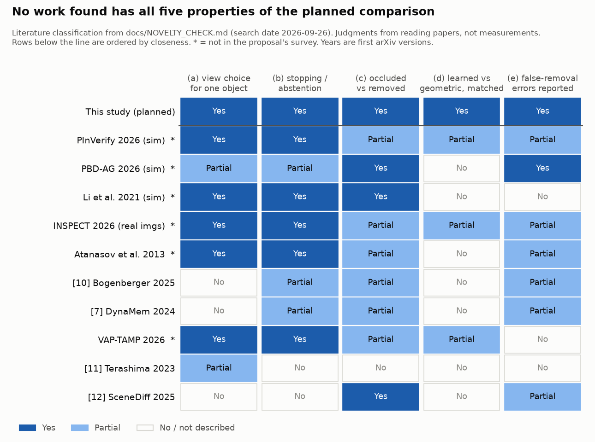

# 2026-09-26: Novelty check for the week-2 gate

**Question:** Does the closest active-perception work already contain the planned comparison (learned vs geometric vs fixed/random view selection under one shared stopping rule, for present / removed / unknown verification under occlusion)? The full write-up, with quotes and section references, is in [`docs/NOVELTY_CHECK.md`](../docs/NOVELTY_CHECK.md).

**Short answer:** No paper found contains the comparison. However, four papers not in our survey are closer than the three we named ([7] DynaMem, [10] Bogenberger et al., [11] Terashima et al.). The claims need to narrow; the topic does not need to change.



The figure shows the rubric from `docs/NOVELTY_CHECK.md`. The classifications are my reading of the papers, not measurements. To regenerate it:

```
uv run --no-project --with matplotlib python notes/figures/2026-09-26/make_novelty_rubric.py
```

## What I did

- **Read the four papers the proposal names as closest in full.** I downloaded each arXiv PDF and converted it with `pdftotext`: DynaMem v2, Bogenberger et al. v2, Terashima et al. v2 and SceneDiff v2.
- **Searched for work the survey missed:**
  - 22 web-search phrasings;
  - 10 arXiv abstract searches;
  - forward citations from Semantic Scholar for 8 papers (DynaMem alone has 59 citing papers).
- **Read the new close papers:** four in full (PInVerify, PBD-AG, Li et al. 2021, INSPECT) and three in targeted sections (Atanasov et al. 2013, VAP-TAMP, a detector-confidence audit). 22 others were screened by abstract only (see the abstract-only table in `docs/NOVELTY_CHECK.md`). *(Evidence check: the figure caption said "eleven" and this line said "about 20"; the figure has ten related works and the table lists 22 papers.)*

## What I learned

- **PInVerify (May 2026)** is almost our protocol, applied to a different question. It uses an offline replay of 6 pre-captured views and one adaptive stopping rule, and compares random, *angular farthest-point* (essentially our G without occlusion flags or a travel penalty) and MLLM view selection. The three strategies land "within 0.2 pp of each other". The difference from us is its task: it checks whether a *present* object matches a description. It has no removed class, and it runs in simulation.
- **PBD-AG (Aug 2026)** already implements the idea behind H1. A missed detection counts as negative evidence only if a depth-based visibility gate passes, and an object is removed only after three or more admissible misses. It reports false absence of 0.014, rising to 0.262 without the gate (simulation, RGB-D).
- **Li et al. (IROS 2021)** is the closest *task*. A robot circles a table in 30° steps and learns when to stop, to decide whether a queried object exists behind an occluder. The learned policy "learns to always choose one direction to move". In effect it became a fixed order.
- **Terashima et al.** explicitly leave "occluded vs removed" out of scope. DynaMem handles occlusion only at the voxel level (ray casting against RGB-D depth). Bogenberger et al. revisit stale *regions*; they do not choose a view to check a specific object.
- **A design point surfaced during the check.** With 5 positions and a primary budget of 3 extra views, a policy that never stops early sees 3 of the 4 unvisited positions. A and G can then differ only in which single view they skip and in the order they visit. So budgets 1-2 matter most for the selection comparison.

## Open items

- I have not read the PBD-AG supplement. Its conclusion mentions "paired acquisition experiments ... under bounded budgets", and this is the most concrete unchecked lead that could narrow the distinction further.
- Proceedings-only work (IEEE Xplore without an arXiv version) is under-covered. The check should be repeated before the final report, because three of the closest papers appeared on arXiv in May-September 2026.
