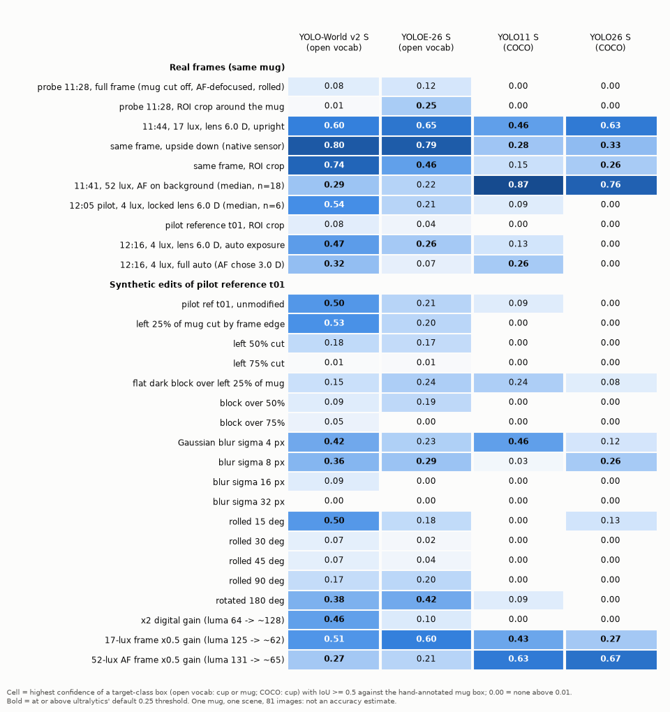
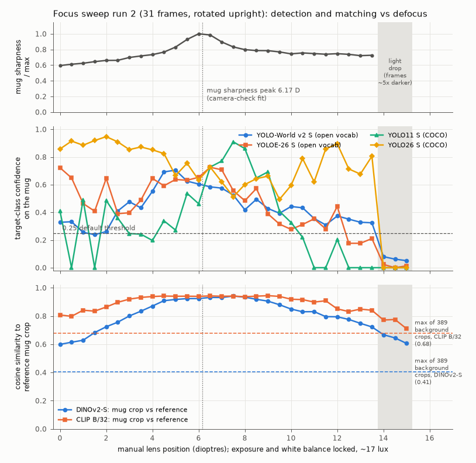
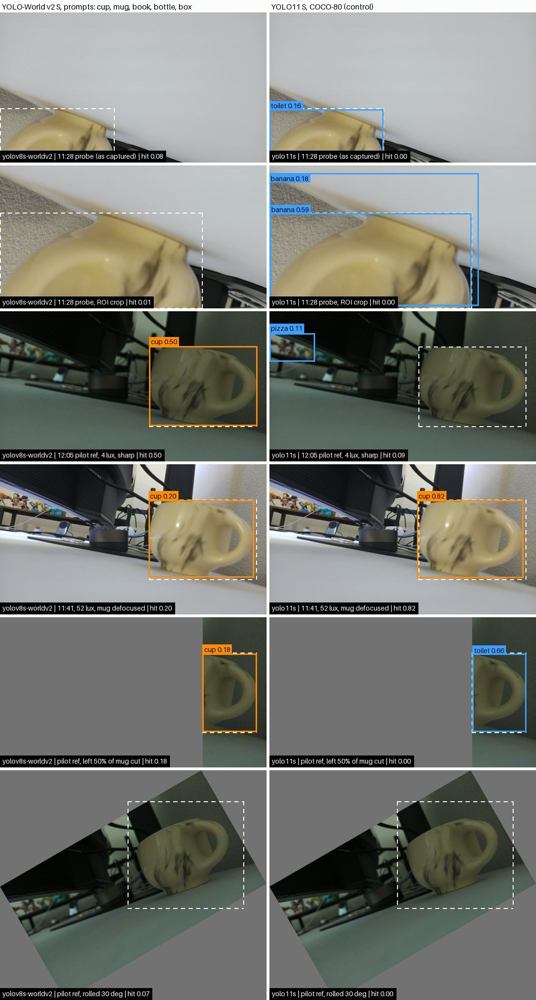
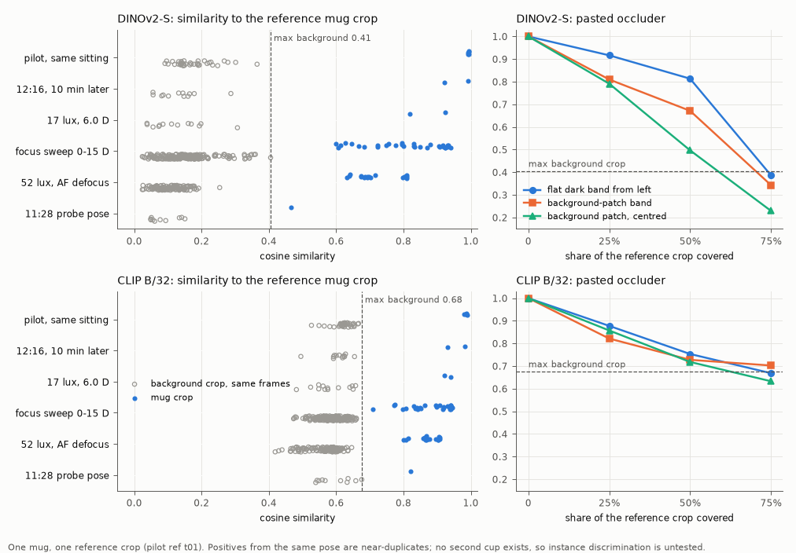
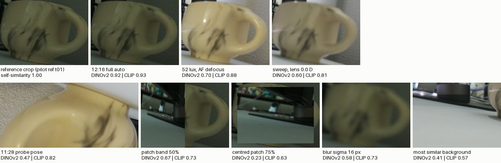

# 2026-09-26 — First perception front-end check on the GB10

Week 3, Saturday, 12:10–12:35 PDT. The week-2 gate asks that "the front end works on clearly visible
targets". Today there is one camera pose, one mug, and no occluders or other study objects. This entry
checks whether the proposed front end runs on the GB10 and behaves sensibly on that one mug. The front
end is a small YOLO-World checkpoint that proposes candidates, plus reference-crop matching with a frozen
image encoder. **This is a smoke test, not an evaluation.** Every number below describes one mug in
one desk scene.

**Summary**

- **CUDA works.** The official PyTorch cu130 aarch64 wheel (torch 2.12.1+cu130) sees the GB10
  (compute capability 12.1). A 4096² fp32 matmul matches fp64 to a relative error of 2.9e-6. No CPU
  fallback was needed.
- **Finding the mug was not the problem when all of it was in the frame.** There were 54 unedited
  frames of the current pose, at 4, 17 and 52 lux and lens positions from 0 to 13.5 D. In all 54,
  YOLO-World v2 S put a cup/mug box on the mug (IoU ≥ 0.5 with a hand-drawn box) at confidence ≥ 0.10.
  In 47 of them the confidence was ≥ 0.25. It never placed a cup/mug box elsewhere at ≥ 0.25.
- **The label confidence swings with lighting, and differently for each model.** YOLO11 S (COCO)
  called the mug "cup" at 0.82–0.91 in 52-lux light. On all 8 dim (4 lux) frames, YOLO26 S (COCO)
  gave "cup" 0.00; its top label on the mug there was "apple" (0.25–0.33, 6 frames) or "mouse" (2
  frames). YOLO-World went the other
  way: 0.48–0.58 on the six dim pilot frames (0.47 and 0.32 on the two dim 12:16 stills), and
  0.20–0.52 in bright light with the mug defocused. *(The range for the 12:16 stills was added in the
  evidence check; the first version gave 0.48–0.58 for "dim", which covers only the pilot frames.)* Doubling the brightness of
  a dim frame digitally did not bring the COCO models back, so average brightness alone does not
  explain the drop.
- **The 11:28 probe frame defeated every detector.** In that frame the mug is cut off by the frame
  edge, out of focus and rolled. The best cup/mug score was 0.12 (YOLOE-26 S), and 0.08 for
  YOLO-World. Cropping around the mug did not reliably help: YOLOE rose to 0.25, YOLO-World fell to
  0.01, and the COCO models called the crop "banana" or "person". Synthetic edits of a good frame reproduce each
  cause separately. For YOLO-World: 50 % or 75 % of the mug cut off gave 0.18 / 0.01; a 30° or 45°
  roll gave 0.07; Gaussian blur with σ = 16 px gave 0.09.
- **Matching separated the mug from the background in this scene.** DINOv2-S scored all 59 real mug
  crops at ≥ 0.466 (the lowest was the probe) and all 389 same-size background crops at ≤ 0.405.
  CLIP B/32 left a much narrower gap: mug crops ≥ 0.710, background ≤ 0.676. Covering 75 % of the
  reference crop with a pasted occluder dropped DINOv2 similarity to 0.23–0.39, inside the background
  range.
- **What this means for the gate.** The front end runs end to end on the GPU at about 4 ms per image
  plus about 8 ms per crop embedding, and it handles one clearly visible object in the current pose. It
  does **not** show that the front end works on the study's 6–10 objects, can tell look-alike
  instances apart, copes with real occluders, or works across five views. Read literally, the gate
  criterion is met only as a smoke test on one object.

---

## 1. Environment

| Item | Value (from `perception/env_check.py`, `runs/…/pip_freeze.txt`, `detect/env.json`) |
| --- | --- |
| Host | GB10, aarch64, driver 595.84 (nvidia-smi reports CUDA 13.2), Python 3.12.3 (system; `.python-version` = 3.12) at the time of this run. *Since 16:50 the environment is CPython 3.13.5 to match the Pi; the run reproduced exactly (§9).* |
| torch / torchvision | 2.12.1+cu130 / 0.27.1+cu130, from `https://download.pytorch.org/whl/cu130` (explicit uv index) |
| CUDA runtime / cuDNN | 13.0 (torch build), nvidia-cuda-runtime 13.0.96 / cuDNN 9.20.0.48 |
| Device | `NVIDIA GB10`, capability (12, 1); torch arch list `sm_80 … sm_120` (no sm_121 entry, but kernels ran and the check passed) |
| GPU check | 4096³ matmul: fp32 7.46 ms (18.4 TFLOP/s), max relative error vs fp64 2.9e-6; fp16 1.76 ms (78.2 TFLOP/s). Not a benchmark: 20 iterations, one run |
| ultralytics | 8.4.163 (pinned); YOLO-World text encoder: `clip @ git+https://github.com/ultralytics/clip@a13192f` |
| Matching | transformers 5.17.0 (DINOv2-S, HF `facebook/dinov2-small` rev `ed25f3a`), open-clip-torch 3.3.0 (ViT-B-32 `laion2b_s34b_b79k`) |
| Other | numpy 2.5.3, pillow 12.3.0, opencv-python 5.0.0.93, matplotlib 3.11.2, timm 1.0.30 |

| Checkpoint (in `checkpoints/`, gitignored) | Role | sha256 (first 16) |
| --- | --- | --- |
| `yolov8s-worldv2.pt` | open vocabulary, the proposal's "small YOLO-World checkpoint" | `9b2c17ab6124a913` |
| `yoloe-26s-seg.pt` | open vocabulary, YOLOE-26 S (successor in ultralytics 8.4); text prompts, boxes only | `48f24206bc8680d6` |
| `yolo11s.pt` | closed-set COCO-80 control | `85a76fe86dd8afe3` |
| `yolo26s.pt` | closed-set COCO-80 control, current generation | `646f8bc3fe0a6568` |

**What needed care (nothing failed outright):**

- Importing ultralytics the first time created `~/.config/Ultralytics/settings.json` with
  `sync: true` (anonymous usage analytics on predict/train/val/export) and `weights_dir` pointing at
  `<repo>/weights/`. The CLIP text encoder (338 MB) then landed in `<repo>/weights/clip/`, and YOLOE's
  `mobileclip2_b.ts` (242 MB) landed in the repo root. Both files were moved into `checkpoints/`.
  The global settings file was deleted: it did not exist before this session, and no prediction ran
  under it.
- `perception/common.py` now sets `YOLO_CONFIG_DIR=checkpoints/ultralytics_config` and creates the
  directory first; otherwise ultralytics silently falls back to `/tmp/Ultralytics`. It also sets
  `YOLO_AUTOINSTALL=false`. After import, it pins `sync: false` and `weights_dir: checkpoints/`.
- Every `uv run` reinstalls `nvidia-cusparselt-cu13` ("Uninstalled 1 package / Installed 1 package").
  This is harmless and was not investigated.

## 2. What was run

```bash
# environment (repo root)
uv sync                                         # pyproject.toml + uv.lock; torch from the cu130 index
uv run python perception/env_check.py

# two fresh stills for this check (Pi, 12:16; scene and pose unchanged since the 12:05 pilot, ~3.9 lux)
ssh -o BatchMode=yes ai-pi 'cd ~/cmpe249/perception-smoke/2026-09-26 && \
  rpicam-still -n --width 2304 --height 1296 --mode 2304:1296:10:P -q 93 --rotation 180 --lens-position 6.0 -t 3000 \
    --metadata now_lens6_autoexp.json --metadata-format json -o now_lens6_autoexp.jpg && \
  rpicam-still -n --width 2304 --height 1296 --mode 2304:1296:10:P -q 93 --rotation 180 -t 3000 \
    --metadata now_fullauto.json --metadata-format json -o now_fullauto.jpg'   # verbatim in commands.log there
rsync -a ai-pi:cmpe249/perception-smoke/2026-09-26/ data/raw/2026-09-26_perception-smoke/

# smoke test, matching check, tables and figures
uv run python perception/manifests/make_2026-09-26_smoke.py
uv run python perception/smoke_test.py --manifest perception/manifests/2026-09-26_smoke.json \
    --out runs/2026-09-26-perception-smoke/detect
uv run python perception/match_check.py --manifest perception/manifests/2026-09-26_smoke.json \
    --detections runs/2026-09-26-perception-smoke/detect/detections.jsonl --out runs/2026-09-26-perception-smoke/match
uv run python perception/report_smoke.py --run runs/2026-09-26-perception-smoke \
    --manifest perception/manifests/2026-09-26_smoke.json --figs notes/figures/2026-09-26
```

The detector pass is 81 images × 4 models × 5 timed runs and took 21 s. The matching pass took 13 s.
Detections are deterministic: two full runs gave identical confidences.

**Inputs** (81 manifest entries; all frames 2304 × 1296 from the imx708):

| Group | n | What it is |
| --- | --- | --- |
| probe | 2 | The orchestrator's 11:28 full-auto still at an earlier camera pose: mug cut off at bottom-left, out of focus (AF), scene rolled. Full frame plus a hand-picked crop |
| sweep_best | 3 | Sweep run 2 at 6.0 D (11:44, 17 lux, closest step to the 6.17 D mug sharpness peak): upright, native upside-down, and cropped |
| sweep_series | 31 | All of sweep run 2 (0–15 D, exposure and white balance locked), rotated upright. Steps 14.0–15.0 D came after a light drop: about 5× less light by rpicam's Lux (15.6 → 3.1), and mean 8-bit luma 122 → 42 (about 2.9×) |
| af_bright | 18 | 11:41 autofocus stills at 52 lux; AF chose 0–3 D, so the mug is soft |
| pilot | 7 | 12:05 capture-tool pilot at 4 lux, locked lens 6.0 D (2 references, 3 queries, the calibration still) plus a crop of reference t01 |
| now | 2 | 12:16 stills above: lens locked at 6.0 D, and full auto (AF chose 3.03 D) |
| synthetic | 18 | Edits of pilot reference t01: frame-edge truncation (25/50/75 % of the mug painted letterbox-grey), a flat dark block over 25/50/75 % of the mug, Gaussian blur σ 4/8/16/32 px, roll 15/30/45/90/180°, digital gain (×2 on the pilot frame, ×0.5 on a 17-lux and a 52-lux frame) |

Mean luma (inline PIL): pilot reference 64.0; 12:16 lens-locked still 61.1; 17-lux sweep frame 124.5;
52-lux AF still 130.9; probe 178.8.

**Scoring.** The agent (not the student) hand-annotated the mug box from 100 px grid overlays, to
about ±15 px. The same box applies to every frame of the 11:39+ pose; the probe has its own box. The
image operations transform the box together with the image. Terms used below:

- **hit**: a target-class box with IoU ≥ 0.5 against the hand box. For the open-vocabulary models
  the target classes are `cup` or `mug`; for the COCO models, `cup`.
- **false positive**: a target-class box with IoU < 0.1.
- **top box on the mug**: the highest-confidence box of *any* class with IoU ≥ 0.5.

Detections are recorded down to 0.01. Other settings: imgsz 640, NMS IoU 0.7, fp32, batch 1. The
prompt catalog is `cup, mug, book, bottle, box`.

## 3. Detection results

### 3.1 Frames with the whole mug in view (unedited)

| Frames | n | YOLO-World v2 S | YOLOE-26 S | YOLO11 S | YOLO26 S |
| --- | --- | --- | --- | --- | --- |
| pilot + 12:16, 4 lux (lens 6.0 D, except one AF still) | 8 | 8 / 8 / 8 / 0 | 2 / 7 / 7 / 0 | 1 / 3 / 4 / 0 | 0 / 0 / 8 / 0 |
| focus sweep 0–13.5 D, 17 lux | 28 | 27 / 28 / 28 / 0 | 25 / 28 / 28 / 0 | 16 / 21 / 28 / 0 | 28 / 28 / 28 / 1 |
| of which in the mug's in-focus band, 5.0–7.5 D | 6 | 6 / 6 / 6 / 0 | 6 / 6 / 6 / 0 | 6 / 6 / 6 / 0 | 6 / 6 / 6 / 0 |
| AF stills, 52 lux (mug defocused) | 18 | 12 / 18 / 18 / 0 | 8 / 18 / 18 / 0 | 18 / 18 / 18 / 0 | 18 / 18 / 18 / 2 |

Each cell gives four frame counts:

1. hit at ≥ 0.25 (ultralytics' default threshold);
2. hit at ≥ 0.10;
3. a box of any class on the mug at ≥ 0.10;
4. a false positive at ≥ 0.25.

The totals over the 54 frames are:

| Model | hit at ≥ 0.25 | hit at ≥ 0.10 |
| --- | --- | --- |
| YOLO-World v2 S | 47 | 54 |
| YOLOE-26 S | 35 | 53 |
| YOLO11 S | 35 | 42 |
| YOLO26 S | 46 | 46 |

### 3.2 Every condition



Real frames, with the top box on the mug shown where it was not a cup/mug. The full table is in
`runs/2026-09-26-perception-smoke/report/conditions.md`.

| Condition | YOLO-World v2 S | YOLOE-26 S | YOLO11 S | YOLO26 S |
| --- | --- | --- | --- | --- |
| probe 11:28, full frame | 0.08 | 0.12 | 0.00 (toilet 0.16) | 0.00 (toilet 0.24) |
| probe 11:28, crop around the mug | 0.01 | 0.25 | 0.00 (banana 0.59) | 0.00 (person 0.35) |
| 11:44, 17 lux, 6.0 D, upright | 0.60 | 0.65 | 0.46 | 0.63 |
| same frame, upside down | 0.80 | 0.79 | 0.28 | 0.33 (vase 0.57) |
| same frame, crop | 0.74 | 0.46 | 0.15 | 0.26 (vase 0.62) |
| 11:41, 52 lux, AF on background (median of 18, range) | 0.29 (0.20–0.52) | 0.22 (0.13–0.36) | 0.87 (0.82–0.91) | 0.76 (0.54–0.82) |
| 12:05 pilot, 4 lux (median of 6, range) | 0.54 (0.48–0.58) | 0.21 (0.15–0.27) | 0.09 (0.07–0.21) | 0.00 (all 6; apple 0.25–0.31 or mouse 0.22–0.27) |
| pilot reference t01, crop | 0.08 | 0.04 | 0.00 (elephant 0.26) | 0.00 (apple 0.35) |
| 12:16, 4 lux, 6.0 D | 0.47 | 0.26 | 0.13 (vase 0.15) | 0.00 (apple 0.31) |
| 12:16, 4 lux, full auto (AF 3.0 D) | 0.32 | 0.07 | 0.26 | 0.00 (apple 0.33) |

Synthetic edits of pilot reference t01, which scores 0.50 / 0.21 / 0.09 / 0.00 unedited:

- **Truncation.** YOLO-World's score was 0.53, 0.18 and 0.01 with 25 %, 50 % and 75 % of the mug
  cut. The COCO models scored 0.00 as cup throughout; YOLO11 S called the half mug a "toilet"
  (0.66).
- **Flat dark block.** Covering 25 %, 50 % and 75 % of the mug gave 0.15, 0.09 and 0.05
  (YOLO-World).
- **Blur.** σ 4, 8, 16 and 32 px (1.1–8.9 px at the 640 px input) gave 0.42, 0.36, 0.09 and 0.00.
- **Roll.** 15°, 30°, 45°, 90° and 180° gave 0.50, 0.07, 0.07, 0.17 and 0.38.
- **Brightness.** ×2 digital gain on the pilot frame gave YOLO-World 0.46, and YOLO11 S / YOLO26 S
  still 0.00. Halving the 17-lux frame left YOLO11 S at 0.43, and halving the 52-lux frame left it at
  0.63. Brightness alone does not explain why the COCO models fail on the 4-lux frames. Sensor noise
  at gain 7.8 and colour rendering are candidates; neither was tested.

### 3.3 Detection vs defocus (real frames)



- Along the 17-lux focus sweep, only YOLO-World roughly follows mug sharpness:
  - YOLO-World v2 S peaks at 0.70 around 4.5–5.0 D and falls to 0.24–0.33 at 0–2 D.
  - YOLOE-26 S ranges 0.18–0.73 with no clear relation to focus (0.72 at 0 D).
  - YOLO26 S stays at 0.49–0.95 everywhere except the light-drop frames.
  - YOLO11 S swings between 0.00 and 0.91 from one step to the next. At this level, the score of a
    single frame is not a stable signal.
- All four collapse (≤ 0.08) on the light-drop frames at 14.0–15.0 D. With exposure locked, those
  frames got about 5× less light by the Lux estimate (15.6 → 3.1). Their mean 8-bit luma fell from 122
  to 42, about 2.9×, because the JPEG values are gamma-encoded. A mid-session lighting change under a locked exposure is therefore a
  detection failure, not just a pixel-statistics shift.

### 3.4 Overlays



*The dashed white box is the hand-drawn box. Detections ≥ 0.10 are drawn: orange for target classes,
blue for others. All overlays for all four models are in `runs/2026-09-26-perception-smoke/detect/overlays/`.*

### 3.5 Prompts, occluder classes, latency

- **"cup" vs "mug".** In YOLO-World, "cup" was the best-scoring class in 79 of 80 hits. The "mug"
  prompt reached ≥ 0.10 on the mug in only 2 of 81 images (max 0.29). The wording of the prompt
  matters for this object.
- **No book, bottle or box is in the scene.** Across the 58 real frames, the highest score for those
  prompts was 0.09 (YOLO-World) and 0.14 (YOLOE). So there are no spurious occluder detections here,
  but detecting real occluders is untested. The 58 frames are the distinct full frames: no ROI crops
  and no `sweep_best` copies. These numbers were first counted inline; `report_smoke.py` now writes
  them to `report/occluder_prompts.json`.
- **Warm latency on the GB10.** Batch 1, 640 px, fp32, image already decoded; the median of per-image
  medians over 81 images × 5 runs. The detector timing covers preprocessing, inference and NMS; the
  encoder timing covers crop preparation and the forward pass. These numbers say nothing about the Pi,
  the Hailo or the Jetson.

| Model | ms | min | max |
| --- | --- | --- | --- |
| YOLO-World v2 S | 3.98 | 3.61 | 5.63 |
| YOLOE-26 S | 5.83 | 5.13 | 7.76 |
| YOLO11 S | 3.76 | 3.45 | 5.19 |
| YOLO26 S | 4.21 | 3.87 | 5.57 |
| DINOv2-S, one 224 px crop | 8.32 | 7.66 | – |
| CLIP B/32, one 224 px crop | 8.81 | 8.18 | – |

  An earlier identical run gave 3.70 ms for YOLO-World, so treat about ±0.3 ms as run-to-run noise.
  Two code-review re-runs gave 3.95 / 3.70 (YOLO-World), 5.75 / 5.38 (YOLOE-26 S), 3.70 / 3.42
  (YOLO11 S), 3.83–4.12 (YOLO26 S), and 7.91–8.02 / 8.78–8.87 ms for the two encoders. Differences
  of up to about 0.45 ms are therefore run-to-run noise too. *(Evidence check: the logs of the first
  re-run are only in the session scratchpad; the second is in `runs/2026-09-26-perception-smoke-review/`.
  A third detector re-run at 13:05 gave 3.71 / 5.41 / 3.44 / 3.84 ms, with detections identical to this
  run. Output is in `data/raw/2026-09-26_evidence-check/`.)*

## 4. Reference-crop matching (sanity check)

**This is a single-object, single-viewpoint sanity check, not an evaluation.**

- **Reference.** One crop: the mug in pilot reference t01, 925 × 688 px at the hand box.
- **Mug crops ("positives").** 59 crops from 57 distinct frames. One frame, sweep run 2 at 6.0 D,
  appears three times: twice upright, as pixel-identical crops in the `sweep_best` and `sweep_series`
  sets, and once upside down. (Corrected in code review; this entry first said "twice".)
- **Background crops.** Same size as the frame's mug box, drawn randomly with seed 0. Each contains
  at most 10 % of the mug's area, and they overlap each other with IoU < 0.5.
- **Encoders.** DINOv2-S (pooler/CLS output) and CLIP B/32 (image tower). Crops are padded to a
  square with grey, resized to 224 px and normalised with each model's mean and std.
- **Limits.** There is no second cup, so nothing here tests whether the encoder can tell this mug
  from a similar one. The 5 pilot positives were shot seconds apart with locked settings, so they are
  near-duplicates.

| Crop set | n | DINOv2-S min / median | CLIP B/32 min / median |
| --- | --- | --- | --- |
| mug, pilot frames, same sitting (P1, 4 lux) | 5 | 0.992 / 0.993 | 0.981 / 0.987 |
| mug, 12:16 stills (10 min later) | 2 | 0.922 / 0.957 | 0.932 / 0.958 |
| mug, 17-lux frame at 6.0 D (upright; upside down) | 2 | 0.820 / 0.872 | 0.922 / 0.930 |
| mug, focus sweep 0–15 D, 17 lux | 31 | 0.599 / 0.830 | 0.710 / 0.916 |
| mug, 52-lux AF stills (defocused) | 18 | 0.632 / 0.696 | 0.800 / 0.868 |
| mug, 11:28 probe (other pose, cut off, defocused) | 1 | 0.466 | 0.822 |
| background crops from the same frames | 389 | median 0.135, **max 0.405** | median 0.586, **max 0.676** |





*The most similar background crop includes a sliver of the mug at its right edge; the sampling rule
allows up to 10 % of the mug.*

| Augmentation of the reference crop | DINOv2-S | CLIP B/32 |
| --- | --- | --- |
| brightness ×0.5 / ×0.7 / ×1.4 / ×2.0 | 0.981 / 0.994 / 0.993 / 0.993 | 0.911 / 0.977 / 0.987 / 0.973 |
| Gaussian blur σ 2 / 4 / 8 / 16 px | 0.993 / 0.977 / 0.844 / 0.582 | 0.989 / 0.931 / 0.823 / 0.731 |
| flat dark band from the left, 25 / 50 / 75 % | 0.917 / 0.814 / **0.387** | 0.878 / 0.753 / **0.669** |
| band made of a background patch, 25 / 50 / 75 % | 0.810 / 0.672 / **0.344** | 0.822 / 0.728 / 0.703 |
| centred background patch, 25 / 50 / 75 % | 0.791 / 0.497 / **0.230** | 0.857 / 0.718 / **0.633** |
| *max background crop, for comparison* | *0.405* | *0.676* |

Bold means below the maximum background crop.

- **Separation.** DINOv2-S separated every real mug crop from every background crop. The narrowest
  gap was the probe crop: 0.466 against 0.405. CLIP B/32 also separated them, but the gap was
  0.710 against 0.676 (focus-sweep step 15.0 D) and 0.822 against 0.676 for the probe. DINOv2's
  wider spread makes it the better default for this cue, on this evidence alone.
- **Brightness hardly matters.** DINOv2 stays ≥ 0.98 across ×0.5–×2 gain. **Blur and occlusion
  dominate.** With 75 % of the crop covered, both encoders fall to the level of background crops or
  below. At 50 %, the score depends on what covers the mug and where.
- **Ranking detector proposals.** For each real frame, all YOLO-World proposals of any class at
  conf ≥ 0.01 were ranked by similarity (the per-group median was 2–10.5 proposals per frame). The most similar proposal was
  the mug in 59 of 59 frames for both encoders. Against proposals that barely touch the mug
  (IoU < 0.1), the smallest margin was 0.32 for DINOv2 and 0.11 for CLIP. However, the proposal with
  the highest cup/mug confidence was also the mug in all 59 frames. With a single cup in the scene,
  this adds no evidence about identity.

## 5. What this does and does not say about the gate (interpretation)

**Supported, for this mug in this scene:**

- The proposed pipeline, a small YOLO-World checkpoint plus a frozen encoder, runs on the GB10 with
  CUDA and needs no workarounds beyond keeping ultralytics' files inside the repo.
- When the whole mug is in the frame, the open-vocabulary detector finds it in every lighting level
  and focus setting tried (54/54 at ≥ 0.10).
- The matching score separates the mug from background regions, including in frames where the
  detector's class confidence was low.

**Not shown:**

- Detection or matching for the study's 6–10 objects.
- Telling two similar objects apart.
- Behaviour under real occluders; the occlusion here is pasted rectangles.
- Behaviour at the other four camera positions.
- The present / removed / unknown decision itself.
- Any calibrated threshold. Confidence scales differ between models and conditions: the same visible
  mug scored anywhere from 0.00 to 0.91.

The gate's other half, "meaningful differences between camera views", cannot be tested with one
viewpoint.

**Carry into the capture protocol and design:**

1. **Framing is a precondition, not a detail.** The probe failed because of how it was framed, and
   the synthetic edits point the same way. Truncation beyond about a quarter of the mug, a roll of
   30–90°, or heavy defocus each pushed YOLO-World below 0.2. *(The evidence check narrowed this from
   "30° or more": a 180° rotation gave 0.38.)* Keep every target fully inside
   the frame from all five stops, keep the camera level (15° was tolerated here and 30° was not),
   and lock focus on the workspace. This backs the rig recommendation in
   `notes/2026-09-26-camera-check.md` §5.
2. **Lighting interacts with the model.** The COCO models and YOLO-World reacted in opposite
   directions to the same lighting change. Choose the detector under the study's own L1 and L2
   lamps, and check per-lighting detection on the development set. Otherwise the lighting factor in
   the 2 × lighting design partly measures the detector.
3. **Prompt wording matters.** "cup" worked and "mug" barely fired. Choose prompts, or synonym sets,
   per object during the pilot, and record them with the checkpoint's sha256.
4. **Occlusion pushes the match score into the background range.** With any match threshold above
   the background crops, a 75 %-occluded mug would count as "no match", so a rule of "no match means
   absent" would call it removed. This supports the proposal's requirement that
   absence evidence needs a low estimated obstruction and adequate image quality. Blur also pulls
   similarity down (σ 16 px: 0.58), so the image-quality check has to cover focus as well as
   exposure.
5. **No detector decision yet.** YOLO-World v2 S was the only model with a hit at ≥ 0.25 on all 8
   dim frames, but it was the weakest on bright, defocused frames. YOLO26 S was strong at 17–52 lux
   and scored zero at 4 lux. One object cannot decide this. Run YOLO-World v2 S (the proposal's
   choice) and YOLOE-26 S on the pilot arrangements, with a COCO model as a control.

## 6. Next perception steps (once the camera is reframed and objects and occluders are added)

1. **Rig first.** Build the rig and lighting from camera-check §5, then run its acceptance checks:
   a lens sweep, locked stills in good light, and a drift series. Re-run `smoke_test.py` on one
   still per stop to confirm the whole workspace is detectable from all five positions before any
   pilot arrangement is shot.
2. **Pilot arrangements that can fail.** Use 6–10 objects, including at least two look-alike
   targets (for example two similar mugs) so matching faces a real identity test. Add real occluders
   from the catalog (book, box, bottle) in the matched layouts the protocol requires. Shoot 2–3
   arrangements × 5 positions × 3 target conditions × 2 lighting levels with `pi_capture.py`.
3. **Annotations.** The student should annotate the reference boxes (target crop and expected region)
   and per-query visibility labels. The boxes used today were annotated by the agent and are
   provisional.
4. **Per-view evidence record.** Extend `smoke_test.py` into a front-end module that emits, for each
   query view:
   - detector candidates;
   - the best reference-match score within and near the expected region;
   - overlap of non-target detections with the expected region (the occlusion cue);
   - an image-quality score (luma and a focus measure such as the Laplacian ratio from
     `analyze_camcheck.py`).

   Log the model, prompts and checkpoint sha256 on every record, as `EXPERIMENT_PLAN.md` asks.
5. **Model and threshold selection on development folds only.** Compare YOLO-World v2 S and
   YOLOE-26 S (and prompt sets) by target recall at a fixed false-positive rate. Compare DINOv2-S and
   CLIP B/32 (and DINOv2-B if needed) by how well they separate look-alike instances. Choose match
   and quality thresholds on validation folds grouped by arrangement, then freeze them before test
   collection.
6. **Replace the pasted rectangles with real occluders.** Measure how the match score falls as the
   annotated visible fraction drops, and check whether the 2D overlap cue flags the views where it
   does.

## 7. Update after code review (12:40–13:00)

**Nothing in §§1–6 changed numerically.** The fixes below were checked by re-running all three
scripts. Detections (`summary.csv` apart from latency, and `detections.csv`) and all 1 722
similarity rows came out identical to this entry's run. So did every report table apart from latency,
and all five figures were pixel-identical. The re-run is in `runs/2026-09-26-perception-smoke-review/`,
with its commands in the `README.txt` there.

- **Pinned model weights.** `match_check.py` now loads DINOv2-S at the Hugging Face revision this run
  resolved to (`ed25f3a3…`). CLIP B/32 is loaded from a pinned revision (`1a25a446…`) of
  `laion/CLIP-ViT-B-32-laion2B-s34B-b79K`, file sha256 `ac4f8c4b…`. Both used to follow whatever
  version was newest upstream. `pyproject.toml` pins the `clip` git dependency to commit `a13192f8…`.
  `uv.lock` already resolved to that commit; the only lock change is the source URL.
- **Recorded provenance.** Both `env.json` files now record:
  - the sha256 of every `perception/*.py` file (the code is not committed yet, so a git hash would
    not identify it), plus `uv.lock` and the manifest;
  - the git HEAD;
  - the versions of torch, ultralytics, transformers, open_clip, numpy, pillow and the other
    libraries.
  `smoke_test.py` also records the sha256 of the two prompt text encoders: `clip/ViT-B-32.pt` for
  YOLO-World and `mobileclip2_b.ts` for YOLOE. `match_check.py` records the sha256 of the detections
  file it read.
- **The `nvidia-cusparselt-cu13` reinstall on every `uv run`, explained.** The wheel's `WHEEL` file
  declares the tag `py3-none-manylinux2014_sbsa`, but its filename says `aarch64`. uv logs "Platform
  tags mismatch" and reinstalls the same cached wheel on every run. This is an upstream packaging
  quirk and is harmless.
- **The global Ultralytics settings file is back.** `~/.config/Ultralytics/settings.json` exists
  again, with `sync: true`. It was created at 12:37:26 by a process run from this session's scratchpad
  (its `datasets_dir` points to `scratchpad/py314/datasets`), not by these scripts. They pin their own
  config directory, `checkpoints/ultralytics_config` (`sync: false`), which was unchanged. The file was
  left in place for the main session to decide on. *(Evidence check at 13:06: `~/.config/Ultralytics/`
  no longer exists, so someone removed it after this was written.)*

## 8. Evidence check (13:00–13:25)

All numbers in §§1–5 were traced to `runs/2026-09-26-perception-smoke/` or recomputed. The scripts
and outputs are in `data/raw/2026-09-26_evidence-check/` (gitignored).

- **Recomputed from the raw CSVs and matched:**
  - the §3.1 counts, from `detections.csv` with a separate script;
  - the YOLO26 S dim-frame labels (apple ×6 at 0.25–0.33, mouse ×2);
  - the §3.3 sweep ranges and the light-drop collapse;
  - all §4 matching statistics: 59 positives, minimum 0.466 on the probe; 389 negatives, maximum
    0.405; CLIP minimum 0.710 at 15.0 D; proposals top-1 is the mug in 59/59 frames; margins 0.32
    and 0.11.
- **Re-read and matched:**
  - the checkpoint sha256 prefixes and package versions (from `pip_freeze.txt`);
  - the 12:16 metadata: AF at 3.03 D, Lux 3.86 and 3.97;
  - the mean-luma values;
  - the 21 s and 13 s run times.
- **Re-run:** `smoke_test.py` gave byte-identical detections.
- **Corrections, marked inline:**
  - the YOLO-World dim range in the summary;
  - "5× darker", which is 5× by Lux but 2.9× in 8-bit luma;
  - the roll range in §5;
  - the proposal-count median;
  - the status of the global Ultralytics file.
- **Not re-checked:** the hand-drawn mug box itself (±15 px) and the synthetic-edit geometry.

## 9. Update: environment moved to CPython 3.13.5 to match the Pi (16:49–17:00)

The student asked for one Python version on both machines. The Pi has to stay on its system
CPython 3.13.5 (Debian 13), because its apt-built picamera2, libcamera and HailoRT bindings target that
interpreter. So the GB10 moved instead. **Under 3.13.5, every detection, similarity, report table,
overlay and figure of the smoke test came out identical.** Only the timing values differ: latency
and the unseeded GPU check. The Pi stills and the evidence-check items were not re-run, since they
do not depend on the GB10's Python.

- **What changed.** `.python-version` went from `3.12` to `3.13.5`, now a uv-managed build
  (`uv python install 3.13.5`). The system `/usr/bin/python3` (3.12.3) was not touched. In
  `pyproject.toml`, `requires-python` is now `>=3.13,<3.14`. `uv lock` resolved the same 81 packages
  at **the same versions**. The only changes in the lock were `requires-python` and the wheel entries.
  14 compiled packages moved from their cp312 wheel to the cp313 wheel of the same version: torch,
  torchvision, triton, numpy, pillow, matplotlib, contourpy, kiwisolver, fonttools, cuda-bindings,
  markupsafe, pyyaml, regex and charset-normalizer. psutil keeps its abi3 wheel; the lock only added
  an unused free-threaded (cp313t) entry for it. `uv sync --locked` built
  nothing from source. The one git dependency, `clip`, reused its cached `py3-none-any` wheel. The
  `pip freeze` output is identical to the 3.12 one.
- **Checks.**
  - `env_check.py` passed: Python 3.13.5, torch 2.12.1+cu130, CUDA available, GB10 capability
    (12, 1). The fp32 matmul error against fp64 was 2.5e-6; the matrices are unseeded, so this value
    changes from run to run.
  - Every third-party import in `perception/` worked: numpy, PIL, matplotlib, torch, ultralytics,
    transformers, open_clip and huggingface_hub. So did torchvision, clip, timm and cv2, which the
    models pull in.
  - YOLO-World v2 S and DINOv2-S (pinned revision) loaded and ran on `cuda:0`.
  - `~/.config/Ultralytics/` was not created.
- **Reproduction.** The §2 commands were re-run into `runs/2026-09-26-perception-smoke-py313/`, with
  the figures written there rather than to `notes/figures/`. The regenerated manifest was
  byte-identical. Compared with the 3.12 runs (`runs/2026-09-26-perception-smoke/` and `…-review/`),
  these files were **byte-identical**:
  - `detections.csv` (2 820 rows) and `similarities.csv` (1 722 rows);
  - every report table except `latency.md`;
  - all 324 overlays and the 7 example crops;
  - all five figures, compared with `notes/figures/2026-09-26/`.

  `detections.jsonl`, `summary.csv` and `match/summary.json` differ only in their timing fields.
- **Unrounded values.** The CSVs round to 4 decimals, so the raw outputs were also compared. The 3.12
  lock was rebuilt in a scratch environment, and both interpreters ran the same dump twice:
  - box tensors from all 4 detectors on all 81 images;
  - the DINOv2-S and CLIP B/32 embeddings of the 81 hand-box crops;
  - hashes of the 81 decoded and edited images.

  All of it was **bit-identical** between 3.12.3 and 3.13.5, and between repeat runs on either
  version. So there is no floating-point difference to quantify.
- **Latency** (ms). New run, then the review and original 3.12 runs:

  | Model | 3.13.5 | 3.12 review | 3.12 original |
  | --- | --- | --- | --- |
  | YOLO-World v2 S | 3.68 | 3.70 | 3.98 |
  | YOLOE-26 S | 5.31 | 5.38 | 5.83 |
  | YOLO11 S | 3.41 | 3.42 | 3.76 |
  | YOLO26 S | 3.80 | 3.83 | 4.21 |
  | DINOv2-S | 8.16 | 7.91 | 8.32 |
  | CLIP B/32 | 8.85 | 8.78 | 8.81 |

  Across all the 3.12 runs listed in §3.5, each detector's median spread by 0.28–0.45 ms. The two
  encoder values fall inside the 3.12 range. The four detector values are 0.01–0.07 ms below the
  lowest 3.12 value: YOLO-World by 0.02, YOLOE by 0.07, YOLO11 by 0.01 and YOLO26 by 0.03. Those gaps
  are much smaller than the spread, so this counts as run-to-run noise, not a speed difference. One run
  per version is not a speed comparison.
- **Capture tool.** Its 26 unit tests pass on the GB10 under 3.13.5. They were run with
  `uv run python -m unittest discover -s capture/tests -v`, so the fake `rpicam-still` also runs on
  3.13.5. A bare `python3` on the GB10 is still the system 3.12.3.
- **Same version, different build.** The GB10 runs uv's standalone CPython 3.13.5 (Clang 20.1.4). The
  Pi runs Debian's 3.13.5 package (GCC 14.2.0). `uv python install` also added a `~/.local/bin/python3.13`
  link. The `nvidia-cusparselt-cu13` reinstall on every `uv run` still happens.
- **Evidence.** In `runs/2026-09-26-py313-migration/`:
  - `before/` and `after/`: `pyproject.toml`, `uv.lock`, `.python-version`, pip lists and lock tables;
  - `lock_version_diff.txt` and `uv_lock.diff`;
  - `compare_runs.txt` and `raw_float_compare.txt`, with the scripts that produced them;
  - `logs/`.
- **Independent re-check (17:00–17:10).** A separate verification pass rebuilt the environment from a
  copy of only `pyproject.toml`, `uv.lock` and `.python-version`, with an empty uv cache and a freshly
  downloaded CPython 3.13.5 (46 s, clip built from its pinned git commit). Its installed files matched
  the project `.venv` exactly (23 366 RECORD entries, 0 differences), and torch saw the GPU. The
  unrounded dump, re-run on 3.12.3 (env rebuilt from `before/`) and on 3.13.5, produced files with the
  same sha256 as the ones above. A fresh file-by-file re-diff of the smoke run agreed with this
  section, and the 26 capture tests also passed on bare 3.13.5 with warnings as errors. Evidence:
  `runs/2026-09-26-py313-migration/verify/` (see its `README.txt`).

## Files

- **Environment:** `pyproject.toml`, `uv.lock`, `.python-version`.
- **Code:** `perception/{common,smoke_test,match_check,report_smoke,env_check}.py`,
  `perception/manifests/{make_2026-09-26_smoke.py,2026-09-26_smoke.json}`, `perception/README.md`.
- **Figures:** `notes/figures/2026-09-26/{perception_conditions.png, perception_defocus.png,
  perception_overlays.jpg, match_similarity.png, match_crops.jpg}` (61–224 KB each).
- **Raw outputs (gitignored):** `runs/2026-09-26-perception-smoke/`. It holds:
  - `detect/`: `env.json`, `detections.jsonl` / `.csv`, `summary.csv`, and 324 overlays;
  - `match/`: `env.json`, `similarities.csv`, `summary.json`, example crops;
  - `report/*.md|json`;
  - `cuda_check.txt`, `pip_freeze.txt`, and the console logs.
- **12:16 stills:** `data/raw/2026-09-26_perception-smoke/`, pulled from
  `ai-pi:~/cmpe249/perception-smoke/2026-09-26/`.
- **Weights (gitignored):** `checkpoints/`.
