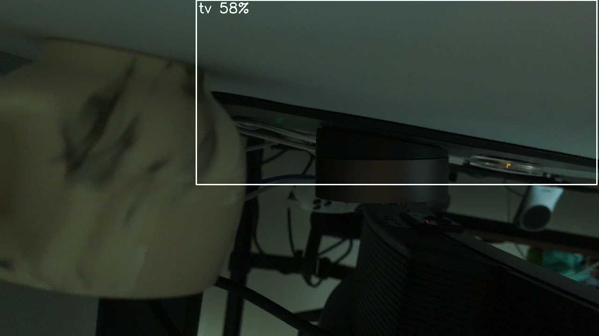

# 2026-09-26: Pi software install and Hailo accelerator check

**Question:** Can the Pi run the proposal's optional on-device inference, and what hardware is actually on the AI HAT+?
**Short answer:** Yes, for precompiled models. The accelerator is a **Hailo-8L** (13 TOPS), not a Hailo-8. It runs a COCO YOLOv8s at 58.7 FPS, and the camera → Hailo → boxes pipeline works in video mode. The proposal's open-vocabulary detector is not available on the Hailo without a model compilation step. Perception for the study stays on the GB10, as the proposal already allows.

## What was installed

On `ai-pi` (Raspberry Pi 5, Debian 13, kernel `6.18.50+rpt-rpi-2712`, system Python 3.13.5):

```bash
sudo apt-get install -y hailo-all python3-picamera2 python3-opencv python3-numpy
```

- It added 698 new packages and upgraded or removed nothing, so the camera stack kept its versions (rpicam-apps 1.13.0, libcamera 0.7.2). Exit code 0.
- Versions: HailoRT 4.23.0 (runtime, CLI, Python `hailo_platform`), Hailo firmware 4.23.0, TAPPAS core 5.1.0, picamera2 0.3.37, OpenCV 4.10.0, numpy 2.2.4.
- The driver package printed "Failed to install PCIe driver to the DKMS tree … Please reboot". This was harmless. The Raspberry Pi kernel ships the Hailo driver in-tree (`hailo_pci`, version 4.23.0, vermagic matches). It loaded the firmware immediately ("NNC Firmware loaded successfully", 148 ms), and `/dev/hailo0` appeared without a reboot.
- The capture tool (`capture/pi_capture.py`) is stdlib only and doesn't depend on any of these packages. Its 26 tests pass on the Pi after the install.

## Which chip it is

`hailortcli fw-control identify` reports:

```
Firmware Version: 4.23.0 (release,app,extended context switch buffer)
Board Name: Hailo-8
Device Architecture: HAILO8L
```

The board name says Hailo-8, but the architecture says HAILO8L. The two chips share the PCI ID `1e60:2864`, which is why `lspci` prints "Hailo-8 AI Processor". A direct test settles it:

| Model file | Result |
| --- | --- |
| `/usr/share/hailo-models/yolov8s_h8.hef` (compiled for Hailo-8) | Rejected: `HAILO_HEF_NOT_COMPATIBLE_WITH_DEVICE: Device arch: HAILO8L, HEF arch: HAILO8` |
| `/usr/share/hailo-models/yolov8s_h8l.hef` (compiled for Hailo-8L) | Runs |

**Rule:** use only `*_h8l*.hef` models on this device.

## Throughput

```bash
hailortcli benchmark /usr/share/hailo-models/yolov8s_h8l.hef --time-to-run 10
```

| Metric | Value |
| --- | --- |
| FPS (hardware only) | 58.71 |
| FPS (streaming) | 58.71 |
| Hardware latency | 13.0 ms |

This is the accelerator alone, with no camera, preprocessing or post-processing. It's not a measure of end-to-end system throughput.

## Camera → Hailo → boxes

```bash
rpicam-vid -n -t 8000 --width 1280 --height 720 --framerate 5 --codec mjpeg --segment 1 -o f%04d.jpg \
  --post-process-file /usr/share/rpi-camera-assets/hailo_yolov8_inference.json -v 2
```

- 34 frames saved, 0 "HailoRT not ready" messages, and 27 frames with at least one detection. The config selects the 8L model automatically through its `hef_file_8L` key.
- **The scene wasn't a study scene.** The room was dark, and the mug was a few cm from the lens and out of focus. COCO YOLOv8s did not detect the mug; it boxed the desk underside as `tv` in all 27 detections (confidence 0.41–0.59). This checks the pipeline, not detection quality.
- `rpicam-still` with the same post-process file gives **no** detections on the final image. The still capture drops the 640×640 low-resolution stream the Hailo stage reads, and the log shows "HailoRT not ready!". Use video mode (or picamera2) for on-device detection.



*Last frame of the video-mode run: the camera looks up from under a desk edge with the mug at the far left, defocused. The only box is a false `tv` detection on the desk underside.*

## What this means for the project

- On-device detection with precompiled COCO models works (COCO has a `cup` class). That's useful for a live demo once the rig exists.
- The study's front end (YOLO-World and DINOv2 matching) runs on the GB10: YOLO-World v2-s takes about 3–4 ms per image there. Running YOLO-World on the Hailo would need compiling it to an 8L HEF with Hailo's Dataflow Compiler. That compiler hasn't been tried; it's unverified whether it runs on the aarch64 GB10.
- Not yet done: a reboot, to confirm that the driver and firmware come up cleanly at boot.

Evidence: `ai-pi:~/cmpe249/logs/` (`2026-09-26-apt-install.log`, `hailo_e2e_vid/run.log` and frames, `hailo_e2e_2026-09-26.{jpg,log}` for the still-mode attempt).
