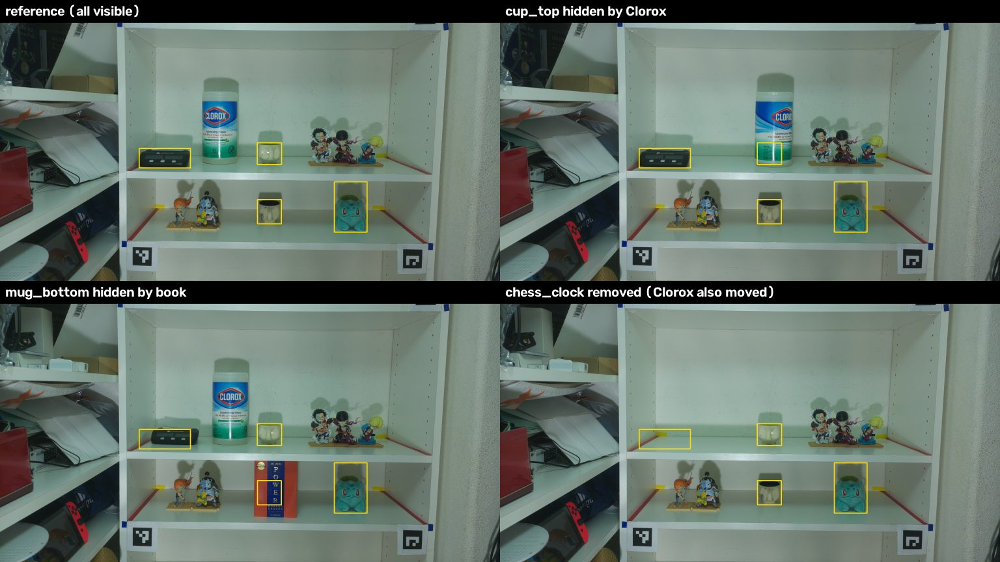

# First real pilot: one stop, one lighting, evidence v0 (2026-10-13 to 10-17)

Raw data and analysis are local only (`data/raw/` is gitignored):

- `data/raw/2026-10-14-pilot/`: captures in `pi/`, the capture helper `shot.sh`, and the analysis files in `analysis/`.
- `data/raw/2026-10-13_tripod/`: the tripod and rotation check.

The pilot numbers below come from those files. The rig distances and the review details come from the session log.

**This is a development result, not a test result.** The evidence code was changed after looking at these photos. A held-out pilot 2 is planned with the code frozen (see the end).

## Rig changes before the pilot (2026-10-13)

- **Tripod.** The camera moved to a tripod + stick, about 10–14 cm closer than the far spot.
  - At that distance the corner tags no longer fit in the frame. The tag span would need about 1300 of the 1296 px frame height.
  - The student lowered the camera so the shelf tags were in view.
- **Rotation.** The image was upside down: the Pi case (`hardware/pi_case/`) mounts the camera with its cable edge up. That was a design error.
  - The board can't be flipped in the case because the lens is off-centre. So the lock config now carries `"rotation": 180` (lock_version 3), and `capture/pi_capture.py` 0.4.0 applies it.
  - A real locked capture with the new config (`rotcheck_L1-v1.jpg`) comes out upright.
- **Looser geometry (the student's decision).** The study only needs "the object is detected and roughly in the same spot", not pixel-perfect pose.
  - `capture/tags.py` 0.2.0 registers with ≥2 ArUco tags: a similarity fit for 2 tags, a homography for ≥3.
  - It refuses only when fewer than 2 tags are shared, when the in-fit RMS is > 10 px, or (with 4+ tags) when the leave-one-out error is > 30 px.
  - This pilot had 3 tags, so only the RMS check applied.
  - In `capture/run_arrangement.py` 1.3.0 the pose check is advisory: it warns and logs, and does not stop the capture.
- **NTP** is a flag, not a failure (`capture/qc_session.py` 1.1.1).

## Capture

- **Session:** `2026-10-14-pilot`, arrangement PILOT01, stop P3 only, lighting L1 (all lights), lock L1-v1. Lux was 161 at the reference and 159–172 across the queries.
- **Shots:** 1 reference, then 12 queries. Each of the 4 targets (top cup, chess clock, bottom mug, Bulbasaur plush) is shown occluded, removed and put back.
- **Occluders:** a Clorox wipes canister on the top shelf and a hardcover book on the bottom shelf.
- **Labels:** every query uses `--condition pilot`; the study conditions need all five stop references. The true condition is recorded in the episode name and in a `--note`.
- **Registration:** 3 tags were used (the 4th is cut off at the top edge). Registration RMS was 0.08–0.14 px on all 12 queries.
- **Boxes:** the target boxes on the reference were proposed by YOLO-World and checked by eye.

## Evidence v0 (`perception/evidence.py`)

Each (target, query) pair becomes one `EvidenceRecord(match, quality, obstruction)`. The shared stopping rule turns it into present / occluded / removed / unknown. The thresholds are placeholders (match 0.6, quality 0.5, obstruction 0.3).

### 0.1.1: 45/48 (`analysis/v010/pilot_table.md`)

- **Visible:** all 40 pairs came out present, with match 0.87–0.99. This includes the mug and clock, which were put back 1–2 cm off their original spots.
- **The dangerous error:** both book occlusions were called **removed**. YOLO-World never detected the book, so the obstruction score was 0.
- **The clock removal was unknown.** The Clorox left at the same time, so the sharpness ring around the clock changed, and quality fell to 0.32.
- **The detector on its own** (a detection with IoU ≥ 0.3 to the target box) finds the mug in all 10 of its visible queries (confidence 0.47–0.71) and the Bulbasaur in all 10, but at low confidence (0.27–0.43). It finds the top cup in only 4/10 and the clock in 0/10. A detector-only miss signal would be wrong most of the time for two of the four targets.

### 0.2.1: 48/48 on the same photos (`analysis/pilot_table.md`), dev only

**Two changes:**

1. **Novelty cue.** Obstruction is now max(detector cue, novelty).
   - Novelty is the share of DINOv2 patches inside the query box whose best cosine to the whole reference window is < 0.5.
   - A book that the detector misses is still "something that was not there before".
2. **Change-masked sharpness.** The sharpness ring leaves out pixels that changed between reference and query, and the score is gain-normalised.
   - A neighbour that leaves no longer looks like blur.

**Rejected alternatives:** before 0.2.0 I tried front-strip and above-strip change cues (`analysis/probe_cues.py`). They did not separate the classes (`analysis/probe_cues.json`). For example, the 25% front strip changed by 0.03–1.00 on occluded rows and by 0.00–0.52 on removed rows.

**Adversarial review:** a 13-agent review (workflow `wf_319a39ec-1eb`) confirmed these problems, all fixed in 0.2.1:

- The novelty explain set left out the search-pad ring around the box, so removing a target from a mat would have read as novel. Clock-removed novelty went from 0.13 to 0.03.
- Sharpness was not gain-normalised, so dimmer light read as blur.
- An empty ring gave NaN, which was read as perfect sharpness.

**Non-visible rows in 0.2.1:**

| photo | truth | match | quality | detector obstr. | novelty | verdict |
|---|---|---|---|---|---|---|
| bulba-occ | occluded | 0.44 | 1.00 | 0.00 | 0.83 | occluded |
| clock-occ | occluded | 0.45 | 0.91 | 0.61 | 0.02 | occluded |
| cuptop-occ | occluded | 0.33 | 1.00 | 0.95 | 0.16 | occluded |
| mug-occ | occluded | 0.32 | 1.00 | 0.00 | 0.86 | occluded |
| bulba-rem | removed | 0.41 | 0.97 | 0.00 | 0.00 | removed |
| clock-rem | removed | 0.23 | 0.88 | 0.00 | 0.03 | removed |
| cuptop-rem | removed | 0.21 | 0.93 | 0.00 | 0.00 | removed |
| mug-rem | removed | 0.28 | 0.96 | 0.00 | 0.00 | removed |

All 40 visible pairs are present (min match 0.87).

**Why 48/48 is not a result:**

- Only 8 rows test the new cues.
- The novelty threshold 0.5 was chosen on these rows. With the v0.2.1 code, any value from 0.37 to 0.66 gives 48/48 (`analysis/novel_cos_sweep_v021.txt`), and each end of that range is set by a single example: Bulbasaur-occluded at the low end, mug-removed at the high end.
- The evidence.py docstring says "about 0.37–0.59". That range was measured on 0.2.0, and the frozen file was left unchanged.
- The sharpness settings (`sharp_dilate`, `min_ring_kept`) make no difference on this pilot.

**Known limits, not fixed:**

- **The Clorox occlusions were caught by the detector, not by novelty** (novelty 0.02 and 0.16). The Clorox was already in the reference, so it "explains" itself. An occluder that looks like the background, or like something already in view, *and* that the detector misses, will be called removed.
- A removal that reveals content not in the reference reads as occluded. This is the safe direction: it gives unknown or occluded, not a false removal.
- Laplacian sharpness can be fooled by blur plus noise.

## Pilot 2: held-out check (planned)

- **Frozen code:** `perception/evidence.py` v0.2.1, sha256 `d0e0927ff9d36ee2a8027cc8050f1801e372faea1e12cd98c513345d258d46cf`. The hash is recorded in `analysis/FROZEN_evidence_v0.2.1.sha256`.
- **Changes from pilot 1:**
  - a new arrangement (PILOT02);
  - a plain light-coloured occluder, aimed at the known limit;
  - queries with one light off (L2) against an all-lights reference.
- **Commitment:** the code is run unchanged and every error is reported.
