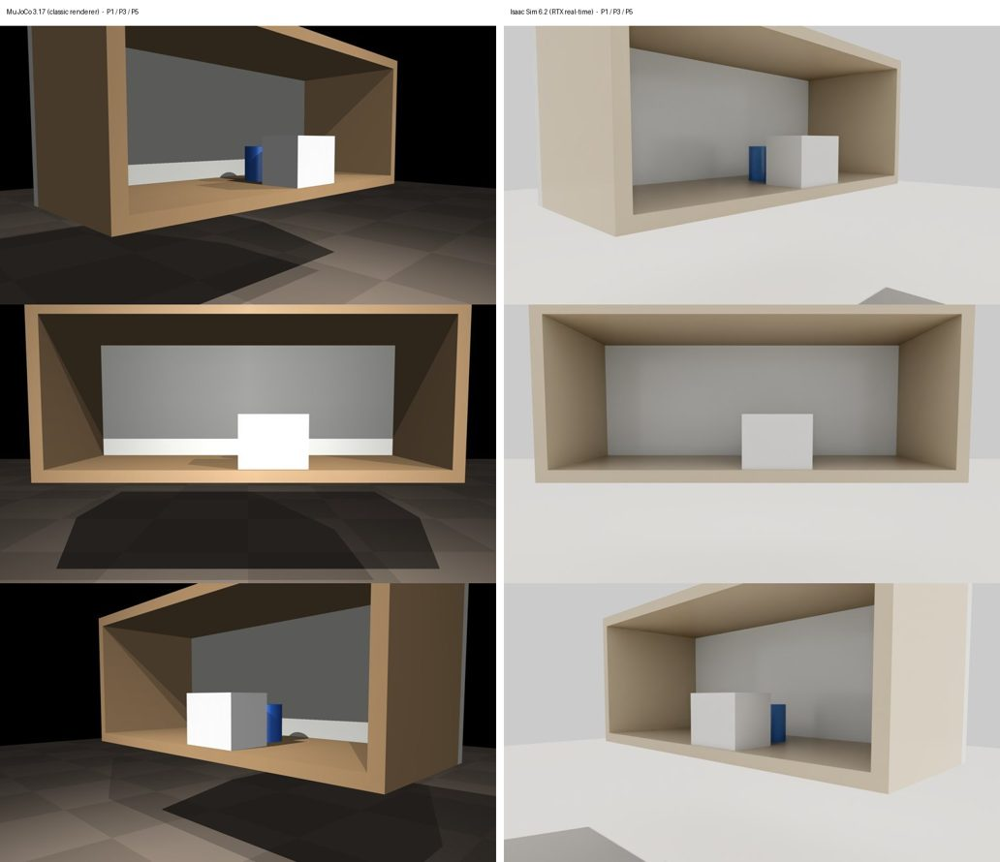
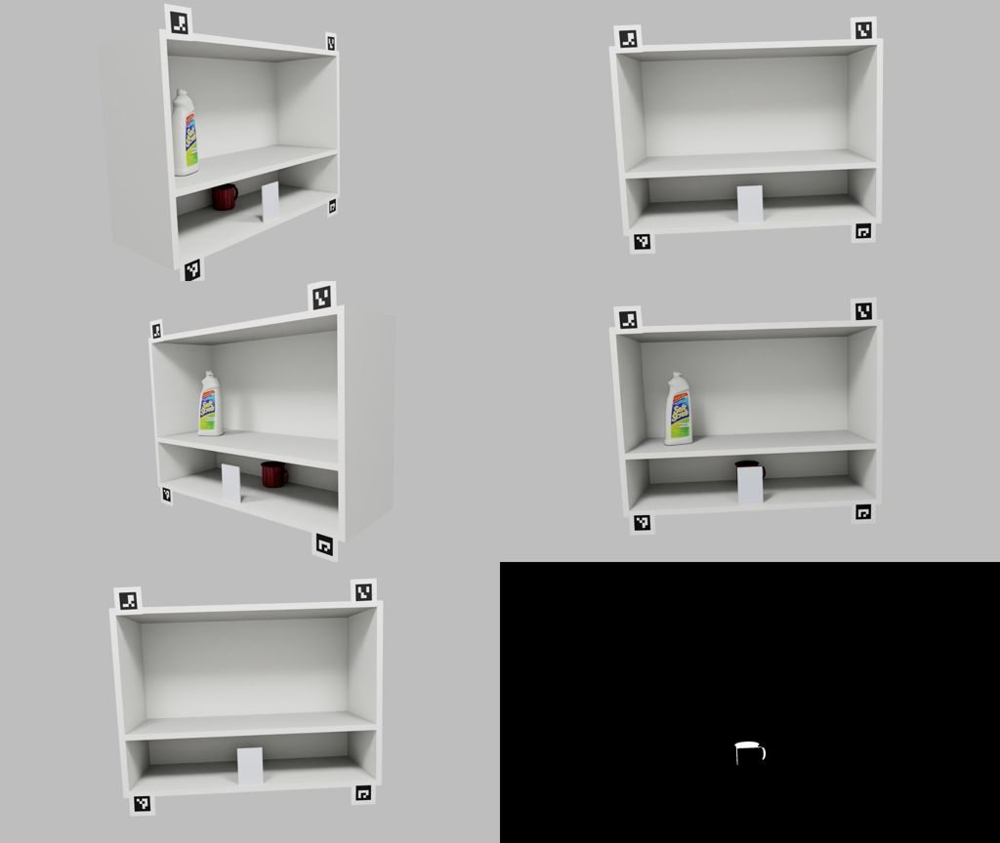

# Simulation: MuJoCo and Isaac Sim replicas of the rig (2026-11-02)

**Why simulate.** Two jobs:
1. **Camera positions.** The five far-spot stops have never been taped (`configs/positions.json` is still PENDING). The 2026-10-10 design (`data/raw/2026-10-10_far-camera/design_far.md`) chose them with a hand-written ray model. A 3D replica can check that design and compare the options before anything is taped.
2. **Development images with exact labels.** These are for the evidence step (v0.3), above all the same-footprint occluder case from pilot 2.

**Later the same day the student moved the course study into simulation**, with the instructor's agreement. The instructor had suggested simulation and allows changes to the proposal ([amendment](../docs/SIMULATION_STUDY.md)). Simulation results are reported as such. Pilots 1 and 2 remain the only real photos, now used as a sim-to-real sanity check.

**Simulator choice (later on 2026-11-02):** Isaac Sim on the GB10 is the single simulator for the study. MuJoCo, which ran on the Jetson, served to cross-check the geometry below and is kept only for that.

**Raw material** (gitignored): `data/raw/2026-11-02_sim/`.

## Tool choice

| | MuJoCo 3.17 | Isaac Sim 6.2 |
|---|---|---|
| Runs on | Jetson and GB10 (aarch64 wheels, headless EGL) | GB10 only: NVIDIA supports its aarch64 build on DGX Spark. Not on Jetson Orin (no RT cores); the Razer's 8 GB RTX 4070 is below the 16 GB minimum |
| Images | Classic Phong renderer: flat, game-like | RTX real-time ray tracing (path tracing available) |
| Labels | Exact per-geom segmentation | Instance/semantic segmentation, 2D/3D boxes, depth |
| Use here | Camera positions, line of sight, visibility labels at scale | Realistic development images |

**Why realism matters.** CNOS (ICCVW 2023), matching DINOv2 descriptors of rendered templates to real BOP images, scored 40.4 vs 36.1 mean AP with photoreal vs simple renders. So MuJoCo images should not tune appearance thresholds; their visibility labels are fine.

## Smoke test: the same toy scene in both (2026-11-02)

Same shelf box, mug (cylinder), white occluder and five arc stops in both simulators. The camera is the Pi Camera Module 3 at 2304×1296 with the rig's measured f_eff = 1731.26 px (67.3° × 41.0°).

Mug visible fraction per stop: visible pixels with the occluder ÷ pixels with the occluder hidden, from each simulator's segmentation.

| Stop | P1 | P2 | P3 | P4 | P5 |
|---|---|---|---|---|---|
| MuJoCo | 0.547 | 0.032 | 0.000 | 0.000 | 0.439 |
| Isaac Sim | 0.550 | 0.020 | 0.000 | 0.000 | 0.442 |

The two renderers agree to within 0.012 at every stop. The start view (P3) is fully blocked while the outer stops see 44–55 % of the mug: the "moving the camera reveals the object" condition the study depends on.

**Timings.**
- MuJoCo, one RGB plus two segmentation renders per stop: 0.25 s on the Jetson, 0.06 s on the GB10.
- Isaac Sim on the GB10: boot 8 s; first warm-up 101 s, which includes one-time shader compilation; then 4.1 s per capture of all five cameras.

**Isaac Sim setup on the GB10** (the student approved a separate environment and NVIDIA's licence on 2026-11-02):
- It lives in `~/cmpe249-sim/isaacsim-6.2/.venv`: Python 3.12, 18 GB, outside the repo and the project env.
- It is installed with `uv pip install "isaacsim[all,extscache]==6.2.0.0" "tinyobjloader==2.0.0rc13" --extra-index-url https://pypi.nvidia.com --index-strategy unsafe-best-match`. pip's cross-index matching and an explicit pin for one pre-release were needed with uv.
- Running it needs `LD_PRELOAD=/lib/aarch64-linux-gnu/libgomp.so.1`, explicit USD lights (headless has none), and about 200 `app.update()` settle frames before the first capture.
- The installed driver, 595.99.02, worked. NVIDIA documents 580.159.03 for Spark, and a forum report of R595 crashing Isaac Sim 6.0 did not reproduce with 6.2.
- **Not working yet:** `occlusionRatio` from the 2D box annotator returns −1, which NVIDIA's docs warn happens for some prims. Visibility is taken from instance masks instead.

## MuJoCo replica of the measured rig: cross-check of the 2026-10-10 design

`sim/rig.py` holds the rig as one simulator-free description, `configs/rig_geometry.json`. It has the shelf unit (#3, #4), the four tags, the study mug (the measured silhouette, plus a handle plate of assumed 1.0 cm thickness) and the eight design occluders, each number traced to its `data/raw` source. `sim/mujoco_rig.py` renders it. Full tables: `data/raw/2026-11-02_sim/analysis.md`.

- **The sim reproduces the measured geometry.**
  - The fitted P3 camera projects compartment #3 within 0.047 px of the analytic model.
  - The draft cameras land within 0.0083 cm of the drafts' floor coordinates.
  - The #3 frame margins equal the 10-10 numbers at all 15 stops.
- **The four option-A occluder picks hold.** S8, M16+3, M16−5 and IND28 give CCHCC, CCHHC, CHHCC and HHHHH in both models. Visible fractions agree to 3 decimals; the only difference is 0.999 vs 1.000.
  - Robustness (keep27, 27 ±1 cm perturbations) is identical for three picks. M16+3 drops from 0.778 to 0.741: one perturbation is lost to the handle.
- **Overall, 22 of 24 option × occluder rows give the same pattern.** The two differences:
  - the 3D handle sticking out past the narrow lower body at the outer stops (+6–9 % projected area at option A's P1/P5);
  - one fraction sitting on the 0.05 class boundary.

  Without a handle in either model, every stop of every row agrees within 0.0071.
- **New finding: tags at option A's P1.**
  - At the drafted 6.83° pitch, tag 0 falls about 18 px below the frame.
  - The 10-10 fix (+2° at P1 and P5) pushes tags 2 and 3 out at the top instead.
  - All four tags and #3 fit at P1 only between 7.35° and 8.10° of pitch, with a best margin of 13.8 px.
  - B15 keeps every tag but loses the occlusion patterns.
- **Watch-out for label renders: MuJoCo segmentation needs MSAA off.** Blended id colours decode to other objects, so `MujocoRig` refuses label renders on a multisampled context.

## Isaac Sim render of the measured rig

`sim/isaac_rig.py` builds the same scene spec in Isaac Sim (`python -m sim.rig --scene-out`):
- the shelf in the spec's colours;
- the tags on their cards (rotated boxes), with the markers just in front;
- the mug body and handle as the target;
- the two lighting presets and the Pi camera.

*Top row:* P1 and P3 at L1. *Middle row:* P5 at L1 and P3 at L2. *Bottom row:* the measured mug fully hidden at P3 (geometry run), and the P3 target mask of the YCB mug (appearance run).

- **Geometry run** (the measured mug):
  - Option A with no occluder gives a visible fraction of 1.0 at every stop.
  - With S8 it gives 1.0 / 1.0 / 0.0 / 1.0 / 1.0, which is **CCHCC, the same as MuJoCo and the analytic model**.
- **Appearance run.** The YCB mug stands in for the study mug, and the YCB bleach bottle for the Clorox. The bottle is in #4: at 25 cm it does not fit #3's 16.5 cm clear height.
  - The YCB mug is larger (8.1 vs 5.7 cm tall), so S8 leaves 30 % of it visible at P3. The occluder designs are tied to the study mug, and simulated labels must always come from the rendered masks.
- **The rendered tags work with the rig's own code.** `capture/tags.py` decodes them with the correct ids in all 10 toy-scene renders, and registers L2 onto L1 at 0.117 px RMS.
- **Raw files:** `data/raw/2026-11-02_sim/isaac_rig_A/` and `isaac_rig_toy/`.
