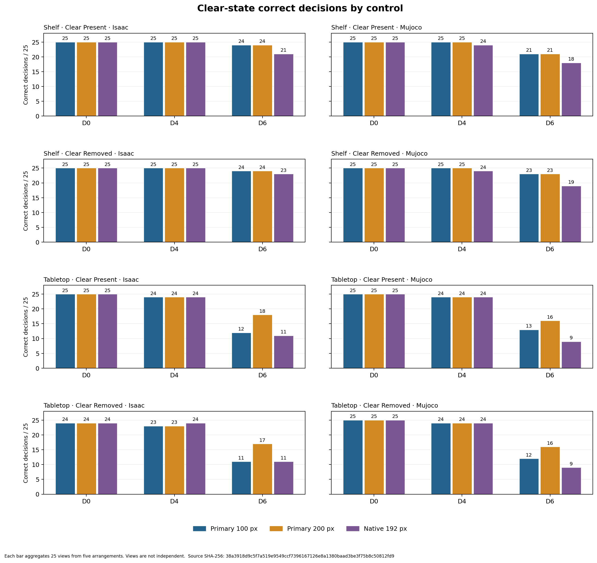
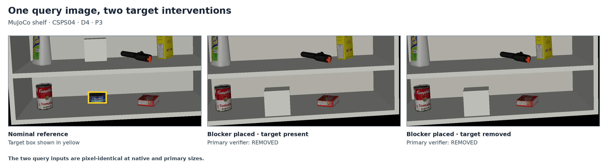

# Paired Isaac Sim and MuJoCo development pilot

This pilot tests a fixed image-only verifier on the same static shelf and tabletop arrangements in two simulators. The outcome concerns factual errors, correct answers and abstentions. Visual support remains a separate endpoint under validation. [Evaluation plan](../development/cross_sim/PLAN.md) · [Adapter qualification](2026-11-17-cross-sim-qualification.md)

## Result and decision

The 200-pixel guard gave **803 correct answers on 1,200 queries**, a gain of 31 over the 100-pixel guard. Each control made one false removal. The wider guard recovered answers in both engines. The largest remaining loss occurred on the tabletop at 6 cm and 3°. The pilot meets its rule for investigating alignment. It supplies no evidence for adding a language-model veto. [Counts by arrangement and condition](figures/2026-11-17-cross-sim/pilot/arrangement_metrics.csv)

| Fixed image control | Isaac correct / 600 | MuJoCo correct / 600 | False removals on 1,200 | UNKNOWN on 1,200 | Both UNKNOWN on 40 certified pairs |
| --- | ---: | ---: | ---: | ---: | ---: |
| Primary, 100 px | 384 | 388 | 1 | 427 | 39 |
| Primary, 200 px | 404 | 399 | 1 | 396 | 39 |
| Native, 192 px | 382 | 365 | 1 | 452 | 40 |

Every false removal came from a placed-blocker, target-present view. The two primary controls made the same error in MuJoCo. The native control made a different error in Isaac. Each column of correct answers uses all 600 views from that engine, including abstentions. Each clear-state point below uses 25 views from five arrangements. [Control settings](../development/cross_sim/scoring_protocol.json) · [Export record](figures/2026-11-17-cross-sim/pilot/export_manifest.json)

At 4 cm and 2°, the primary control answered correctly on all 50 clear shelf views in each simulator. It answered 47/50 clear tabletop views in Isaac and 48/50 in MuJoCo. These are clear-intervention results. The original forecast concerned every visually answerable view, including some placed views. That denominator still needs independent support labels.

At 6 cm and 3°, widening the guard raised correct tabletop removal decisions from 11/25 to 17/25 in Isaac and from 12/25 to 16/25 in MuJoCo. For clear presence the corresponding counts rose from 12 to 18 and from 13 to 16. None of the controls reached the prospective stop rule. [Pilot count table](figures/2026-11-17-cross-sim/pilot/arrangement_metrics.csv)

The 31 additional correct answers represent a gain of 2.58 percentage points over all 1,200 queries. A paired bootstrap that resampled whole arrangements gave a descriptive 95% interval of +0.25 to +5.83 points. In the D6 clear-removal cell, the wider guard resolved one fewer tabletop view in MuJoCo than in Isaac. The paired engine difference was −4 points, with an interval from −16 to +8. Five arrangements per environment give limited precision. [Arrangement bootstrap intervals](figures/2026-11-17-cross-sim/pilot/paired-intervals.json)

The independent recount checked every delivered image and box at both resolutions, reapplied the decision thresholds to all 3,600 raw evidence records, and reproduced the official counts, certificates and engineering decision. The verifier completed all three runs without a failed input. [Portable verification summary](figures/2026-11-17-cross-sim/pilot/pilot-summary.json) · Independent recount (local run `runs/2026-11-17-cross-sim/reviewer/independent-score-review.json`)

## Inputs and controls

Ten fresh arrangements supplied five shelf and five tabletop scenes. Each had five camera stops, three displacements and four physical interventions. D0 used the nominal pose. D4 combined 4 cm of translation with 2° of yaw. D6 used 6 cm and 3°. Both simulators used the same arrangement, displacement signs and physical intervention for each pair. Each engine supplied its own reference and target box. Together they produced **1,200 queries and 100 nominal references**. Every declared query remains in the physical-state calculations.

The blocker could be parked or placed. The target could be present or removed at either blocker position. Some placed blockers allowed a full view of the target from particular camera stops. Every clear-present target retained at least 92.8% of its isolated mask area in both engines. All removed targets had zero mask pixels. The main reviewer inspected the native target boxes and crops at every stop for every arrangement. Three shelf scenes used the same foam-brick asset, and three tabletop scenes used the same tuna-can asset. These repeat identities limit claims about unseen objects. Input release (local run `runs/2026-11-17-cross-sim/reviewer/pilot-release.json`) · Capture review (local run `runs/2026-11-17-cross-sim/reviewer/pilot-visual-review.json`)

The primary verifier used 1200 × 675 RGB and a 100-pixel maximum registration shift. The wider guard used 200 pixels at the same resolution. The native control used 2304 × 1296 RGB and a 192-pixel guard, preserving the primary guard as a fraction of image width. All three used the previously fixed quality, target-match and obstruction thresholds. The verifier received a reference RGB image, a box in that reference and the query RGB image. It saw shuffled opaque identifiers. Simulator geometry and intervention labels were evaluator-only. [Fixed settings](../development/cross_sim/scoring_protocol.json)

A correct clear-state resolution is a definite answer that matches the intervention. The denominator includes abstentions. Each engine, environment, displacement and clear class has 25 observations from five arrangements. Engine comparisons pair observations within the same arrangement. An identical reference, numeric box and query image across opposing physical states certifies ambiguity for that supplied input. A zero target-mask area alone cannot provide that certificate.

The prospective stop rule requires one fixed control to resolve at least 90% of each clear class in every engine, environment and displacement, with zero physical errors anywhere in the pilot. A continuing failure pattern requires the same wrong definite answer or unresolved clear-state evidence gate in at least three common arrangements across all three controls. During rendering and before any pilot prediction, the main reviewer corrected the draft implementation so placed-view abstentions do not count as failures on their own. The analysis reports them separately. Dated clarification (local run `runs/2026-11-17-cross-sim/reviewer/continuation-clarification.json`)

## What the simulator can certify

Each engine supplied 150 placed-blocker pairs. The same 40 camera and arrangement combinations had zero visible target pixels in both engines, spanning nine arrangements. For every one of those MuJoCo pairs, presence and removal gave identical RGB values at both the native and primary resolutions. Each pair also shared its reference and box. These 40 pairs therefore certify an inability to decide the physical state from the supplied input. The remaining 110 MuJoCo placed pairs had a visible target, including 56 with the entire isolated silhouette visible.

The 40 corresponding Isaac pairs had different RGB values at both resolutions. The exact-input certificate therefore leaves those Isaac labels unresolved. Across those 40 Isaac pairs, the median whole-image change was 0.282 levels on the 8-bit RGB scale. The median for 20 same-state qualification repeats was 0.321. The repeats used different scenes, so a matched repeat experiment would be needed to distinguish state-specific cues from ordinary rendering variation. Photometry diagnostic (local run `runs/2026-11-17-cross-sim/reviewer/hidden-pair-photometry.json`) None of the 300 clear pairs across the two engines had identical query pixels. Per-pair source checks (local run `runs/2026-11-17-cross-sim/reviewer/source-exact-certificates.json`) · MuJoCo silhouette comparisons (local run `runs/2026-11-17-cross-sim/reviewer/mujoco-pilot-placed-masks.json`)

On one certified MuJoCo shelf pair, both primary controls answered REMOVED for both states. The removal happened to be physically correct on one member. The identical input could not distinguish the two, so both definite answers lacked support. The controls abstained on the other 39 certified pairs. The native control abstained on all 40. This certificate applies to these specific pairs. It does not estimate how often a model gives unsupported answers on the rest of the pilot.

The figure uses the same crop for all three frames. Only the reference carries a box in the figure. Equality was checked on the complete supplied inputs. [Image sources and verifier records](figures/2026-11-17-cross-sim/pilot/csps04-d4-p3-case.json)

## What failed at the largest displacement

Only one refusal met the declared recurrence rule. On a clear tabletop with the target removed, image alignment fell below the correlation cutoff in the **same three MuJoCo arrangements under all three controls**. The affected views were CSPT03/P3, CSPT04/P5 and CSPT05/P4. All three used the same tuna-can model. Each control correctly resolved those same MuJoCo views at the nominal pose. The 200-pixel guard resolved two of the three corresponding Isaac views at D6. On those two views the original Isaac fit had passed the correlation check but exceeded the 100-pixel shift limit. The third Isaac view failed the correlation check throughout. Matched case records (local run `runs/2026-11-17-cross-sim/reviewer/recurring-matched-cases.json`)

We checked the estimated alignment against the true projection of the remembered target's mesh vertices. The simulator supplied geometry only to this diagnostic. For removed targets the projection refers to the remembered location. Missing fits stay missing. For the primary control, 999 accepted fits had a median target error of 1.78 pixels. The 94 correlation refusals with a saved fit had a median of 112.91 pixels. Each case contributes its median vertex error. For the three recurring MuJoCo cases, the primary residuals were 0.558, 0.067 and 0.070 target-box diagonals. A correlation refusal can occur even when the remembered region moves into nearly the right place. [Diagnostic method](../development/cross_sim/landmark_residuals.py) · Full diagnostic (local run `runs/2026-11-17-cross-sim/reviewer/landmarks/landmark_residuals.json`)

Both distinct false removals passed the verifier's alignment and image-quality checks. On the certified MuJoCo case (CSPS04, D4, P3), the median projected target error was 0.666 box diagonals. On the native Isaac case (CSPS05, D6, P3), it was 1.235 diagonals. In the Isaac view the target occupied 11 of its 6,041 isolated mask pixels. The fitted warp can pass the global checks while putting the target region far from its true position. This association motivates a controlled change to alignment. It does not establish the cause of either false removal. Per-case residuals (local run `runs/2026-11-17-cross-sim/reviewer/landmarks/landmark_cases.csv`)

## Next experiment

**November 18 follow-up.** The [completed RGB geometry comparison](2026-11-18-rgb-geometry-comparison.md) reports the tabletop gains and the two new false removals that ended this revision. The paragraphs below preserve the decision made on November 17.

Compare the 200-pixel control with one RGB-only replacement for its alignment stage. Use two-view geometry and visibility estimated from the supplied images to locate the remembered region. Keep the current target matcher, obstruction calculation and decision thresholds. GeoSCD motivates the geometric component. Its full method predicts change masks and has a different output. Earlier feature matching and local alignment repairs already failed their retention criteria. [GeoSCD paper, §III-B](https://arxiv.org/html/2509.11292v1) · [Authors' implementation](https://github.com/ZilingLiu/GeoSCD) · [Prior registration experiments](2026-11-05-registration-repair-results.md)

Use all 1,200 queries and compare each answer with its paired baseline answer. The development target is more than 16/25 correct clear removals on the MuJoCo tabletop at D6, with a net gain in at least two arrangements. Require at least the baseline's 17/25 on the matching Isaac cell, no newly wrong definite answer anywhere, and abstention on both members of all 40 certified pairs. Fix the checkpoint, geometry adapter, refusal rule and preprocessing before scoring. A miss ends this adapter revision. A pass warrants testing on fresh, target-balanced arrangements. These development choices use the pilot results and cannot establish transfer to unseen targets. [Comparison protocol](../development/cross_sim/PLAN.md#rgb-only-alignment-comparison)

The first implementation step resamples query RGB into reference coordinates and rejects invalid or occluded points. It passed synthetic checks for mapping direction, non-square coordinates, boundary validity and agreement with the existing warp on a known translation. GeoSCD's pinned geometry stage supplies lower-resolution, integer-valued correspondences. Converting them to the verifier grid, qualifying the validity rule and running the pinned model on Ascent remain open. [Resampling code](../development/cross_sim/dense_alignment.py) · [Fixture tests](../development/cross_sim/test_dense_alignment.py) · [Pinned geometry source](https://github.com/ZilingLiu/GeoSCD/blob/dd31369654e96d6843cc4bbcebce854a8bc2159b/src/pixel_match.py)
