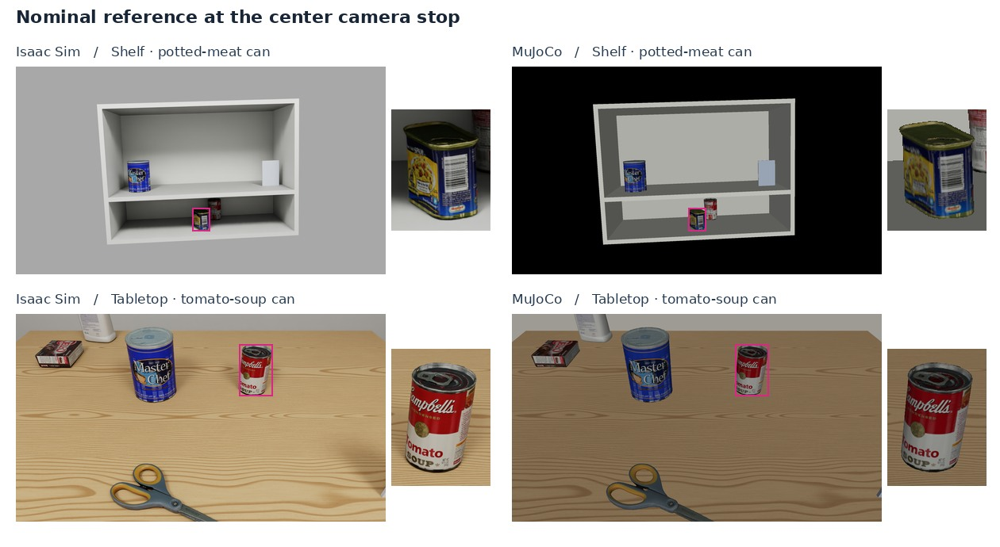

# Qualification of the paired Isaac Sim and MuJoCo development inputs

On November 17, 2026, both development adapters passed the same capture checks. They can supply paired shelf and tabletop observations to the fixed verifier. The checks establish correspondence for the tested static scenes. Physical-state accuracy and visual support are separate research questions.

## What was tested

The two simulators read the same object vertices, textures, arrangement transforms and calibrated cameras. One reserved shelf arrangement used a potted-meat can. One reserved tabletop arrangement used a soup can. Each engine rendered five stops at the nominal pose and after 6 cm of translation and 3 degrees of yaw. Each stop had clear-present, clear-removed, blocker-placed-present and blocker-placed-removed states. This produced **80 query images and 10 nominal reference images per engine**. We also repeated clear presence after changing the scene and rendered each target in isolation.

The main reviewer set the numeric tolerances before the first study render. A separate implementation transformed the original mesh triangles, projected them at native pixel centers and compared their silhouettes with the instance masks. When a full silhouette differed, a depth calculation tested whether foreground geometry hid it. No verifier outputs entered these checks. The operator also verified output hashes, same-input resume and refusal of changed inputs and reserved test seeds. [Qualification limits](../development/cross_sim/qualification_v1.json) · [Procedure](../development/cross_sim/QUALIFICATION.md)

| Across the qualification captures | Isaac Sim | MuJoCo | Declared limit |
| --- | ---: | ---: | ---: |
| Maximum projected landmark error, pixels | 0.00005510 | 0.00000000127 | ≤ 1 |
| Maximum mask error beyond the two-pixel edge band, as a share of projected area | 0 | 0 | ≤ 0.005 |
| Maximum target pixels after removal | 0 | 0 | 0 |
| Minimum clear-target pixels as a fraction of the isolated target | 1.000 | 1.000 | ≥ 0.50 |
| Minimum RGB change inside the target after clear removal, 8-bit units | 52.558 | 45.259 | ≥ 6 |
| Maximum full-image RGB change on repeat, 8-bit units | 0.695* | 0 | ≤ 3 |
| Maximum repeat RGB change inside the target, 8-bit units | 0.631* | 0 | ≤ 6 |

\* Upper values rounded up. Each engine supplied 20 repeat comparisons. A measurement of zero beyond the edge band permits differences within two pixels of a silhouette boundary. For example, the parked blocker at the rightmost shelf stop extends behind foreground geometry. The independently computed visible portion matched the rendered masks in both engines. [Compact measurements and input hashes](figures/2026-11-17-cross-sim/qualification.json) Isaac audit (local run `runs/2026-11-17-cross-sim/reviewer/isaac-qualification-final.json`) · MuJoCo audit (local run `runs/2026-11-17-cross-sim/reviewer/mujoco-qualification-final.json`)

## What changed during qualification

An asymmetric texture fixture exposed a vertical inversion in the first MuJoCo conversion. Terra corrected the mapped texture coordinate before rendering the common arrangements. The fixture then displayed red and green above blue and yellow in both engines. A visual check of every nominal target box showed upright product labels, consistent camera angles and the correct target identity. The original failed fixture and corrected fixture remain in the local run evidence. Visual review (local run `runs/2026-11-17-cross-sim/reviewer/qualification-visual-review.json`)

MuJoCo uses headlight illumination, casts different shadows and shows a black background outside the shelf. Isaac Sim uses ray-traced lighting and a grey background. The tabletop wood grain and object textures follow the same geometry. A post-capture synthetic check in the same Jetson EGL environment identified Mesa llvmpipe software rasterization. The original captures recorded EGL and MuJoCo 3.17.0. Their logs omit the OpenGL renderer string. A difference in verifier performance measures transfer across this combination of rendering effects. This experiment cannot identify the contribution of a particular lighting feature on its own.

## Pilot handoff

The reserved pilot contains ten different base arrangements. The qualification layouts and their derivatives stay outside that pilot. Each engine supplies its own nominal reference and target box. The ordinary verifier receives the reference, box and query RGB. Simulator poses, masks and interventions stay with the evaluator. Random case names and shuffled presentation order hide the engine, intervention and pair from the verifier interface. The earlier support-label qualification hold still applies. [Pilot design](../development/cross_sim/PLAN.md) · Dated release record (local run `runs/2026-11-17-cross-sim/reviewer/qualification-release.json`)
