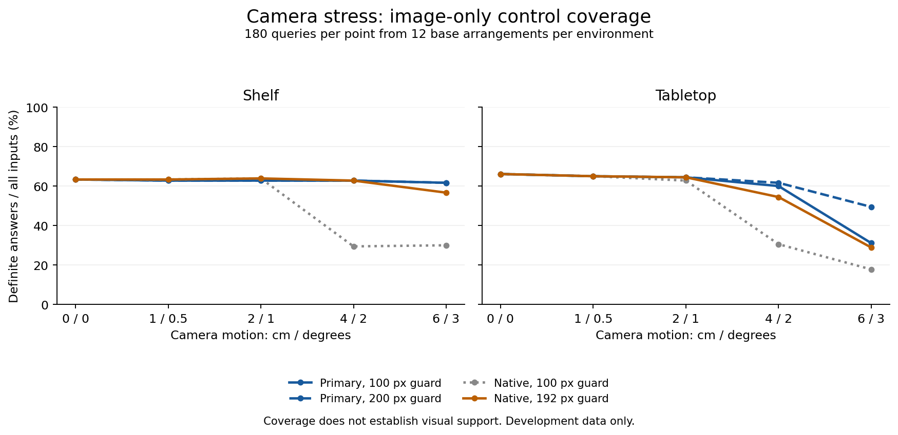

# Scoring completion and label qualification, 2026-11-17

This record follows the request to check scoring, review results and qualify the labels before selecting another experiment.
The experiment remains development. No new test freeze exists.

## Execution review

At the first check in this session, image preparation still ran. Scoring had not started.
The full preparer then exited successfully. The independent input audit accepted 1,800 cases and 7,200 verifier images.
It checked 96 exact source-to-input pixel transformations and retained 1,800 blank human-label rows.
The separate binding check matched all 180 previously audited cases to the final inputs.

Evidence: [input audit](../runs/2026-11-17-stress-dev-v1/completion-review-v1/prepared_audit.json),
[AI input binding](../runs/2026-11-17-stress-dev-v1/completion-review-v1/full-binding.json),
and [main copy verification](../runs/2026-11-17-stress-dev-v1/completion-review-v1/main-copy-verification.json).
Input binding establishes which pixels received a label. It does not establish label accuracy.

## Label qualification

The [qualification specification](../development/stress/label_qualification_v1.json) preceded all new qualification judgments.
Its [guide](../development/stress/LABEL_QUALIFICATION.md) records the primary research sources and pass criteria.
The main reviewer inspected 50 candidate pairs to select 48 controls.
The controls contain eight PRESENT, eight REMOVED and eight UNKNOWN cases per environment, across D0, D4 and D6.
Their IDs exclude the fixed audit and smoke IDs. They still come from the development cohort.

Geometry selected candidates. Main visual review supplied the locked reference, with physical state and geometry known.
This is an AI reference, not independent human validation.
Two ambiguous removal candidates received the next candidates from their saved rankings before reviewer exposure.
These exclusions change only the qualification set. Every stress case remains in the scoring cohort.
The later mask check confirms zero occluder overlap in those excluded cases at their actual revisit poses.
The exclusions record visual uncertainty, not a demonstrated defect in the geometry computation.

Evidence: [locked reference](../runs/2026-11-17-stress-dev-v1/label-qualification-v1/private/approval.json),
[visual observations](../runs/2026-11-17-stress-dev-v1/label-qualification-v1/private/inspection-complete.json),
and [excluded-case geometry check](../runs/2026-11-17-stress-dev-v1/label-qualification-v1/private/excluded_geometry_diagnostic.json).

Two fresh Terra reviewers inspected the same 48 pairs independently.
One used the original instructions. The other used the declared localization-first revision.
Each recorded 96 image presentations with hashes.

| Instructions | PRESENT agreement | REMOVED agreement | UNKNOWN agreement | Declared result |
| --- | ---: | ---: | ---: | --- |
| Original | 16/16 | 15/16 | 16/16 | Pass |
| Localization-first revision | 16/16 | 15/16 | 16/16 | Pass |

Both versions returned UNKNOWN for the same shelf control, `I202d2179861fcc5f918a254e`, against the main REMOVED reference.
The main reviewer places the exposed remembered region beside the panel. Both Terra reviewers place it behind the panel.
Keep this disagreement visible. Do not convert the agreement counts into a bound below 1% label error.
The revised instructions show no improvement on this control set.
One reviewer run per version cannot isolate a repeatable prompt effect.

Evidence: [original score](../runs/2026-11-17-stress-dev-v1/label-qualification-v1/original-score.json)
and [revised score](../runs/2026-11-17-stress-dev-v1/label-qualification-v1/localize-score.json).
Raw judgments and public input manifests remain beside those scores.

## Completed audit repeat

Two fresh Terra reviewers repeated all 180 judgments with the revised instructions.
The new pack used the same pixels and IDs, including new judgments for the four earlier starter cases.
Its [manifest](../runs/2026-11-17-stress-dev-v1/ai-review-full-manager-v2/manifest.json) records zero reused judgments.
Main acceptance verified every label and all 360 presented-image hashes.

| Reference version | PRESENT | REMOVED | UNKNOWN |
| --- | ---: | ---: | ---: |
| Original AI audit | 99 | 6 | 75 |
| Repeated AI audit | 99 | 21 | 60 |

Seventeen judgments changed: 15 UNKNOWN to REMOVED, one UNKNOWN to PRESENT, and one PRESENT to UNKNOWN.
Neither version contains a definite judgment that contradicts physical state. That fact does not establish visual support.
Main inspected every changed pair and agreed with 16 revised judgments.
The remaining case is the false removal discussed below. Main sees the cube and judges PRESENT, while Terra now judges UNKNOWN.
This is a selected, nonblind review. It cannot estimate overall label accuracy.

Evidence: [the complete comparison](../runs/2026-11-17-stress-dev-v1/reviewer/ai-repeat-comparison.json),
[original labels](../runs/2026-11-17-stress-dev-v1/ai-review-full-results-v1/ai_labels.csv),
and [repeated labels](../runs/2026-11-17-stress-dev-v1/ai-review-full-results-v2/ai_labels.csv).
Both raw versions remain unchanged. No main judgment replaces a blind judgment.

The geometry proxy agrees with 160/180 repeated AI judgments, compared with 147/180 original judgments.
The remaining differences comprise 15 proxy-UNKNOWN/AI-PRESENT cases, one proxy-UNKNOWN/AI-REMOVED case, and four proxy-REMOVED/AI-UNKNOWN cases.
These are source disagreements, not an accuracy score for either source.
Evidence: [proxy comparison](../runs/2026-11-17-stress-dev-v1/reviewer/audit-proxy-comparison.json).

Main inspected the four remaining removal disagreements and judged each REMOVED.
Both AI versions retained UNKNOWN. The cases span shelf arrangements STR-SHELF-04 and STR-SHELF-11.
Primary image-only also returned UNKNOWN in all four.
This unresolved disagreement affects estimated recoverable abstentions rather than creating primary veto errors on those cases.
The review was selected and nonblind. Raw labels remain intact.
Evidence: [additional removal review](../runs/2026-11-17-stress-dev-v1/reviewer/remaining-removal-review.json).

Terra passes the basic development screen and can assist label review.
It is not qualified as a sole support reference for a 1% unsupported-error decision.
The current AI decision hold remains active. Do not expand to 1,800 labels merely because the basic screen passed.
Terra's accepted simulator-operation role remains separate from label accuracy.

An additional programmatic audit compared all 600 existing occluded/removed pairs at primary resolution.
Every pair shares its reference and target box, but no pair has exactly identical query RGB pixels.
Therefore, exact input equality supplies no automatic UNKNOWN labels for this cohort.
Small pixel differences also do not establish answerability. No near-equality threshold was introduced.
Evidence: [paired pixel audit](../runs/2026-11-17-stress-dev-v1/reviewer/paired-pixel-audit.json).

## Completed primary control

The primary control completed 1,800 records with exit code 0.
The independent recount found 1,080 definite answers and one physical error, a false removal.
Every other definite answer matched the physical intervention. This does not establish visual support.

| Environment | D0 definite / all inputs | D4 definite / all inputs | D6 definite / all inputs |
| --- | ---: | ---: | ---: |
| Shelf | 114/180 | 113/180 | 111/180 |
| Tabletop | 119/180 | 108/180 | 56/180 |

These are coverage counts. UNKNOWN remains in the denominator.
They are not the share of answerable views resolved, so they do not directly score the earlier D4 forecasts.
The tabletop D6 visible phase received 29 PRESENT answers and 31 UNKNOWN answers out of 60 inputs.
The refusal categories were 18 shift, eight correlation, four optimizer/input and one scale.
The stronger controls must determine how much loss comes from the pixel-shift guard.

Evidence: [primary factual recount](../runs/2026-11-17-stress-dev-v1/reviewer/primary-factual-recount.json).

The false removal occurs in shelf arrangement `STR-SHELF-11`, D0, stop P4, with the target physically present behind a tilted box.
The cube remains partly visible to the right of the box in the main nonblind inspection.
The match score is 0.551509 and obstruction is 0.348469, so the declared removal predicates pass.
The registration check accepts the pair with a reported 0.033-pixel shift.
The mask-based visible fraction is 0.380985, while mask obstruction is 0.619015.
These are different measurements from the verifier's obstruction score.

Evidence: [failure inspection](../runs/2026-11-17-stress-dev-v1/reviewer/primary-false-removal-review.json).
This error motivates a concrete occlusion diagnosis. It does not meet the camera-stress veto rule by itself.

## Completed native control

The unchanged 100-pixel native control completed 1,800 records with exit code 0 in 1,552.98 seconds.
Main independently checked all record bindings and recounted the decisions. It made no physical-state error.
Shelf D4 coverage fell to 53/180, with 88 shift refusals. Tabletop D6 coverage was 32/180.
The completed normalized native guard resolves much of that pixel-unit effect, as shown below.
Native-size support labels remain uncollected.
Evidence: [native factual recount](../runs/2026-11-17-stress-dev-v1/reviewer/native-factual-recount.json).

## Completed four-control review

The full conditional pipeline exited with code 0.
All four controls contain 1,800 records. Both geometry-proxy exports and all eight separate reports are complete.
The main audit independently checked all 7,200 records, manifest bindings, runtime parity and saved metric counts.
Each control exactly reproduced its 60 smoke cases, including every saved evidence score.

| Control | Definite answers / 1,800 inputs | Physical errors across all levels | Shelf D6 definite / 180 | Tabletop D6 definite / 180 |
| --- | ---: | ---: | ---: | ---: |
| Primary, 100-pixel guard | 1,080 | 1 | 111 | 56 |
| Native, 100-pixel guard | 886 | 0 | 54 | 32 |
| Native, 192-pixel guard | 1,060 | 0 | 102 | 52 |
| Primary, 200-pixel guard | 1,116 | 1 | 111 | 89 |

The two error records concern the same nominal-pose cube case. No control made a physical error at a nonzero displacement level.
The controls reuse the same inputs. These are 7,200 evaluations, not 7,200 independent views.

The primary guard change recovered 36 correct physical-state answers: three at tabletop D4 and 33 at tabletop D6.
It lost no definite answer and added no physical error. It left the original false removal unchanged.
At tabletop D6, unblocked present controls improved from 29/60 to 46/60 correct answers.
The wider guard therefore explains part of the lost coverage, while a substantial abstention problem remains.
It does not establish that all recovered answers have visual support.

The normalized native guard recovered 174 correct physical-state answers without adding a physical error.
Shelf D4 coverage improved from 53/180 to 113/180.
Native processing still lost more tabletop answers than primary processing at D6.
Higher resolution alone is not a robustness remedy in this implementation.

Evidence: [independent full audit](../runs/2026-11-17-stress-dev-v1/reviewer/full_evidence_audit.json),
[paired control and label comparison](../runs/2026-11-17-stress-dev-v1/reviewer/completed-control-review.json),
and [copied reports and provenance](../runs/2026-11-17-stress-dev-v1/completion-review-v1/).
The copy inventory identifies the full pipeline exit separately from the AI-binding watcher exit.

This figure shows coverage, not supported-answer accuracy. Its [provenance](figures/2026-11-17-scoring-review/provenance.json) records the source and plotted values.

## Effect of label uncertainty

On the fixed 180-case sample, primary image-only disagreements fall from 14 under the original AI reference to one under the repeated reference.
The relaxed primary control shows the same change. The remaining case is the confirmed physical false removal.
Thus the original reference substantially overstated the apparent opportunity for a veto, according to the revised audit and main review.
This comparison does not establish a true unsupported-answer rate for the full cohort.

At tabletop D6, the repeated AI reference identifies eight recoverable primary abstentions among 18 sampled inputs.
The relaxed guard reduces that count to five. These remain sampled AI-reference judgments.
Treating all changed labels as UNKNOWN is available as a separate conservative sensitivity in the comparison record.
Neither that sensitivity nor the main spot review replaces the raw labels.

No formal A/B/C outcome is assigned. The declared complete, validated support reference is unavailable.
The original D4 forecasts also remain unscored against their declared full support reference.
The result supports a practical change in development order, not a retrospective pass of the old triage gate.

## Additional baseline check

[GeoSCD, section III](https://arxiv.org/html/2509.11292v1) predicts geometry from two RGB images and filters estimated occlusions before change-mask generation.
[Its official implementation](https://github.com/ZilingLiu/GeoSCD) provides code and lists VGGT and SAM checkpoints.
This is a relevant future baseline, not an executed comparison in this project.

[SceneDiff, sections 4.2 and 4.4](https://arxiv.org/html/2512.16908v2) also filters visibility and supports a two-image setting.
These sources strengthen the requirement to compare beyond the current image verifier and a weak language model.
They do not establish performance on this project's reference-region decisions.
The possible distinction remains selective PRESENT, REMOVED and UNKNOWN evaluation, not the general use of occlusion or geometric alignment.

## Reviewer decision and next experiment

Stop further expansion of this simulation axis for now. Do not start another task language model.
The main finding is an abstention and guard-sensitivity problem, with one observed physical error and an unreliable sole-AI support reference.
The guard changes recover many correct answers. They do not remove all tabletop abstentions.

The next experiment is [the real-camera baseline check](../development/real_pilot/PLAN.md).
It plans ten arrangements, all five stops and four query states: 200 queries plus 50 clear references.
An explicit clear-removed state complements clear presence and the matched placed-blocker states.
Physical interventions supply primary engineering labels. Blind AI cue review remains separate and descriptive.
This is a distinct transfer question, not a relabeling of the completed support-based experiment.

Stop the camera-return veto/cascade branch if one fixed image-only control resolves at least 90% of both clear classes in each environment and makes no observed physical error across the complete pilot.
That is a prospective engineering stop rule, not a 1% error bound or proof of general equivalence.
A continuing failure must recur in at least three arrangements within an environment and persist across applicable controls.
It motivates a stronger geometric comparison before any language-model claim.

No real capture, new model run or new test freeze occurred in this session.
The historical protocol, frozen files, original labels and failed pilot remain intact.
