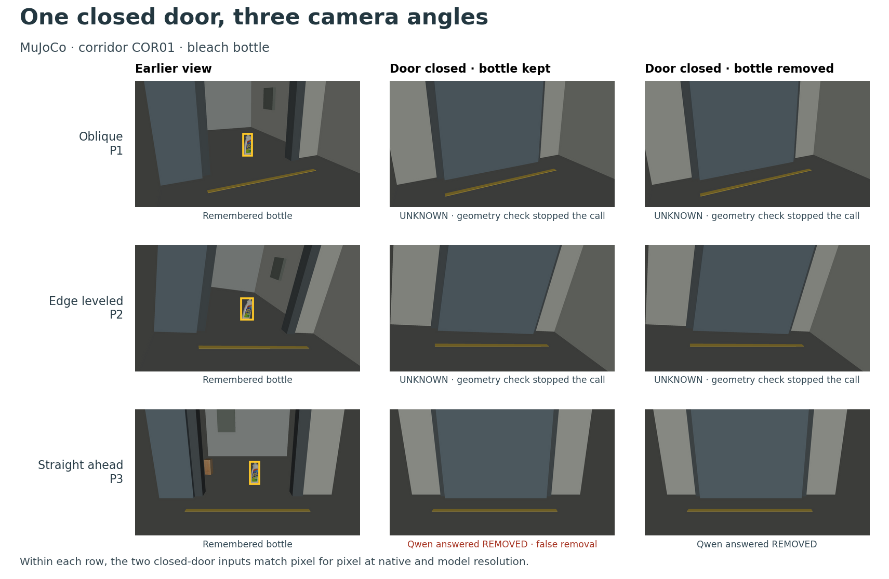
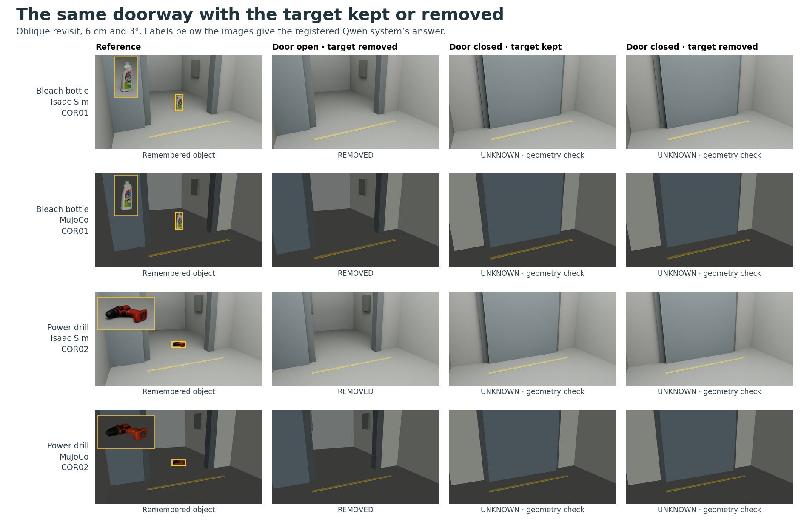

# Can a hidden object still look removed in a service corridor?

**The oblique shelf result did not repeat at the same angle. The false deletion did recur from straight ahead.** Across eight new MuJoCo corridors, the geometry check returned UNKNOWN on all eight oblique closed-door pairs before Qwen saw either image pair. From straight ahead, seven of the eight layouts passed that check in both physical states. Qwen answered REMOVED every time, including seven times when the bottle or drill was still behind the door. The eighth layout stopped at the geometry check. Each matched pair had identical images, target box and task. [Paired results](figures/2026-11-18-corridor-transfer/pairs.csv) · [Independent recount](figures/2026-11-18-corridor-transfer/independent-review.json)

This is the first declared corridor, COR01. The yellow box marks the previously observed bottle. Both closed-door inputs match pixel for pixel within each row. The experiment sent each revisit separately. [Displayed cases and image hashes](figures/2026-11-18-corridor-transfer/illustrated-angles.json)

## From the shelf to the corridor

On a MuJoCo shelf, the registered Qwen system reported removal on both members of four physically opposite, pixel-identical pairs. In a follow-up, those four errors repeated at the original angles. Leveling the camera stopped all four calls at the geometry check. The corridor experiment asks whether either behavior transfers to new objects, room geometry and an occluder. [Original case study](../CASE_STUDY.md) · [Shelf follow-up](2026-11-18-level-shelf.md)

## What changed in the corridor

A power drill or a bleach cleanser bottle rests on the floor beyond a sliding door. Both targets are new to this audit. The target stays or disappears while the door is parked or closed. The floor marking, walls, door frame, nearby objects, cameras and target have the same coordinates in both simulators. The eight layouts vary corridor width, doorway depth, object location and object rotation. Each target appears in four layouts. One additional engineering fixture sits outside the evaluation. [Scene generator](../development/corridor_transfer/scene.py) · [Declared panel](../development/corridor_transfer/declaration.json)

P1 looks obliquely through the doorway. The revisit shifts 6 cm sideways and turns 3°. The painted floor marking tilted 9.90°–13.17° in the actual P1 revisit cameras. P2 keeps both P1 lens positions and viewing directions. Each camera rotates about its optical axis until the marking looks level. P3 looks down the passage from the centerline. Its revisit shifts 6 cm sideways with fixed heading and downward pitch. The marking was level to within 0.001° in every P2 and P3 camera in both engines. [Measured camera angles](figures/2026-11-18-corridor-transfer/camera-angles.csv) · [Camera checks](../development/corridor_transfer/verify_geometry.py)

We fixed the task, model checkpoints, prompts, image resolution, geometry thresholds and three decision rules from the paper. Every scorer received an anonymous reference image, its target box and one revisit. The evaluator kept the simulator masks, physical states and pair identities separate. The primary test required REMOVED on both members of an oblique, closed-door MuJoCo pair with identical inputs. Two distinct layouts qualified as recurrence across layouts. [Prospective protocol](../development/corridor_transfer/PROTOCOL.md) · [Original verifier specification](../paper/evidence/design/specification.json)

## What the cameras saw

With the door open, all 24 retained views per engine showed 100% of the isolated target mask. Closing the door took the visible area to zero in every view. In MuJoCo, keeping or removing the hidden object then produced identical native revisits at every angle. In Isaac Sim, the same intervention changed 42.7%–50.7% of native pixels by at least one channel level. The mean absolute channel change was only 0.18–0.22 on the 0–255 scale. Physical state is known in both engines. Testing whether Isaac's residual differences carry usable evidence would require a separate control. [Pair and mask measurements](figures/2026-11-18-corridor-transfer/pairs.csv) · [MuJoCo pixel comparison](figures/2026-11-18-corridor-transfer/mujoco-native-pixels.csv) · [Isaac pixel comparison](figures/2026-11-18-corridor-transfer/isaac-native-pixels.csv)

## What the geometry controls did

The homography verifier called a hidden drill removed on MuJoCo layout COR06 in the oblique view. It gave the same answer when we actually removed the drill. From straight ahead in Isaac, it also falsely removed four hidden targets. Dense geometry abstained on every closed-door query in both engines. Its one false removal occurred with the door open, on the retained MuJoCo drill in COR02 after leveling. The two geometry methods found the same number of clear removals overall in each engine, although they found different individual removals in MuJoCo. [Per-query records](figures/2026-11-18-corridor-transfer/decisions.csv) · [Paired pose comparisons](figures/2026-11-18-corridor-transfer/pose-comparisons.csv)

## Results from all three methods

Each engine contributed 96 queries across the same eight layouts. Clear removals count the 24 open-door revisits with the target removed. False removals count REMOVED on any of the 48 retained revisits. A definite answer is PRESENT or REMOVED. [All 576 decisions](figures/2026-11-18-corridor-transfer/decisions.csv) · [Scores by method and view](figures/2026-11-18-corridor-transfer/method-by-view.csv) · [Breakdown by object and physical state](figures/2026-11-18-corridor-transfer/summary.json)

| Simulator | Verifier | Clear removals found | False removals on retained targets | Definite answers |
| --- | --- | ---: | ---: | ---: |
| Isaac Sim | Homography | 24/24 | 4/48 | 56/96 |
| Isaac Sim | Dense geometry | 24/24 | 0/48 | 37/96 |
| Isaac Sim | Qwen3.5-9B with geometry check | 24/24 | 3/48 | 47/96 |
| MuJoCo | Homography | 17/24 | 1/48 | 35/96 |
| MuJoCo | Dense geometry | 17/24 | 1/48 | 30/96 |
| MuJoCo | Qwen3.5-9B with geometry check | 20/24 | 7/48 | 52/96 |

**Oblique and leveled views.** MuJoCo supplied eight exact closed-door pairs at each angle. The geometry check stopped all 16 pairs. The primary failure count was 0/8, and no primary failures were eligible for the conditional leveling test. In Isaac, Qwen falsely removed a hidden drill on two oblique layouts, COR04 and COR08. Leveling stopped the retained COR04 error. The COR08 error persisted. All Isaac pairs differed in RGB. [Matched camera decisions](figures/2026-11-18-corridor-transfer/pose-comparisons.csv)

**Straight ahead, door closed.** MuJoCo produced the double-REMOVED error on all four bottle layouts and three of four drill layouts. COR02 was the drill layout where the geometry check stopped both calls. In Isaac the check stopped all eight frontal pairs. Across all views and both simulators, the check stopped 93 of 192 queries. Qwen gave a definite answer on each of the 99 calls it received. All three methods completed all queries without an execution failure. [Paired results](figures/2026-11-18-corridor-transfer/pairs.csv) · [Independent recount](figures/2026-11-18-corridor-transfer/independent-review.json)

**Straight ahead, door open.** Qwen falsely removed 0/8 fully visible retained targets in each engine. It correctly called PRESENT on 8/8 in MuJoCo and 7/8 in Isaac. The geometry check stopped the remaining Isaac case. The visible-marker error from the shelf therefore did not repeat on these corridor targets. [Decisions](figures/2026-11-18-corridor-transfer/decisions.csv)

The wider figure shows the first declared layout for each object in both simulators. The original delivered images supplied every panel. The yellow outline and inset identify the remembered object in the reference. [Image hashes and decisions](figures/2026-11-18-corridor-transfer/illustrated-cases.json) · [YCB object credits](../paper/evidence/ASSET-CREDITS.md)

## What this adds to the paper

The audit transfers to a new room, occluder and two new targets. In both the shelf and the corridor, a verifier accepted an exact pair and reported a deletion that the images could not establish. The prospective corridor test also found a boundary to that claim. The original oblique failure did not recur, and leveling alone had no opportunity to rescue it. The seven frontal failures are a separate observation from a declared view. P3 also changes the lens position, viewing direction and revisit yaw relative to P1. These data cannot assign that difference to a single camera parameter. Eight designed layouts represent one corridor family. [Prospective protocol](../development/corridor_transfer/PROTOCOL.md) · [Camera measurements](figures/2026-11-18-corridor-transfer/camera-verification.json)

The next experiment should give each policy one additional camera view on fresh layouts. Include both a view that can reveal the remembered location and a view where it stays hidden. Compare viewpoint selection with fixed and random moves under the same budget. Count how often the extra view recovers a correct update and how often it introduces a false deletion. This would test whether collecting new evidence helps a robot act on UNKNOWN. [Study roadmap](../docs/EVALUATION_PLAN.md)

## Check the evidence

The protocol and design were recorded before predictions. An independent recount checked the raw answers, the target masks, all 96 pairs and the paper's scorer settings. The [portable archive](https://github.com/Adithya-Rajendran/cmpe249-active-verification/releases/download/scene-memory-audit-v1/corridor-transfer-inputs.zip) contains the blinded inputs, native RGB and masks, scene recipes, raw answers and its own verifier. [Pre-score input checks](figures/2026-11-18-corridor-transfer/input-qualification.json) · [Design receipt](figures/2026-11-18-corridor-transfer/design-release.json) · [Archive checksum and verification](figures/2026-11-18-corridor-transfer/input-archive.json)
