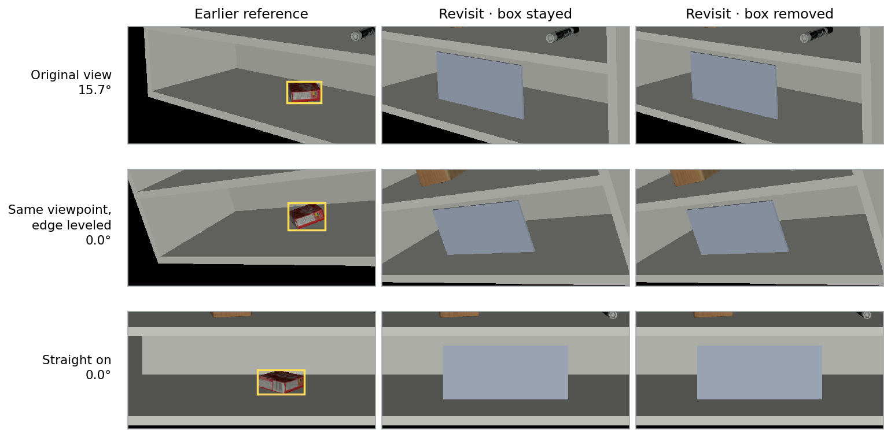
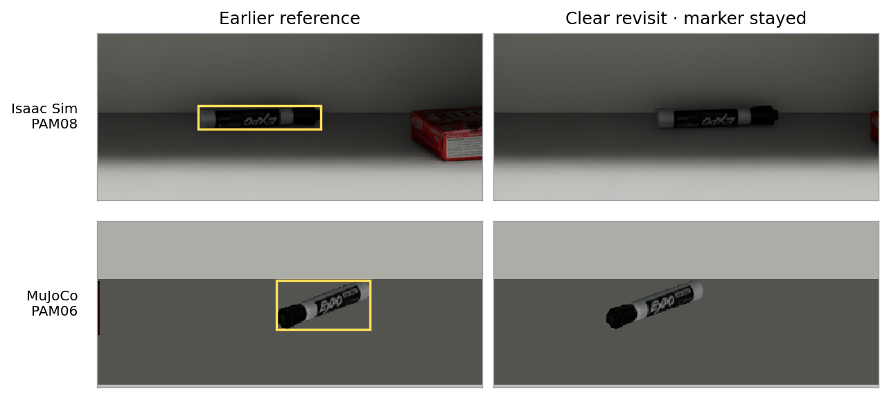

# Does the shelf angle explain the false removal?

The shelf boards were horizontal. The oblique camera made their front edges slope in the image. In the illustrated MuJoCo case, the Qwen3.5-9B system again reported a hidden gelatin box removed. Leveling the floor’s front edge from the same camera position changed both answers to UNKNOWN. A straight-on camera also gave UNKNOWN. In both conditions the geometry check withheld the question from Qwen. [Camera protocol](../development/level_shelf/PROTOCOL.md) · [Per-query decisions](figures/2026-11-18-level-shelf/decisions.csv)

## The illustrated box

The [shelf input archive](https://github.com/Adithya-Rajendran/cmpe249-active-verification/releases/download/scene-memory-audit-v1/level-shelf-inputs.zip) includes the exact reference and revisit PNGs, native RGB and masks, original scores, and pair tables for this follow-up.

The original reference marked the box on an unobstructed shelf. On the revisit we placed a panel in front of it. The simulator kept the box for one query and removed it for the other. We scored both versions independently. The same earlier picture, earlier bounding box, prompt and later RGB image reached the verifier in each MuJoCo pair.

| Camera treatment | Front-edge angle in the revisit | Fraction of reference box mapped by VGGT | Box stayed | Box removed |
| --- | ---: | ---: | --- | --- |
| Replayed original P5 | 15.73° | 65.2% | REMOVED | REMOVED |
| Same camera position, edge leveled | 0.00° | 0.0% | UNKNOWN | UNKNOWN |
| Straight on | 0.00° | 34.8% | UNKNOWN | UNKNOWN |

The geometric check requires 60% of the reference box to have a usable mapping. It admitted both original images. It stopped both images in each corrected view. All three views hid the box completely, and each retained/removed pair was pixel-identical at both native and scoring resolution. The two geometric verifiers answered UNKNOWN in all six cases. [Matched pairs](figures/2026-11-18-level-shelf/pairs.csv) · [Measured camera angles](figures/2026-11-18-level-shelf/camera-angles.csv)

The numbers beside the rows measure the floor board’s front edge. Each row uses one crop across its three panels. The model received the full reference and revisit and its usual computed crops. In Isaac Sim, the target also contributed zero visible pixels in all three blocked views. The two Isaac renders differed in each pair and the system answered UNKNOWN in all six cases. [Isaac Sim images](figures/2026-11-18-level-shelf/isaac-level-shelf.png)

## Eight matched shelf layouts

We reused all eight shelf layouts from the paper. The two oblique stops include all four previously identified MuJoCo pairs with unsupported Qwen removals. Each layout contained a gelatin box or a large marker as its target. A panel or white box served as the blocker. Each engine rendered the reference and all four combinations of target retained/removed and blocker parked/placed.

The roll-only condition kept each lens position, viewing direction, focal length, 6 cm travel and original 3° revisit yaw. We rotated each reference and revisit separately about its optical axis until the floor board’s front edge appeared horizontal. The frontal condition placed the camera on the shelf centerline at the original height and arc radius. Its revisit translated 6 cm sideways with zero yaw, pitch and roll. This condition tests a different line of sight as well as a different orientation. [Design release](figures/2026-11-18-level-shelf/design-release.json) · [Capture record](figures/2026-11-18-level-shelf/capture-receipt.json)

| Engine | View | Identical inputs / blocked pairs | Qwen-system removal calls on identical pairs | False removals / all retained queries | Correct clear removals |
| --- | --- | ---: | ---: | ---: | ---: |
| MuJoCo | Original oblique | 7/16 | 4/7 | 8/32 | 16/16 |
| MuJoCo | Same positions, edge leveled | 7/16 | 0/7 | 4/32 | 16/16 |
| MuJoCo | Straight on | 8/8 | 0/8 | 1/16 | 8/8 |
| Isaac Sim | Original oblique | 0/16 | — | 4/32 | 16/16 |
| Isaac Sim | Same positions, edge leveled | 0/16 | — | 2/32 | 16/16 |
| Isaac Sim | Straight on | 0/8 | — | 1/16 | 8/8 |

A dash means the renderer produced no identical pair for that comparison. All four original MuJoCo errors reproduced before the roll correction. All four switched to UNKNOWN after it. Those pairs span three layouts. The three corresponding frontal pairs also produced UNKNOWN. Front-on views hid all eight targets completely in each simulator. With the blocker parked, every frontal retained-target mask covered 100% of its isolated target silhouette. [Pairs](figures/2026-11-18-level-shelf/pairs.csv) · [Full counts](figures/2026-11-18-level-shelf/summary.json)

The roll correction also changed useful answers. Across the 64 MuJoCo queries, the number of correct definite answers fell from 38 to 33. In Isaac it stayed at 35 of 64. In each engine all 16 clear removals were still detected. Across the entire 320-query panel the geometry check stopped 128 calls. Qwen gave a definite answer on all 192 calls it received. [Individual decisions](figures/2026-11-18-level-shelf/decisions.csv)

## A separate failure with the camera straight on

In each engine Qwen reported one clearly exposed marker removed on a straight-on revisit. The Isaac marker in PAM08 covered all 3,190 pixels of its isolated mask. The MuJoCo marker in PAM06 covered all 2,764. The geometry check mapped 100% of the reference box in both cases. Both geometric verifiers correctly answered PRESENT on these two specific queries. [Decisions and visibility](figures/2026-11-18-level-shelf/decisions.csv)

## Interpretation and reproducibility

The box example demonstrates a pose-sensitive false deletion. Rotating the camera changed whether the registration stage let Qwen answer. The images remained just as ambiguous. A level, front-facing view can also yield a false deletion when the object is fully exposed. This follow-up supports reporting these two failure modes separately. The eight reused layouts and two targets define the scope of the observed rates.

All three frozen verifiers scored 320 blinded queries without technical errors. In MuJoCo all 64 original-view inputs and predictions per method reproduced. In Isaac, the re-rendered RGB differed from the archive. Both geometric methods repeated all 64 decisions. Qwen repeated 63. On retained PAM04 at original P5 it changed from REMOVED to PRESENT. The table compares the fresh controls with the fresh interventions. [Blinded packet checks](../development/level_shelf/validate.py) · [Independent recount](figures/2026-11-18-level-shelf/independent-review.json)
