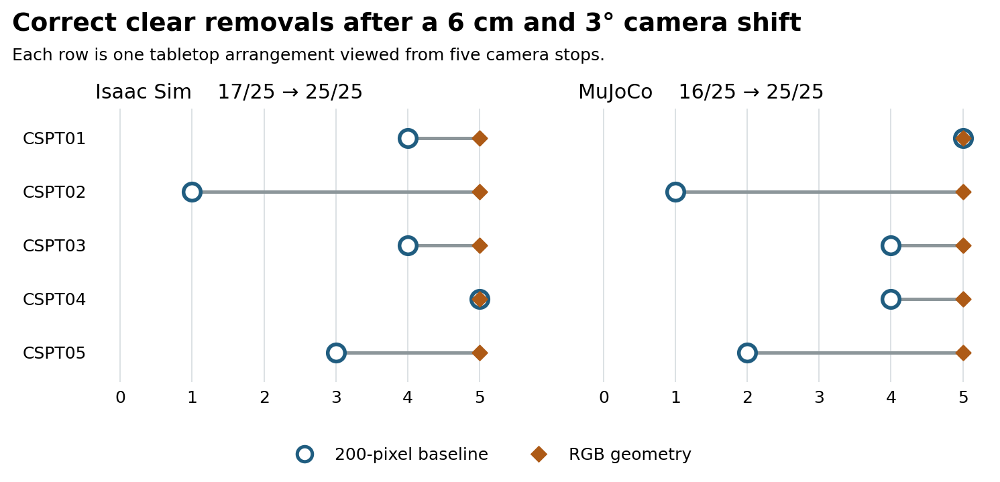
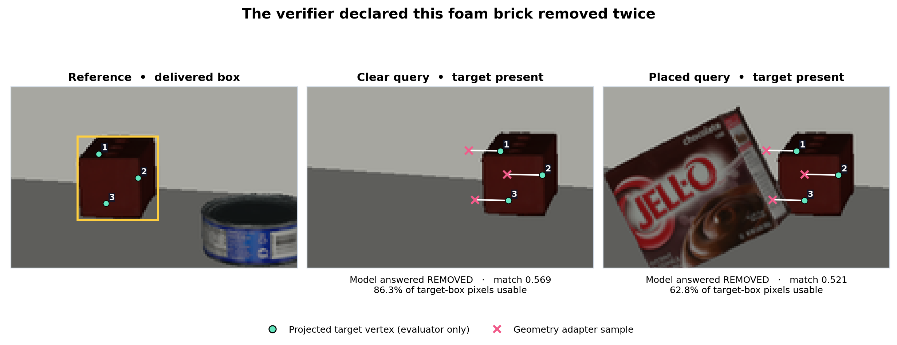
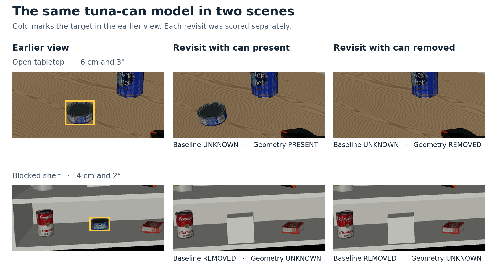

# RGB geometry for verifying a remembered object

This development experiment asks whether two-view geometry helps a verifier find the remembered region after a camera move and abstain when that region is hidden. It compares an adaptation of GeoSCD's geometry stage with the 200-pixel alignment baseline on the same ten arrangements in Isaac Sim and MuJoCo. [Earlier paired pilot](2026-11-17-cross-sim-pilot.md) · [Prospective comparison protocol](../development/cross_sim/geometry_protocol.json)

## Decision

**Stop this version of the geometry verifier.** It resolved every clear tabletop removal at the largest camera move in both simulators. It also incorrectly declared the same foam brick removed in two shelf views where the baseline correctly found it. The development rule allowed zero new wrong answers. Three of the four criteria passed. [Decision and complete counts](figures/2026-11-18-geometry-comparison/summary.json) · [Dated scoring release](figures/2026-11-18-geometry-comparison/candidate-release.json)

| Criterion fixed before candidate scoring | 200-pixel baseline | RGB geometry | Outcome |
| --- | ---: | ---: | --- |
| Clear MuJoCo tabletop removals at 6 cm and 3° exceed 16/25, with net gains in at least two arrangements | 16/25 | 25/25, gains in 4 of 5 | Pass |
| Clear Isaac tabletop removals at the same displacement reach at least 17/25 | 17/25 | 25/25 | Pass |
| Zero newly wrong definite answers across the same 1,200 images | Reference | 2 | Fail |
| Both answers are UNKNOWN for all 40 certified ambiguous pairs | 39/40 | 40/40 | Pass |

The candidate recovered all three recurring MuJoCo tuna-can removals that prompted the experiment. The five tabletop arrangements supplied five views each. On clear tabletop removals at this displacement, every arrangement either improved or kept its baseline score in both simulators. The criterion was chosen after the original pilot, on these same arrangements. [Counts by arrangement](figures/2026-11-18-geometry-comparison/arrangements.csv)

## All 1,200 decisions

| Simulator | Correct, baseline → geometry | UNKNOWN, baseline → geometry | Wrong, baseline → geometry |
| --- | ---: | ---: | ---: |
| Isaac Sim, 600 queries | 404 → 425 | 196 → 175 | 0 → 0 |
| MuJoCo, 600 queries | 399 → 421 | 200 → 177 | 1 → 2 |
| Both engines | 803 → 846 | 396 → 352 | 1 → 2 |

Geometry gained 113 correct answers and lost 70. All 113 gains came from prior abstentions. The net gain was 43/1,200, or 3.58 percentage points. Resampling whole arrangements and retaining their paired engine observations gave a descriptive 95% interval of −2.92 to +11.08 points. There were five shelf and five tabletop arrangements. The two new errors are physically wrong even on the more limited physical-state endpoint. [All 48 conditions](figures/2026-11-18-geometry-comparison/cells.csv) · [All paired decisions](figures/2026-11-18-geometry-comparison/case_decisions.csv)

## What failed at the shelf

The two new false removals occurred at MuJoCo shelf arrangement CSPS05, camera stop P4, after a 4 cm and 2° move. The brick stayed in place. In one image the blocker was parked. In the other it covered part of the brick. The baseline answered PRESENT on both. The geometry verifier accepted 86.3% and 62.8% of the box as usable. Its appearance matches were 0.569 and 0.521, both below the 0.60 absence threshold. It answered REMOVED twice. The candidate also stopped the baseline's earlier false removal in a different shelf arrangement by returning UNKNOWN to both physically opposite, pixel-identical inputs. [Case measurements](figures/2026-11-18-geometry-comparison/false-removals.json)

On reference vertices that both methods could map, median target-position error rose from 4.02 to 17.38 pixels on the clear view and from 4.58 to 16.76 on the partly blocked view. Across the 933 queries with a shared measurable target point, the median of the per-query errors fell from 2.40 to 1.81 pixels. An estimated map can cover much of the box and still put that box in the wrong place. Alignment error and a low appearance match occurred together in these two views. Their separate causal contributions remain uncertain. For removed targets, the diagnostic projects the remembered position. Missing or occluded points contribute no distance. [Landmark summary](figures/2026-11-18-geometry-comparison/landmarks.json) · [Evaluator](../development/cross_sim/geometry_residuals.py)

The scoring and independent recount agreed on every answer, every box fraction, all 48 condition summaries and all 40 certified pairs. The independent reader rechecked both supplied images per case, all 1,200 correspondence archives and the original baseline record inventory. The measured target-position errors used simulator meshes and camera poses only after scoring. [Verification record](figures/2026-11-18-geometry-comparison/verification.json)

## The same tuna can in two MuJoCo scenes

On the open tabletop, the baseline answered UNKNOWN both when the can remained and when it had been removed. Geometry answered PRESENT and REMOVED respectively. On the blocked shelf, the two revisit images matched pixel for pixel across the full frame. The baseline answered REMOVED twice. Geometry answered UNKNOWN twice. Each method received the earlier reference and only one revisit at a time. We selected these examples after scoring to illustrate the decisions. [Case records and image hashes](figures/2026-11-18-geometry-comparison/tuna-can-pairs.json)

Across both simulators, geometry raised correct physical answers on tabletops from 370 to 447 out of 600. On shelves they fell from 433 to 399 out of 600. These are the five tabletop and five shelf arrangements in this development pilot. [All case decisions](figures/2026-11-18-geometry-comparison/case_decisions.csv)

## What comes next

Keep the 200-pixel baseline and the stopped geometry version as development comparisons. The remaining paper question is whether the images justify a decision about the remembered location. A useful next task is to qualify a reference for visual support on partly occluded views. Use separate simulation controls, require reviewers to identify the target or the visible empty location, and check their judgments blind to predictions. The exact-input pairs already certify some UNKNOWN cases. Unresolved judgments stay unscored for support. The full-pilot counts above use physical state. [Label qualification](../development/stress/LABEL_QUALIFICATION.md) · [Evaluation plan](../docs/EVALUATION_PLAN.md)

## Experiment and checks

Each method received the same reference RGB, reference target box and query RGB for each of the 1,200 inputs. The target could remain or be removed, with a blocker parked or placed. The simulators supplied the physical states to the evaluator. The geometric method estimated its own depth, camera motion and visibility from the images. Both methods used the same target matcher, quality and obstruction calculations, downstream model weights, decision thresholds and input resolution.

The adapted method projects points from one image into the other, uses the predicted depths to identify blocked points, and estimates subpixel displacements on the verifier's image grid. We specified a minimum usable fraction of 60% of the target box before any candidate pilot prediction. The numerical choice follows the complement of the baseline's 40% obstruction ceiling. The box fraction and the downstream obstruction score measure different things. A usable map permits the existing evidence rule to decide. [Geometry adapter](../development/cross_sim/geoscd_geometry.py) · [Shared scoring code](../development/cross_sim/geometry_run.py)

The development method uses GeoSCD's geometry stage with VGGT-1B. The authors' full change detector also uses a segmentation model. Our adapter keeps floating-point coordinates, requires positive finite depths and conservatively interpolates only usable regions. Model inference on Ascent used the pinned public weights with bfloat16 in the image encoder. The two official checkpoint formats matched on all 1,797 tensors. [Pinned geometry source](https://github.com/ZilingLiu/GeoSCD/blob/dd31369654e96d6843cc4bbcebce854a8bc2159b/src/pixel_match.py) · [Pinned VGGT checkpoint](https://huggingface.co/facebook/VGGT-1B/tree/860abec7937da0a4c03c41d3c269c366e82abdf9)

Terra replayed the original 200-pixel baseline through the shared scorer. Main independently compared every decision and every input's quality, match and obstruction score. All 1,200 answers and refusal states matched. The maximum difference on each evidence score was zero. Replay audit (local run `runs/2026-11-18-geoscd-development-v1/review/baseline-check.json`)

Analytic fixtures verified the coordinate direction, visibility mask and behavior at image boundaries. Two independent offline model runs produced identical warped pixels and validity masks on a separate textured fixture. That fixture moved four pixels to the right. Across 14,899 textured, valid pixels in its target box, the model estimated a median displacement of +1.86 pixels horizontally and −0.57 vertically. Its map was closer to zero displacement than to the known displacement. This measures underestimation on one artificial image. Direct measurement (local run `runs/2026-11-17-cross-sim/reviewer/geoscd-direction-fixture-v2/output/result.json`)

Each certified pair supplies identical reference pixels, target box and query pixels under opposite physical states. Those inputs cannot distinguish the two states. Physical correctness elsewhere uses the simulator intervention. The support of other definite answers still needs independent validation. [Certificate and input checks](2026-11-17-cross-sim-pilot.md#what-the-simulator-can-certify)
