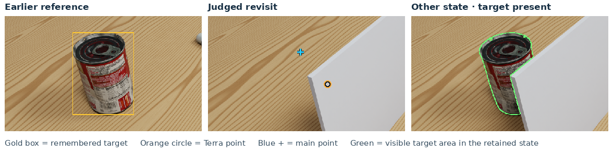
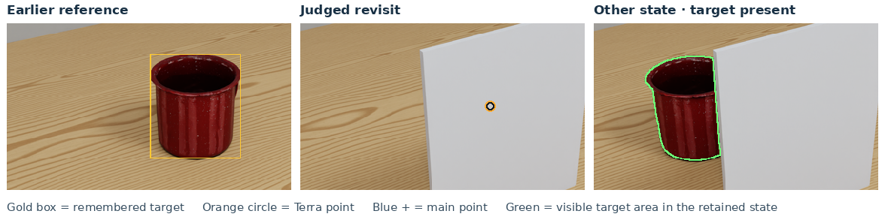

# Can Terra label partly occluded views?

**Development decision, November 18, 2026. Terra failed the qualification in both Isaac Sim and MuJoCo.**
In each simulator, Terra identified all four partly visible retained objects and answered UNKNOWN on all four partly occluded removals.
All eight clear controls passed across the two engines. Every definite Terra answer matched the intervention and had a corroborated visual cue.
The failure was that Terra missed evidence of removal when a panel covered only part of the remembered location. [Fixed rules](../development/cross_sim/support_labels/PROTOCOL.md) · [Results](figures/2026-11-18-support-label-qualification/results.json)

## What each reader saw

The pilot used four fresh arrangements, two shelves and two tabletops. Both engines rendered the same object placements and camera settings.
Five stops and two displacement levels supplied candidate views. The levels were the original pose and 6 cm of translation with 3° of yaw.
Before annotation, the camera and object checks passed in both engines. [Cohort definition](../development/cross_sim/support_label_cohort_protocol.json)

Selection used the simulator masks before any judgments. A partly blocked target had to retain 10% to 90% of its clear silhouette in both engines.
The blocker had to cover at least 8% of that silhouette. Each arrangement supplied two partial camera positions, one clear control and one hidden control per engine.
Each selected position supplied one physical state to the readers. The evaluator kept the opposite intervention at the same camera position. [Selection rules](../development/cross_sim/support_labels/PROTOCOL.md#image-selection)

Eight fresh Terra sessions each saw four anonymous cases, one from each arrangement. They received a boxed earlier reference, an unmarked revisit and a reference-based coordinate aid.
Terra saw no predictions, simulator records, other readers' judgments or opposite-state images. The project verifier did not run on these cases.
The main reviewer knew the design and saw all 32 image pairs in a separate shuffled order. Both reviews were locked before either simulator evidence or Terra's answers were opened by the main reviewer. [Reader instructions](../development/cross_sim/support_labels/REVIEWER.md)

For every definite answer, the reviewers named the visible feature or exposed remembered space and marked a point on the revisit.
The evaluator checked the registered target mask, the change in the 7 × 7 patch when the target was removed, and a repeat capture.
The main reviewer then examined every explanation and its matched images. A corroborated definite answer required agreement on the physical state, two passing points and a specific visible cue.
An UNKNOWN certificate required identical full inputs for opposite physical states. Every disagreement or uncertified abstention stayed in the results. [Evidence rule](../development/cross_sim/support_labels/PROTOCOL.md#evidence-checks-and-decision) · [All 32 visual reviews](figures/2026-11-18-support-label-qualification/casebook.html)

## Results

| Measure | Isaac Sim | MuJoCo |
| --- | ---: | ---: |
| Corroborated PRESENT on partial retained cases | 4/4 | 4/4 |
| Terra REMOVED on partial removal cases | 0/4 | 0/4 |
| Corroborated definite answers on all partial cases | 4/8 | 4/8 |
| Corroborated definite answers on clear controls | 4/4 | 4/4 |
| Both readers answered UNKNOWN on hidden controls | 4/4 | 4/4 |
| Hidden controls with pixel-identical opposite states | 0/4 | 4/4 |
| Physically wrong definite Terra answers | 0/8 definite | 0/8 definite |
| Any agreement between the two readers | 14/16 | 14/16 |

Each engine needed at least six corroborated partial cases out of eight, including one PRESENT and one REMOVED, and three clear controls out of four.
Both engines missed the partial count and the requirement for a supported removal. Across all 32 cases, the reviewers agreed 28 times. Sixteen definite answers and four exact UNKNOWN answers met the evidence rule.
The four fully hidden Isaac pairs differed somewhere in their delivered pixels. Zero visible target pixels and two abstentions alone cannot settle whether a person or model could use those differences. [Per-case data and original explanations](figures/2026-11-18-support-label-qualification/case-review.csv)

A separate implementation recomputed the complete-input comparisons, both readers' local evidence checks, the totals and each engine's qualification decision from the saved renders. It reproduced all 32 records. [Independent recount](figures/2026-11-18-support-label-qualification/independent-recount.json)

## Where the removal judgments failed

The four rows below are four camera conditions. Each row occurred once in each simulator. The visibility column describes the evaluator's retained counterpart at the same camera and blocker position.

| Removed object | Camera | Retained silhouette exposed | Blind decisions and evidence |
| --- | --- | ---: | --- |
| Dark brick, lower shelf | Original | 76% | Terra said UNKNOWN. The main reviewer marked open shelf immediately left of the panel. Restoring the brick covers the marked patch in both engines. |
| Soup can, tabletop | Original | 71% | Terra marked the panel and said UNKNOWN. The main reviewer marked wood where the pull-tab lid had been. The retained twin places the lid over every pixel of that patch. |
| Blue tin, lower shelf | Moved | 15% | Both said UNKNOWN. The retained twin exposes a narrow strip to the left of the panel. Neither reader located that strip from the judged pair. |
| Red mug, tabletop | Moved | 79% | Both said UNKNOWN. The retained twin places most of the mug left of the panel. Both readers mislocalized the remembered position. |

For the shelf brick in MuJoCo, even Terra's optional point for UNKNOWN landed on exposed shelf that the retained brick would cover. Its explanation still treated the panel as hiding the brick.
For the soup can in another view, both readers recognized the retained object from its rim and printed label with only 21% of the silhouette visible.
The availability of an identifying feature and the ability to locate an empty remembered spot are different demands. A visible-area percentage alone settles neither. [Brick case](figures/2026-11-18-support-label-qualification/casebook.html#250ee6a54894) · [Partly visible soup can](figures/2026-11-18-support-label-qualification/casebook.html#5d6cf73a6525)

The orange circle marks Terra's point. The blue cross marks the main reviewer's point. The right image shows where the can actually appears when retained. It was private during labeling.

## What this changes

Use Terra to operate the simulators and propose visible target cues for inspection. These results do not qualify its UNKNOWN judgments as support labels for partial removals.
Keep those cases unresolved in support scoring. Preserve both locked readings, including the four main-only removal judgments, and keep the support-based model comparison on hold.

The next experiment should test whether explicitly locating the remembered object helps a reader establish removal. Compare the current instructions with a two-step reading on fresh arrangements.
First have the reader locate the remembered region from visible landmarks. Then have it identify which part is exposed and decide whether a retained object must appear there.
Use the same camera inputs for the two instruction sets, with different blind readers. Balance retained and removed targets across fixed and moved cameras, and include exact hidden controls.
Carry forward the original per-engine requirements. An increase in removal calls counts only if the cited patches support them. A wrong definite answer or a definite guess on an exact hidden pair fails the screen.

This pilot used two AI reviewers, four selected arrangements, and matched versions of those arrangements in both engines. The environment, target and selected camera are linked within the four partial removal conditions.
The examples locate failures in these images. They do not estimate an error rate for a wider population, isolate camera motion as the cause, or validate a 1% unsupported-error threshold.
