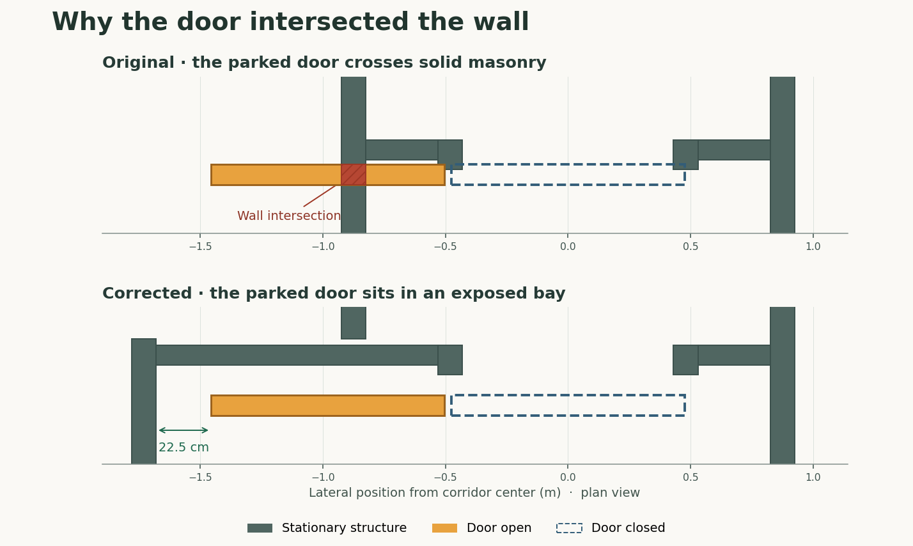
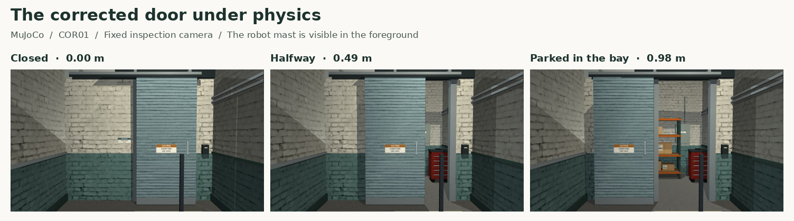
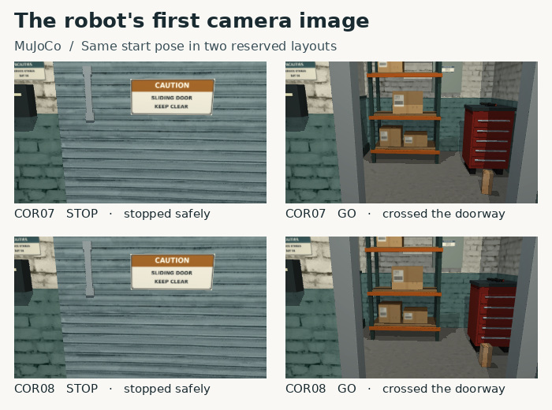
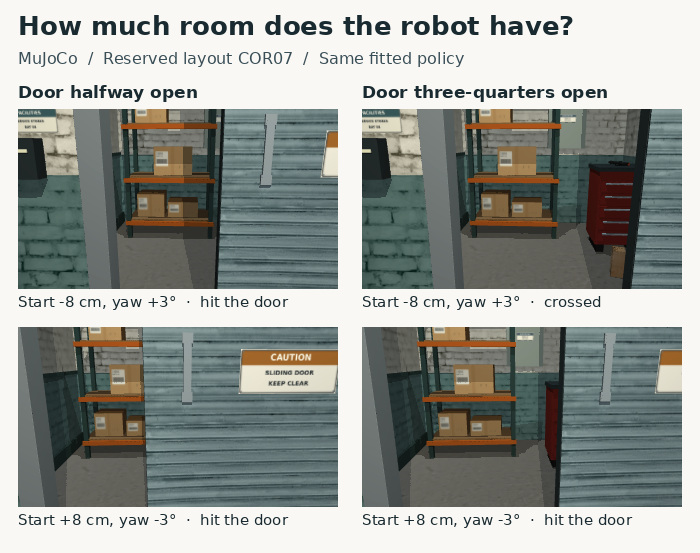
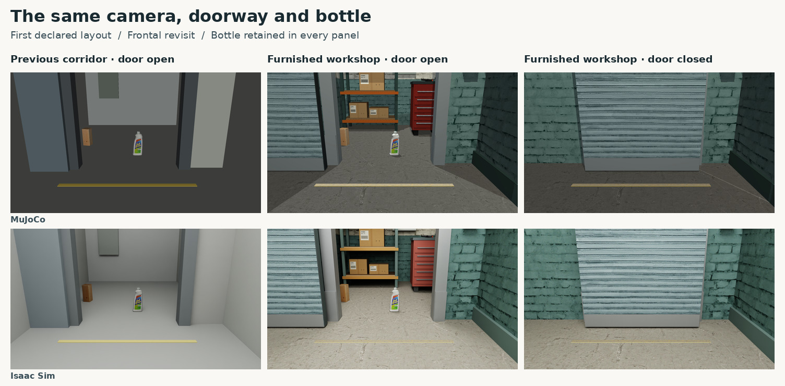
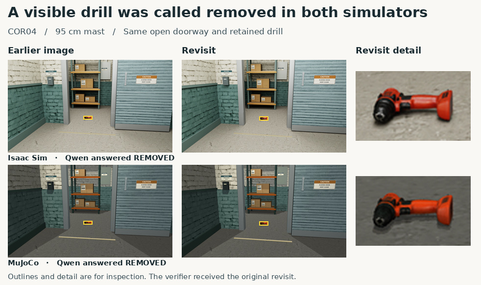

# A physically traversable workshop for robot scene memory

The false deletion seen in seven of eight plain corridors occurred in **zero of eight** matching frontal MuJoCo views in the furnished workshop. All eight hidden-object comparisons remained pixel-identical. The geometry check stopped every one before Qwen ran. On the new robot-mounted views, the same system called a fully visible drill removed six times across the two simulators. The strongest verifier in the corrected workshop was the simple homography baseline. [Paired changes](figures/2026-11-18-workshop-clearance/paired-changes.csv) · [All methods](figures/2026-11-18-workshop-clearance/summary.json)

The workshop also supports a separate robot training task. A camera policy handled all eight fully open and closed test episodes, then struck partly open doors in seven of twelve trials. The two studies share a facility and evaluate different decisions. [Physical test results](figures/2026-11-18-workshop-clearance/partial-openings.json)

## The door and the robot

The first furnished room had a real geometry defect. In COR01 the parked leaf reached 1.455 m from the centerline. Solid masonry began at 0.825 m. Placing the panel directly at either endpoint allowed the camera experiment to run despite that intersection. The student noticed it in the rendered images during scoring. We archived that run and froze the correction before collecting the new panel. [Superseded run](2026-11-18-workshop-realism.md) · [Recorded amendment](../development/workshop_realism/DOOR_AMENDMENT.md)

The fixed room has a visible parking bay, relocated jambs and a full overhead guide. An exact continuous sweep of the door envelope found at least 12 mm of clearance from every fixed box and cladding surface. Its outer edge stays 225 mm from the parking wall. The open and closed endpoint images retain the previous camera positions, the target poses, the door width and the 98 cm sideways travel. The corrected leaf clears the floor by 14 mm. [Swept-volume results](figures/2026-11-18-workshop-clearance/door-clearance.json) · [Scene generator](../development/workshop_realism/door_clearance.py)

The same sweep from measured native bounds checked 92 architectural shapes plus the target and two other objects per scene. Across both camera conditions and both simulators, the closest architectural surface was the overhead rail. The closest object stayed at least 28.3 cm from the sweep. [Native clearance checks](figures/2026-11-18-workshop-clearance/native-clearance.json) · [Scene regeneration](figures/2026-11-18-workshop-clearance/design-replay.json)

We ran a differential-drive robot with two powered wheels, free ball casters, wheel encoders and mounted cameras in MuJoCo. The test kept the target out of the robot's path. With the same forward command on each of eight layouts, the bumper made contact with the closed door. Under sustained drive, the contact solver recorded a maximum bumper penetration of 2.7–3.7 mm across layouts. Opening the door allowed eight crossings with zero bumper contacts. Every robot center finished at least 0.99 m past the door plane. A separate steering test exercised the wheels and reset. The excluded fixture and the first panel layout also verified that the camera image changed with the robot's heading. [Native robot rollouts](figures/2026-11-18-workshop-clearance/robot-rollouts.json)

Isaac Sim exercised a driven sliding joint and a guided cart on the same eight layouts. The cart center stopped 20.1 cm before each closed door and reached 54.7 cm beyond each open door. The cart exists only during the clearance test. Each exported facility includes the original target, a signed joint limit for its parking side and 76 collision shapes. We reopened every stage and verified that all 13 textures resolved inside its own USDZ. [Isaac motion tests](figures/2026-11-18-workshop-clearance/isaac-robotics.json) · [Facility package](figures/2026-11-18-workshop-clearance/isaac-package.json)

A separate learning demonstration used 72 camera images from six layouts to fit a two-class policy. On two reserved layouts it selected STOP in all four closed-door episodes and GO in all four open-door episodes. It took one initial camera image, chose an action, and physically executed it. The entrance task demonstrates that an agent can learn and act in the facility. The object-memory audit below asks a different question about what a single revisit can establish. [Training example](../development/workshop_realism/train_navigation.py) · [Reserved episode results](figures/2026-11-18-workshop-clearance/navigation-demo.json)

### What happens between fully open and fully closed?

We kept the fitted policy fixed and parked the door at five fractions of its travel. The model saw only the initial mast image. For each start, a second rollout drove straight ahead so that physical contact could test the available clearance. Crossing required the robot center to reach 30 cm past the door without contact. All eight endpoint frames matched the original evaluation. [Test design, policy hash and individual trajectories](figures/2026-11-18-workshop-clearance/partial-openings.json)

| Door open | Policy stopped | Policy hit door | Policy crossed | Driving straight crossed |
| --- | ---: | ---: | ---: | ---: |
| 0% | 4 | 0 | 0 | 0/4 |
| 25% | 3 | 1 | 0 | 0/4 |
| 50% | 0 | 4 | 0 | 0/4 |
| 75% | 0 | 2 | 2 | 2/4 |
| 100% | 0 | 0 | 4 | 4/4 |

The policy drove into the door in seven of twelve partly open trials. At 75% opening it chose GO from both starts in each layout. From 8 cm left of center and a +3° heading it crossed. From 8 cm right and a −3° heading it hit the door. Both start position and heading changed together. This checks two straight approaches within one room family. A robot that can steer or wait has additional options. [Diagnostic code](../development/workshop_realism/partial_openings.py)

A clean extraction loaded all eight MuJoCo models and their textures. Retraining reproduced the same weights and eight held-out outcomes. Running the partial-opening test again reproduced every recorded result and all 20 camera frames. The package includes both tests and the fitted policy. [Training guide](../development/workshop_realism/ROBOTICS.md) · [Package verification](figures/2026-11-18-workshop-clearance/training-package.json)

DoorGym varies door and scene properties during policy training. Interactive Gibson measures path efficiency and physical disturbance as separate outcomes. These precedents motivate testing reachable views, contact and travel alongside the correctness of a memory update. Our stop/go example provides a small simulation task with known failure cases. [DoorGym](https://arxiv.org/abs/1908.01887) · [Interactive Gibson Benchmark](https://arxiv.org/abs/1910.14442)

## The image experiment

The robot first sees a bleach bottle or power drill through the open doorway. On the revisit, the object either stays or is removed. The door independently stays open or closes. Each verifier sees one revisit at a time. The earlier corridor study supplies the matched plain-room scores. [Earlier corridor](2026-11-18-corridor-transfer.md) · [Prospective rule](../development/workshop_realism/PROTOCOL.md)

The workshop uses photographed concrete, masonry, shutter steel and plywood, stocked racks, labeled cartons, a tool chest, moving door hardware and local lights. MuJoCo uses shadow-casting spotlights. Isaac Sim uses ray-traced area lights. The first three cameras repeat the original oblique, leveled and frontal poses. The new 95 cm and 48 cm robot mounts advance 6 cm. Their pitch and heading are fixed per layout side. The earlier 192 anonymous corridor queries re-exported byte for byte through the same image pipeline. [Material sources and credits](../development/workshop_realism/ASSETS.md) · [Measured poses](figures/2026-11-18-workshop-clearance/measured-cameras.csv) · [Export check](figures/2026-11-18-workshop-clearance/previous-export-check.json)

Homography and dense geometry align the revisit and apply a fixed decision rule. The third verifier requires successful registration and a usable geometry mapping for at least 60% of the remembered box. If both checks pass, Qwen3.5-9B sees both images and two location crops. It can answer PRESENT, REMOVED or UNKNOWN. We used the original prompt, checkpoints, thresholds and camera resolution. The primary test asks how many of the eight frontal MuJoCo pairs receive REMOVED in both physical states when the complete inputs are identical. Two qualifying layouts establish recurrence on this panel. [Frozen system](../paper/evidence/design/specification.json) · [Design release](figures/2026-11-18-workshop-clearance/design-release.json)

### What the cameras actually showed

We checked 320 camera transforms. All 192 that had a plain-corridor counterpart matched, and all 48 corresponding reference boxes had identical coordinates. The 40 open-door controls in each engine exposed at least 99.93% of the isolated target mask. Every closed-door mask contained zero visible target pixels. [Measured cameras](figures/2026-11-18-workshop-clearance/measured-cameras.csv) · [Reference boxes](figures/2026-11-18-workshop-clearance/matched-reference-boxes.json) · [Input checks](figures/2026-11-18-workshop-clearance/input-checks.json)

All 40 closed-door MuJoCo pairs gave the verifier the same reference, revisit, box and task across opposite physical states. This includes eight exact opportunities for the primary frontal test. In Isaac, zero of 40 closed-door pairs matched at both resolutions. Between 64.6% and 73.0% of native pixels differed, with a mean absolute difference of 0.34–0.47 on an 8-bit color channel. Isaac therefore supplies physical false-removal counts even where exact visual ambiguity remains uncertified. [Per-pair native and delivered comparisons](figures/2026-11-18-workshop-clearance/input-pairs.csv)

### Where the decisions changed

In the plain room, geometry could map 88.5–100% of the remembered box on the seven frontal layouts where Qwen called both identical revisits REMOVED. In the furnished room, the usable fraction fell to zero on all eight. Seven previous false deletions became abstentions. The eighth layout abstained in both rooms. The camera pose, target box, target identity and inference settings matched across rooms. Several features of the scene changed together, so the paired comparison identifies sensitivity to the room as a whole. [All 288 matched comparisons](figures/2026-11-18-workshop-clearance/paired-changes.csv)

On all five camera views the gate stopped every closed-door case in both simulators. In each engine it also stopped 12 open-door cases, all with the target retained. Qwen returned a definite answer on each of its 68 calls per engine. With the door open, it detected all 40 actual removals in each simulator. Every query, including each abstention, contributes to the following totals. [Decisions and model replies](figures/2026-11-18-workshop-clearance/decisions.csv) · [Results by camera](figures/2026-11-18-workshop-clearance/method-by-view.csv)

| Simulator | Verifier | Definite / 160 | Correct / 160 | False removal / 80 retained | Detected open-door removal / 40 |
| --- | --- | ---: | ---: | ---: | ---: |
| Isaac Sim | Homography | 80 | 80 | 0 | 40 |
| Isaac Sim | Dense geometry | 64 | 61 | 3 | 40 |
| Isaac Sim | Geometry + Qwen | 68 | 64 | 4 | 40 |
| MuJoCo | Homography | 80 | 80 | 0 | 40 |
| MuJoCo | Dense geometry | 63 | 58 | 5 | 39 |
| MuJoCo | Geometry + Qwen | 68 | 66 | 2 | 40 |

Homography correctly classified every open-door case and abstained on every closed-door case. Dense geometry falsely removed three retained objects in Isaac and five in MuJoCo. All of these errors occurred with the door open. [Opposite-state pairs for each method](figures/2026-11-18-workshop-clearance/pairs.csv)

### Where Qwen still erased a visible object

All six false removals involved a retained power drill seen from a robot mount. On the 95 cm mast, the verifier falsely removed three of eight exposed targets in Isaac and one of eight in MuJoCo. The 48 cm mount produced one false removal of eight in each simulator. The three original camera poses produced none. The open-door removal controls passed on all five views. These view counts reuse the same layouts. [Results by method and view](figures/2026-11-18-workshop-clearance/method-by-view.csv)

The 95 cm mast in COR04 yielded the same failure in both engines. We chose this example after scoring because it recurred at the same layout and view. In each revisit, all 3,578 isolated drill pixels remained visible. The usable fractions were 69.5% in Isaac and 67.7% in MuJoCo, both above the 60% threshold. Qwen answered REMOVED twice. The homography verifier answered PRESENT in both. The masks establish that the drill was exposed. The saved replies do not establish which feature led Qwen to its answer. [Illustration source images and regions](figures/2026-11-18-workshop-clearance/exposed-drill-sources.json) · [Individual decisions](figures/2026-11-18-workshop-clearance/decisions.csv)

## What to test next

Keep the paper claim conditional on the scene and camera. The same model, threshold and camera can produce a false deletion in a plain corridor and abstain in a furnished one. The six visible-drill errors show a second failure that persists even when the location is exposed. This experiment used the same eight corridor layouts twice and covers a single room family. The training task exercises a simulated mobile robot. Hardware transfer and broad navigation performance remain open questions. [Results](figures/2026-11-18-workshop-clearance/summary.json)

Test whether **one additional reachable view** improves memory updates on fresh layouts. Include an offset doorway or a side aisle where the robot can see the remembered location, and a closed configuration where every permitted path leaves it hidden. Compare fixed, random and selected views with equal motion and image budgets. Keep the homography baseline. Count correct updates, false removals, abstentions and door contacts by layout. If the robot may open the door, give every policy the same opportunity and charge for that action separately. [Robot interface](../development/workshop_realism/ROBOTICS.md) · [Reproduction guide](../development/workshop_realism/REPRODUCE.md)

## Evidence and reuse

An independent program reconstructed 360 distinct delivered RGB images from the native captures, checked 160 opposite-state pairs and recounted all 960 original decisions. It also checked 288 comparisons with the earlier corridor and both simulators’ recorded door clearance. All three verifiers used their original settings. The captured data produced zero invalid replies or execution failures. [Independent recount](figures/2026-11-18-workshop-clearance/independent-review.json) · [Scoring summary](figures/2026-11-18-workshop-clearance/summary.json)

The [paper release](https://github.com/Adithya-Rajendran/cmpe249-active-verification/releases/tag/scene-memory-audit-v1) includes the [MuJoCo training package](https://github.com/Adithya-Rajendran/cmpe249-active-verification/releases/download/scene-memory-audit-v1/workshop-mujoco-training.zip), [Isaac Sim facilities](https://github.com/Adithya-Rajendran/cmpe249-active-verification/releases/download/scene-memory-audit-v1/workshop-isaac-facilities.zip), and [original images and scores](https://github.com/Adithya-Rajendran/cmpe249-active-verification/releases/download/scene-memory-audit-v1/workshop-inputs.zip). Each verification record lists the archive size and checksum. [MuJoCo verification](figures/2026-11-18-workshop-clearance/training-package.json) · [Isaac verification](figures/2026-11-18-workshop-clearance/isaac-package.json) · [Image verification](figures/2026-11-18-workshop-clearance/independent-review.json)

The workshop uses YCB object meshes and Poly Haven material images. [Asset credits](../development/workshop_realism/ASSETS.md)
