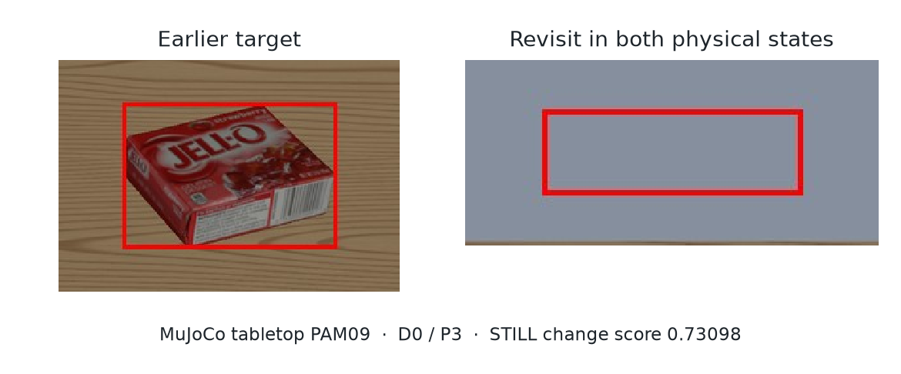

# The authors' trained STILL verifier on the scene-memory audit

20 November 2026 · Secondary analysis of archived Isaac Sim and MuJoCo images

We evaluated the verifier released with Jinjie Xie, Baihua Li and Qinggang Meng's *Is It Still There? Place-Registered Verification Makes VLMs Reliable Scene-Change Detectors*. Both language-model systems use the Qwen Team's Qwen3.5-9B architecture. The counts below come from our scene-memory audit. [STILL paper](https://doi.org/10.48550/arXiv.2611.18734) · [Released STILL checkpoint](https://huggingface.co/oran9er/STILL-Qwen3.5-9B/tree/81d9373e1dd9c07c537d5fb2436b36a26a2206b4) · [Qwen Team publication](https://qwen.ai/blog?id=qwen3.5) · [Base checkpoint](https://huggingface.co/Qwen/Qwen3.5-9B/tree/c202236235762e1c871ad0ccb60c8ee5ba337b9a)

The trained verifier recovered 43 more removals and falsely deleted 15 fewer retained objects than the original zero-shot Qwen system. Compared with dense geometry, it recovered 63 more removals and falsely deleted 34 more retained objects. Occlusion still mattered. All 36 of the trained verifier's false deletions occurred when the object was fully or partly hidden. [Decisions, raw scores and recount](figures/2026-11-20-still-verifier/trained-still-comparison.zip)

## Where the systems differed

Each entry reports **missed removals / false deletions** at the stated operating point. A miss leaves a removed object in memory. A false deletion erases a retained object. Each simulator supplied 320 queries in each physical state. The combined denominator is 640 per state.

| Method | Isaac Sim | MuJoCo | Both simulators |
| --- | ---: | ---: | ---: |
| Homography | 137 / 0 | 125 / 1 | 262 / 1 |
| Dense geometry | 128 / 0 | 113 / 2 | 241 / 2 |
| Registered zero-shot Qwen3.5-9B | 112 / 24 | 109 / 27 | 221 / 51 |
| **Trained STILL, registered crop** | **85 / 22** | **93 / 14** | **178 / 36** |
| Trained STILL, conservative crop threshold | 213 / 2 | 214 / 1 | 427 / 3 |
| Trained STILL, whole scene plus crop | 43 / 74 | 18 / 86 | 61 / 160 |

Registration withheld a crop on 153 removed and 153 retained queries. This accounts for 153 of the primary method's 178 misses. Among the 834 queries admitted by the original Qwen and dense registration check, trained STILL missed 14 of 419 removals and falsely deleted one of 415 retained objects. Qwen scored 0 misses and 51 false deletions there. Dense geometry scored 20 and two. Outside that original check, STILL recovered 57 additional removals and made 35 of its 36 false deletions. An earlier diagnostic threshold on the geometric match score recovered all 419 admitted removals with six false deletions. We chose that threshold after seeing the original outcomes. [Original comparison](2026-11-19-still-verifier.md) · [Diagnostic calculation](../paper/reader_controls.py) · [Per-query scores and cohort counts](figures/2026-11-20-still-verifier/trained-still-comparison.zip)

The retained-target masks show different failure patterns. Trained STILL made 28 false deletions with no target pixel visible, eight with partial exposure and zero with full exposure. The zero-shot system made four with no target pixel visible and 47 with full exposure. Training alone cannot explain the difference because the systems inspected different crops and admitted different views. [Original reader controls](../paper/reader_controls.py) · [Raw decisions and exposure recount](figures/2026-11-20-still-verifier/trained-still-comparison.zip)

The 16 layouts give a more cautious reading than the 1,280-query count might suggest. Relative to Qwen, STILL's missed-removal rate fell by 6.7 percentage points (paired layout-bootstrap 95% interval, −11.6 to −2.2 points). Its false-deletion rate fell by 2.3 points (−8.6 to +4.2). The latter interval spans an increase and a decrease. Relative to dense geometry, STILL missed 9.8 percentage points fewer removals (−15.3 to −4.7) and falsely deleted 5.3 points more retained objects (+1.7 to +9.7). These descriptive intervals use the fixed development thresholds and resample whole layouts within shelf and tabletop environments. [Paired differences and recount code](figures/2026-11-20-still-verifier/trained-still-comparison.zip)

## The indistinguishable pairs

On 88 MuJoCo pairs, keeping the object behind a blocker and removing it produced identical revisit pixels. The primary STILL rule deleted both twins on 11 pairs, kept both below threshold on five and withheld both for lack of a registered crop on 72. Homography deleted both on zero pairs, dense geometry on one, and the original Qwen system on four. Only four pairs reached the original Qwen reader. The conservative STILL threshold deleted both on one pair. Adding the whole-scene score led to deletion on 79 of the 88 pairs. [Matched states](../paper/evidence/pairs.csv) · [Exact-pair decisions](figures/2026-11-20-still-verifier/trained-still-comparison.zip)

*The only identical pair that crossed the conservative threshold.* A gray panel covered the gelatin box on MuJoCo tabletop layout PAM09. STILL assigned a change score of 0.73098 whether the box stayed or was removed. Both geometric rules withheld judgment. These are the two actual JPEG crops fed to the verifier. The two full revisit images also match exactly. The example illustrates why even a high change score can erase a valid memory. The gelatin box is a YCB object from the BOP YCB-Video collection. [Image archive](https://github.com/Adithya-Rajendran/cmpe249-active-verification/releases/tag/scene-memory-audit-v1) · [Model credit used in the original study](../README.md#why-match-the-pairs)

## What we tested

STILL verifies whether a place changed between two captures. Here the only physical change to the remembered target was removal. Each input contained an earlier image, a supplied target box and one revisit. The authors released a seed-2 retraining of their Qwen3.5-9B verifier. We used those weights directly. Their published detector also generates and scores candidate regions. Our audit supplies the region in advance. [Authors' model card](https://huggingface.co/oran9er/STILL-Qwen3.5-9B/blob/81d9373e1dd9c07c537d5fb2436b36a26a2206b4/README.md) · [STILL implementation](https://github.com/Oran9er/STILL/tree/ef115fdfbcc69ca53f4874720c9e5eab429ec221)

For the primary test, Pi3 used the two images to project the supplied box into the revisit. The trained model saw two red-box crops and scored whether the object had changed at that location. An unusable projection withheld deletion. A below-threshold score also kept the memory, without establishing that the object was visible. The model received neither the simulator masks nor the physical state. [Registration](https://github.com/Oran9er/STILL/blob/ef115fdfbcc69ca53f4874720c9e5eab429ec221/scripts/pi3_anchor.py) · [Place question and crop settings](https://github.com/Oran9er/STILL/blob/ef115fdfbcc69ca53f4874720c9e5eab429ec221/scripts/build_crops.py)

We chose the operating points on ten earlier layouts with 400 retained and 400 removed queries. No complete image-pair and box combination appeared in both sets. We fixed the thresholds before running the trained verifier on the 16 main layouts. The archive contains 640 retained and 640 removed queries on those layouts, split equally between simulators. We restored repeated inputs to their original denominators after scoring. The project had already inspected the main layouts for the original paper. [Archived images](https://github.com/Adithya-Rajendran/cmpe249-active-verification/releases/tag/scene-memory-audit-v1) · [Original query table](../paper/evidence/queries.csv)

| Operating point | Development threshold | Missed / 400 removed | False deletions / 400 retained |
| --- | ---: | ---: | ---: |
| Registered crop, maximum removal F1 (primary) | 0.00071 | 76 | 18 |
| Registered crop, zero development false deletions | 0.11916 | 225 | 0 |
| Whole scene plus crop, maximum removal F1 | 0.0003872983 | 4 | 87 |

F1 balances precision and recall for deletion. The secondary scene-plus-crop score uses the geometric mean of the two change scores, or the scene score alone when registration fails. The whole-scene question permits `unseen`. Only the score for `changed` contributes evidence to delete. The published SD-V threshold of 0.00067 includes proposal confidence and was calibrated on a different dataset. For our supplied boxes we used a constant proposal weight and calibrated each rule locally. [Published fusion](https://github.com/Oran9er/STILL/blob/ef115fdfbcc69ca53f4874720c9e5eab429ec221/scripts/combine_views.py) · [Model card and original operating point](https://huggingface.co/oran9er/STILL-Qwen3.5-9B/blob/81d9373e1dd9c07c537d5fb2436b36a26a2206b4/README.md)
